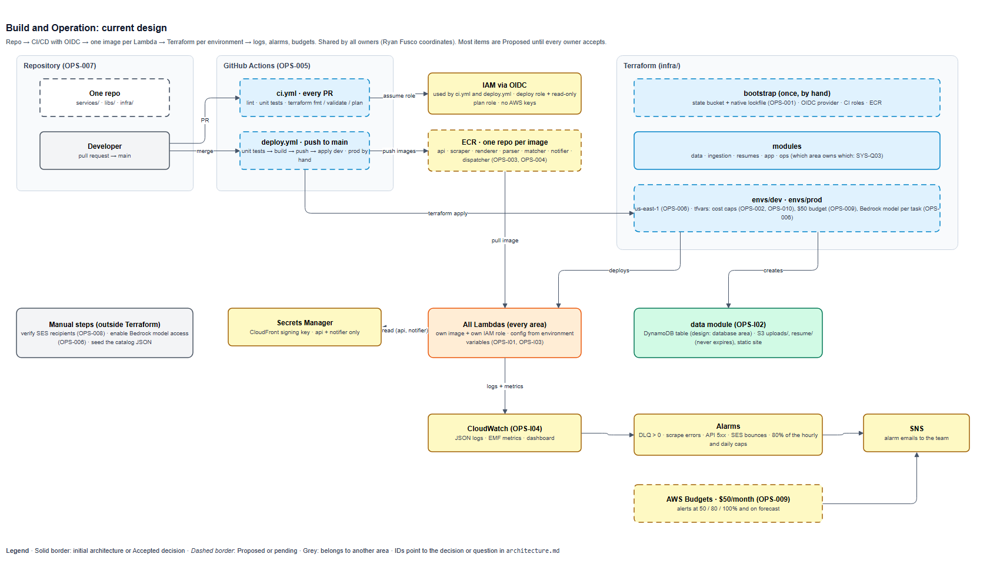

# Build and Operation Architecture

Source: RFC 0001 (`architecture/inputs/Froop_inital_architecture.pdf`), pp.3–8, and the "Build and Operate" diagram lane. Everything below is `Proposed` until the owner accepts it.

## Scope

**Owns:**
- **Bootstrap.** It's run once by hand and creates the Terraform state bucket (versioned and encrypted, with locking), the GitHub OIDC provider, the CI roles, and the ECR repositories.
- **Terraform layout.** The modules are `data`, `ingestion`, `resumes`, `app`, and `ops`. `envs/dev` and `envs/prod` use the same modules with different settings, and each environment keeps its own state. This area also sets the module conventions (SYS-Q03).
- **The `data` module:** provisions the DynamoDB table exactly as `database` designs it (DB-I01), and the S3 buckets (uploads with event notifications, resumes with no expiry, DEL-007, and the static site).
- **The `ops` module:**
  - the CloudWatch dashboard and alarms
  - the SNS alarm topic and email subscriptions
  - spend alarms
- **CI/CD (`deploy.yml`):**
  - Runs on every push to `main`.
  - Builds one image per Lambda function (OPS-003, OPS-004) and pushes them to ECR, tagged with the commit SHA.
  - Runs `terraform apply` for dev.
  - Deploys prod only when started by hand.
  - Authenticates to AWS through OIDC only.
- **IAM conventions.** Each Lambda gets its own role, with access limited to specific resource ARNs.
- **Secrets Manager.** It holds the CloudFront signing key, which only the `api` and `notifier` roles can read.
- **Steps outside Terraform:** verifying SES recipient addresses while in the sandbox (OPS-008), enabling Bedrock model access (OPS-006), and running the catalog seed script. Requesting SES production access is deferred (OPS-008). The catalog JSON itself is owned by `job-discovery-and-matching`.
- **Scaling and throttling settings:** Lambda reserved concurrency, SQS batch size and visibility timeout, maximum receive count before the DLQ, and API Gateway throttling. These matter in Phase 6.

**Does not own:**
- The table design: keys, indexes, TTL, and item types. That's `database`.
- Lambda code and message payloads: each area owns its own.
- Cognito, API Gateway routes, and the CloudFront distribution's behavior: `web-app-and-api`. This area provides the IaC conventions and secrets for them. Choices that are really platform choices, such as throttling and the signing key, are decided here by all owners (SYS-Q01).
- Bedrock spend accounting (the `COST#` items): `job-discovery-and-matching`. This area alarms on the metric.

## Current Design Diagram

Source: `architecture.drawio`. The diagram shows the design **as it stands now**:
- **Solid borders:** the initial architecture or Accepted decisions.
- **Dashed borders:** Proposed or pending items.
- **Grey boxes:** parts that belong to other areas.

Keep it in step with this file (see "Keeping Area Diagrams Current" in `planning/architecture/AGENTS.md`).

## Initial Architecture

> **Frozen baseline.** This is RFC 0001 *as originally submitted* (`architecture/inputs/Froop_inital_architecture.pdf`), transcribed without changes. It is never updated when decisions change the design. The current design is in **Decisions** below, and the whole current system is in `architecture/revised-rfc/`.

- **AWS Services (p.3–4)** (the team's text in each row):
  - Lambda: "Compute". Why: "Tasks come in bursts; the server would be idle most of the time"
  - S3: "Object storage (user uploads)". Why: "Cheap; time/event based actions"
  - ECR: "Stores the container images built by CI". Why: "Chromium and LaTeX are too large for Lambda's zip limit"
  - CloudWatch: "Custom metrics, alarms, and a dashboard". Why: "Lambda already sends log and metrics here"
  - SNS: "Send alarm emails to the team". Why: "Built in way for CloudWatch alarms to notify people"
  - Secrets Manager: "Stores the CloudFront signing key". Why: "Keeps the key out of git; only the api and notifier Lambdas can read it"
- **Infrastructure as Code (p.6–7):** "Terraform has five modules that match how we split the work: data (the DynamoDB table and S3 buckets), ingestion, resumes, app, and ops (the dashboard and alarm topic). Each module creates its own Lambdas, queues, roles, and alarms. envs/dev and envs/prod use the same modules with different settings. A small bootstrap setup, run once by hand, creates the state bucket, the GitHub OIDC provider, the CI roles, and the ECR repositories." "State is stored in a versioned, encrypted S3 bucket. Each environment has its own state file, and a lock file stops two people from applying at the same time." "Two things are not in Terraform. SES production access is a request to AWS support. The job catalog is data, so a seed script loads it from a JSON file in the repo." "To set up a new environment, run bootstrap, run deploy.yml, then run the seed script. After that, a teammate only needs to clone the repo and push to main."
- **CI/CD (p.7):** "deploy.yml, runs on every push to main. It builds the api, scraper, and worker images, pushes them to ECR tagged with the commit SHA, and runs terraform apply for dev. Prod deploys only when we run it by hand. It authenticates to AWS with GitHub's OIDC token, so no AWS keys are stored in GitHub."
- **Security (p.7):** "Each Lambda has its own role with only the access it needs." "The only secret is the CloudFront signing key. It is kept in Secrets Manager, and only the api and notifier can read it. Job boards need no keys, and CI uses OIDC instead of AWS keys."
- **Observability (p.7–8):** "Every Lambda logs JSON to CloudWatch with the source and posting IDs, so we can trace one posting from scrape to email. Custom metrics count postings found, matches, PDFs rendered, emails sent, and Bedrock spend per hour, and a CloudWatch dashboard shows them next to queue depth and Lambda errors. We will also have spend limits and alarms email the team."
- **Demo step 5 (p.8):** "Point a source at a broken URL and show the alarm email while the other sources keep updating."
- **Alternatives Considered (p.8):** "We considered Fargate but chose Lambda, because the work is idle most of the day, and container-image Lambdas can run Chromium"
- **Diagram, Build and Operate lane (p.3):**
  - "GitHub Actions (build · test · deploy)" → "OIDC" → "ECR (api · scraper · worker images)"; "Lambdas pull images"; "all Lambdas log here →"
  - "CloudWatch (EMF metrics · alarms · dashboard)" → "SNS (alarm emails to the team)"
  - "Alarms: DLQ depth > 0, scrape errors, API 5xx, Bedrock $/hour, SES bounces"

## Architecture Review

_None yet._

## Decisions

### OPS-001: Lock Terraform state with the S3 backend's native lockfile
Status: Proposed. Accepted by: Ryan Fusco (2026-11-17), Graham Cohick (2026-11-18). Waiting for: Luke Campbell (shared area).
Date: 2026-11-17
Context: Answers OPS-Q01. The RFC (p.7) asks for "a lock file" so two people can't apply at the same time.
Decision: Use the S3 backend's native locking (`use_lockfile = true`, Terraform 1.10 or later) on the versioned, encrypted state bucket that bootstrap creates. Each environment has its own state key.
Alternatives:
- A DynamoDB lock table. Rejected: it's an extra resource to create and pay for, and native S3 locking does the same job.
Consequences:
- Everyone has to use Terraform 1.10 or later. Pin the version in `infra/` and in CI.

### OPS-002: Hourly spend caps of $1 per user and $5 for the platform, set by configuration
Status: Proposed. Accepted by: Ryan Fusco (2026-11-17), Graham Cohick (2026-11-18). Waiting for: Luke Campbell (shared area).
Date: 2026-11-17
Context: Answers OPS-Q02. The RFC (p.5, p.8) caps "Bedrock spend per hour" and promises "spend limits". The project is on a tight budget, and the caps will probably need tuning.
Decision:
- **Caps:** at most **$1 per hour per user**, and **$5 per hour for the whole platform**, on usage-priced AI spend (Bedrock). That's the cost that grows with use.
- **Enforcement:** before every Bedrock call, the caller (the Bank parser or the Matcher) checks both hourly counters, the student's and the platform's, and adds its estimated cost to both. If either cap would be exceeded, the call is deferred, not made. The parser follows EB-013. What the Matcher does is defined by `job-discovery-and-matching`.
- **Configuration:** both caps are Terraform variables for each environment, passed to Lambdas as environment variables (`COST_CAP_USER_PER_HOUR`, `COST_CAP_PLATFORM_PER_HOUR`). Changing them means editing the environment's `tfvars` and applying. No code changes.
- **Alarms:** a CloudWatch alarm fires at 80% of the platform cap, on the Bedrock $/hour metric (OPS-I04). An AWS Budgets alert covers total monthly AWS spend (OPS-009).
Alternatives:
- One platform cap only. Rejected: one heavy user could use the whole platform's budget.
- Caps hard-coded in the code. Rejected: changing them would need a code change and a deploy of every caller.
- Caps in SSM Parameter Store, changeable without an apply. Possible later if caps change often. For now, an apply is quick enough.
Consequences:
- **Counters:** a per-user hourly counter is needed alongside the platform counter (DB-Q07).
- **Sustained worst case:** $5 per hour is up to about $3,600 per month if it's reached every hour, so the monthly AWS Budgets alert is the backstop (OPS-009). The daily cap (OPS-010) keeps Bedrock inside it.
- **Other AWS costs** (Lambda, S3, DynamoDB) can't be capped per hour. They're covered by the monthly alert.

### OPS-003: Keep scraper and renderer images separate, and keep other functions out of the renderer image
Status: Proposed. Accepted by: Ryan Fusco (2026-11-17), Graham Cohick (2026-11-18). Waiting for: Luke Campbell (shared area). **Partly superseded by OPS-011:** the scraper image no longer contains Chromium or Playwright. The renderer separation still stands.
Date: 2026-11-17
Context: Answers part of OPS-Q03. Chromium (the Scraper) and TeX (the Renderer) make very large images. Putting the parser, Matcher, or Notifier in the renderer image would make those functions large too, and mix responsibilities.
Decision:
- The `scraper` image holds only the Scraper (Chromium and Playwright).
- The RFC's `worker` image is renamed `renderer`, and holds only the Renderer (TeX).
- The parser, Matcher, Notifier, and Catalog dispatcher are **not** in either image (see OPS-004).
Alternatives:
- Everything except the Scraper in `worker` (as in the RFC). Rejected: large images and slower cold starts for small functions, plus mixed responsibilities.
Consequences:
- The RFC's "api, scraper, and worker images" (p.7) becomes more images. The revised RFC changes once this is accepted.

### OPS-004: One image per Lambda function, built from a shared base image
Status: Proposed (recommendation for the rest of OPS-Q03). Accepted by: Graham Cohick (2026-11-18). Waiting for: Ryan Fusco, Luke Campbell (shared area).
Date: 2026-11-17
Context: Answers the rest of OPS-Q03: should the parser, Matcher, and Notifier have their own images, or share one?
Decision:
- **One image per Lambda function:** `api`, `scraper`, `renderer`, `parser`, `matcher`, `notifier`, and `dispatcher`.
- **A shared base image** (Python runtime plus the shared `libs/` packages, such as the experience-bank package) is built first. Each function's image adds only its own code and dependencies.
- **CI builds the images in parallel.** An ECR lifecycle policy keeps the last 10 images in each repository.
Alternatives:
- One shared "light" image holding the parser, Matcher, Notifier, and dispatcher, with a different handler for each. Fewer builds, but each function gets every other function's dependencies, they deploy together, and ownership is blurred, since the functions belong to three areas.
Consequences:
- Bootstrap creates 7 ECR repositories.
- A change to `libs/` rebuilds every image that uses it.
- Each area owns its own function's image.

### OPS-005: CI runs unit tests and Terraform checks on every pull request, and before every deploy
Status: Proposed. Accepted by: Ryan Fusco (2026-11-17), Graham Cohick (2026-11-18). Waiting for: Luke Campbell (shared area).
Date: 2026-11-17
Context: Answers OPS-Q04. The RFC's `deploy.yml` builds and applies on every push to `main`, with no tests, though the diagram says "build · test · deploy".
Decision:
- **`ci.yml` (every pull request):** linting, the unit tests for changed services and `libs/`, `terraform fmt -check`, `terraform validate`, and `terraform plan` for dev, using a read-only role.
- **`deploy.yml` (push to `main`):** unit tests, then build and push images, then `terraform apply` for dev. Prod deploys only when started by hand (`workflow_dispatch`).
- **How this relates to the testing phases in `planning/AGENTS.md`:**
  - **Phase 2 (Implementation):** "A task is not Done until [its unit tests] pass", and the exit criterion is "All unit tests pass in CI". This decision is the CI that enforces that. It runs **unit tests only**.
  - **Phases 3–4 (Test Planning and Testing):** integration and end-to-end tests come from the approved test plans (`testing/`). They run against a deployed environment and are **not** part of every-push CI under this decision. Test Planning decides whether any of them become CI jobs (for example, smoke tests after each dev deploy), and records that as a new decision.
  - **Phases 5–6 (Load Planning and Load Balancing):** load tests **never** run in CI. They run only in the environments the load plan names.
Alternatives:
- Tests only in `deploy.yml`. Rejected: problems would only show up after merging.
Consequences:
- CI needs a read-only plan role (bootstrap) as well as the deploy role.
- Required pull-request checks on `main` should be turned on in GitHub.

### OPS-006: Start with the smallest Bedrock model in us-east-1, configurable for each task
Status: Proposed. Accepted by: Ryan Fusco (2026-11-17), Graham Cohick (2026-11-18). Waiting for: Luke Campbell (shared area).
Date: 2026-11-17
Context: Answers OPS-Q06. The budget is tight, and finding the right balance of accuracy and cost will take experimenting.
Decision:
- **Region:** `us-east-1` for Bedrock, and for the whole stack, to avoid traffic and latency between regions.
- **Model:** start with the smallest, cheapest text model available on Bedrock in `us-east-1` that reliably returns structured (JSON) output. Candidates include Amazon Nova Micro and the current Claude Haiku-class model.
- **Configurable for each task:** each Bedrock task has its own model setting, as a Terraform variable passed as an environment variable. There are two tasks: leftover-section classification (EB-003, `BEDROCK_MODEL_PARSER_LEFTOVERS`) and the Matcher's single ranking call (JDM-005, `BEDROCK_MODEL_MATCHER_RANK`). There's no separate requirement-extraction call (revised 2026-11-18, review item C6). Changing a model is a configuration change.
- **Measurement:** every call logs its input and output tokens and estimated cost (EMF, OPS-I04). Each task keeps a small labeled sample set, so models can be compared before switching.
Alternatives:
- Pick a larger model up front. Rejected: higher cost before we know it's needed.
Consequences:
- Model access has to be enabled in each environment's account. That's a manual console step, listed with the other steps outside Terraform.
- Costs per call vary by model, so the cost counters (OPS-002) use the configured model's prices.

### OPS-007: One repository with `services/`, `libs/`, and `infra/`
Status: Proposed. Accepted by: Ryan Fusco (2026-11-17), Graham Cohick (2026-11-18). Waiting for: Luke Campbell (shared area).
Date: 2026-11-17
Context: Answers OPS-Q08. The experience-bank package (EB-010) is shared by several images.
Decision:
- `services/<name>/`: each Lambda's code and Dockerfile, one folder per image (OPS-004).
- `libs/<name>/`: shared Python packages, such as `libs/experience_bank`.
- `infra/`: Terraform (bootstrap, modules, `envs/dev`, `envs/prod`).

Each image installs the `libs/` packages it needs at build time.
Alternatives:
- One repository per service. Rejected: sharing `libs/` would need a package registry.
Consequences:
- CI decides what to test and build from the paths that changed.

### OPS-008: Stay in the SES sandbox for now
Status: Proposed. Accepted by: Ryan Fusco (2026-11-17), Graham Cohick (2026-11-18). Waiting for: Luke Campbell (shared area).
Date: 2026-11-17
Context: Answers OPS-Q05. A domain would be nice, but the sandbox is the easiest option for development and the demo.
Decision:
- **Sandbox:** SES stays in the sandbox. Email goes only to verified addresses (up to 200 a day, 1 per second).
- **Recipients:** the team's addresses, and any demo address, are verified by hand in each environment. That's a manual step outside Terraform.
- **No domain or production access request for now.** If the group later wants real users, the path is a domain verified with DKIM, then production access. That would be a new decision.
Alternatives:
- Buy a domain and request production access now. Deferred: it costs money and adds setup, and the demo doesn't need it.
Consequences:
- Students whose address isn't verified get no emails. The Notifier should record the SES rejection on the match (`notifyStatus: failed`) rather than retry forever. Their resumes are still in the dashboard.
- The SES production access step outside Terraform (RFC p.7) is not done for now.

### OPS-009: A $50 monthly AWS budget alert, set by configuration
Status: Proposed. Accepted by: Ryan Fusco (2026-11-17), Graham Cohick (2026-11-18). Waiting for: Luke Campbell (shared area).
Date: 2026-11-17
Context: Answers OPS-Q09. The group is on free-tier accounts with little money to spend, and the amount may need changing.
Decision:
- **The budget:** an AWS Budgets cost budget of **$50 per month** for total AWS spend in each account.
- **Alerts:** at 50%, 80%, and 100% of actual spend, and at 100% of forecast spend. They go to the team's SNS alarm topic (email).
- **Configuration:** the amount and the alert percentages are Terraform variables (`monthly_budget_usd`, `budget_alert_percents`) in each environment's `tfvars`. Changing them means editing the file and applying.
Alternatives:
- No budget alert. Rejected: the only per-hour caps (OPS-002) cover Bedrock, not the rest of AWS.
Consequences:
- AWS Budgets only **alerts**. It doesn't stop spending. The per-hour caps (OPS-002) are what actually stop Bedrock spend.
- The hourly caps alone didn't fit this budget, so OPS-010 adds a daily cap.

### OPS-010: A $1.50 daily platform cap on Bedrock, set by configuration
Status: Proposed. Accepted by: Ryan Fusco (2026-11-17), Graham Cohick (2026-11-18). Waiting for: Luke Campbell (shared area).
Date: 2026-11-17
Context: Answers OPS-Q10. At the hourly platform cap (OPS-002), Bedrock could use the whole $50 monthly budget (OPS-009) in 10 hours. The project is due in under a month, and the group is spending only free-tier amounts.
Decision:
- **Daily cap:** total Bedrock spend for the platform is capped at **$1.50 per day** (UTC), on top of the hourly caps. At $1.50 a day, a month is about $45, inside the $50 budget.
- **Enforcement:** before each Bedrock call, callers check the daily platform counter as well as the hourly per-user and platform counters (OPS-002). If any cap would be exceeded, the call is deferred, not made.
- **Configuration:** a Terraform variable (`cost_cap_platform_per_day`), passed as `COST_CAP_PLATFORM_PER_DAY`, in each environment's `tfvars`. "We'll go from there": tune it based on the cost metrics (OPS-006).
- **Alarm:** a CloudWatch alarm fires at 80% of the daily cap, so the team knows before work starts being deferred.
Alternatives:
- Lower the hourly caps instead. Rejected: it would slow normal bursts, such as a big scrape, without limiting the daily total.
- Rely on the monthly alert alone. Rejected: alerts don't stop spending.
Consequences:
- **Daily counter:** a daily platform counter is needed alongside the hourly counters (DB-Q07).
- **Deferred work:** once the daily cap is reached, parsing of leftover sections (EB-013) and Matcher work that needs Bedrock wait until the next UTC day. The Matcher's behavior is decided by `job-discovery-and-matching`.
- **Most uploads aren't affected:** most of the parser's work needs no Bedrock (EB-003).

### OPS-011: Greenhouse-only ingestion resources
Status: Proposed (2026-11-18; all shared owners must agree). Proposed by Luke Campbell. Accepted by: Graham Cohick (2026-11-18). Waiting for: Ryan Fusco (shared area).
Date: 2026-11-18
Context: JDM-001 removes browser scraping; JDM-003/004 use one dispatcher for polling and recovery.
Decision: Amend OPS-003 so the scraper image is a small HTTP client without Chromium/Playwright. Keep separate function images, existing AWS services and the proposed repository/CI conventions. Place dispatcher, scraper and Matcher in `ingestion`; renderer and its queue consumer stay with delivery. A single 15-minute dispatcher tick replaces per-source schedules; hourly/daily digest schedules remain delivery resources.
Reasoning: Removes browser dependencies and source-specific schedule management, while reusing the existing dispatcher for recoverable work.
Alternatives: Browser image and one scheduler resource per source are unnecessary for Greenhouse-only polling.
Consequences: OPS-003's original proposal stays in the history pending group acceptance; OPS-I05 is the current proposed JDM intake. No infrastructure is provisioned during planning. Shared decisions OPS-001 to OPS-010 are not automatically accepted by this change.

### OPS-012: The dashboard lives in `web/`, and CI builds and publishes it
Status: Proposed. Proposed by Graham Cohick. Accepted by: Graham Cohick (2026-11-18). Waiting for: Ryan Fusco, Luke Campbell (shared area).
Date: 2026-11-18
Context: Answers OPS-Q11. OPS-005 and OPS-007 cover Lambda images only, and the React dashboard is a static site served from S3 through CloudFront (RFC p.3).
Decision:
- **Location:** the dashboard's source is in a top-level `web/` folder, next to `services/`, `libs/`, and `infra/` (extends OPS-007).
- **`ci.yml` (every pull request):** when `web/` changes, lint it, run its unit tests, and build it (extends OPS-005).
- **`deploy.yml` (push to `main`):** after `terraform apply` for dev, build the dashboard with that environment's settings (API URL, Cognito client and domain), upload the build to the static-site bucket, and invalidate CloudFront. Prod follows the same steps when started by hand.
Alternatives:
- `services/dashboard/`. Rejected: OPS-007 defines `services/` as one folder per Lambda image, and the dashboard isn't one.
- Upload the build with Terraform. Rejected: it puts build output in Terraform state and slows every apply.
Consequences:
- The deploy role needs permission to write to the static-site bucket and to create CloudFront invalidations.
- The dashboard's build settings come from Terraform outputs, so nothing is hard-coded in the repository.

## Interfaces

### Provides

#### OPS-I01: Deployment contract
Status: Proposed
Consumers: web-app-and-api, job-discovery-and-matching, experience-bank, delivery
Contract:
- **Images:** every Lambda is a container image in ECR, one image per function, built from a shared base (OPS-003, OPS-004).
- **Image contract:** each image states its handler entry points.
- **Config:** comes from environment variables that Terraform sets: table name, bucket names, queue URLs, and the secret ARN.
- **Environments:** pushes to `main` deploy to dev automatically. Prod deploys only when started by hand.
- **Area resources:** each area's Lambdas, queues, roles, and alarms live in that area's Terraform module (SYS-Q03).
Accepted by: —

#### OPS-I02: Storage resources
Status: Proposed
Consumers: all areas, database
Contract:
- **Table:** one DynamoDB table per environment, provisioned from DB-I01. Its name is passed to services as config (OPS-I01).
- **Buckets:**
  - uploads: private, and fires an event to the Bank parser
  - resumes: private, never expiring (DEL-007; an optional move to Standard-IA after 30 days is allowed), served through CloudFront OAC
  - static site: served through CloudFront

  Each area owns the key layout of its own prefix (EB-I01, DEL-I01).
Accepted by: —

#### OPS-I03: IAM and secrets
Status: Proposed
Consumers: all areas
Contract: Each Lambda has its own role, granted only the permissions its area lists in the Requirements Intake. The only secret is the CloudFront signing key, stored in Secrets Manager and readable only by `api` and `notifier`. Job boards need no keys, and nothing is stored in git or in GitHub secrets.
Accepted by: —

#### OPS-I04: Observability conventions
Status: Proposed
Consumers: all areas
Contract:
- **Logs:** every Lambda writes JSON logs to CloudWatch, including `sourceId` and `postingKey` (and `sub`/`docId` where relevant), so one posting can be traced from scrape to email.
- **Custom metrics (EMF):**
  - postings found
  - matches
  - PDFs rendered
  - emails sent
  - Bedrock spend per hour
- **Dashboard:** shows those metrics alongside queue depth and Lambda errors.
- **Alarms:**
  - DLQ depth above 0
  - scrape errors
  - API 5xx
  - Bedrock $/hour
  - SES bounces

  All alarms go to SNS, which emails the team.
Accepted by: —

#### OPS-I05: Amended JDM Requirements Intake
Status: Proposed
Consumers: job-discovery-and-matching, database, delivery, web-app-and-api
Contract:
- Dispatcher, scraper and Matcher small container-image Lambdas; no browser dependency. One dispatcher schedule every 15 minutes, source poll interval default one hour; manual cooldown five minutes. Digest schedules are separate delivery resources.
- SQS scrape/match/render with DLQs; JDM produces render messages, delivery consumes. Start batch size 1, bounded receives 5, Lambda timeout 60 seconds for dispatcher/scraper and 120 seconds for Matcher, visibility 720 seconds; configure and validate these together. Values are implementation defaults, not load targets. Workers checkpoint before timeout; a large source cannot silently omit later jobs/subscribers.
- Table permissions scoped by operation: API configuration writes; dispatcher source/work/checkpoint reads and conditional updates plus enqueue; scraper HTTP egress to fixed Greenhouse API, posting/work writes and match enqueue; Matcher bank-package access, matches/work/cost transactions, render enqueue and configured Bedrock model invocation. Only authorized API commands can initiate user actions. No Greenhouse secret and no Bedrock permission for scraper.
- Config: table and queue names, poll/cooldown/lease limits, HTTP/response limits, ranking token limits/model ID/pricing version, cost caps, and work recovery page limits. No hardcoded model prices.
- Metrics/alarms: poll failures, DLQ depth, oldest pending work, budget deferral, invalid model output and estimated/actual AI cost; retain JSON correlation IDs without resume text, job bodies or raw prompts.
- Provision GSI3 and work/reservation schemas only after DB-I04 acceptance. Keep GSI1/GSI2; proposed LSI1 removal requires DB agreement before table deployment.
Accepted by: —

### Consumes
- **The table design:** DB-I01 from `database`.
- **Requirements from every area,** collected below.

### Requirements Intake

One row per need, citing where it came from. Rows taken from the RFC are `Proposed` until the area owner confirms them (OPS-Q07).

| Area | Need | Source | Status |
|---|---|---|---|
| web-app-and-api | **Sign-in:** Cognito user pool, hosted UI, and a public app client using the code flow with PKCE (WEB-002); the self sign-up switch and callback URLs as variables for each environment (WEB-004). **API:** API Gateway HTTP API with a JWT authorizer, CORS origins as a variable for each environment (WEB-010), and throttling values; the `api` image with no function URL (WEB-005) and a timeout under 30 seconds (WEB-011). **Table:** read and write on Profile, Settings, Subscription, and private Source items, `appliedAt` on matches, and queries on GSI1 and GSI3 (DB-I05, DB-I04). **Buckets:** write to `uploads/` for upload links, delete through the bank package (EB-I03), and list `resume/` (WEB-007). **Queues:** send a refresh request (JDM-I01); a regeneration request is pending WEB-Q03. **CloudFront:** the static site, and `resume/` behind signed URLs, with read access to the signing key. **Alarms:** API Lambda errors and latency, with the API 5xx alarm. **CI:** the dashboard build and publish step (OPS-012). | RFC p.3–4, 7; WEB-001 to WEB-011; `web-app-and-api` review item 17 | Proposed (revised 2026-11-18; confirmed by Graham Cohick, OPS-Q07) |
| experience-bank | Uploads bucket that accepts only `.tex` (presigned PUT limited to that content type and the size limit), with event notifications to the Bank parser; parser Lambda (small: a Python LaTeX parser, with no OCR and no TeX install, EB-001, EB-009); Bedrock invoke permission; read and write on the `COST#` counter (EB-004); table access for experience items | RFC p.3, 5; EB-I01 | Proposed |
| job-discovery-and-matching | One dispatcher tick; HTTP-only Greenhouse scraper; Matcher; scrape/match/render queues and DLQs; durable recovery and cost reservations; seed catalog. Digest schedules stay with delivery. See OPS-I05 for permissions/configuration. | JDM-001 to JDM-007, OPS-011 | Proposed amendment; replaces RFC-derived JDM intake |
| delivery | Renderer Lambda (`renderer` image, OPS-003, with a minimal TeX distribution holding only the template's packages, compiled with shell escape off and file access restricted, DEL-002); Notifier Lambda (sends raw MIME email with attachments through SES at most once, DEL-004, DEL-018); hourly and daily digest schedules that trigger the Notifier (DEL-019); resumes bucket with no expiry (DEL-007); SES identity, in the sandbox with verified recipients (OPS-008); read access to the signing key; digest schedule target | RFC p.3–5; DEL-I01 | Proposed |
| database | One table with the keys, GSI1, GSI2, GSI3 (no LSI), and TTL from DB-I01 and DB-I04 | RFC p.5; DB-I01; DB-I04 | Proposed |
| experience-bank | The experience bank package (EB-I03) built into the `api` image and every image that runs the parser, Matcher, or Renderer | EB-010 | Proposed |
| all | Spend limits and alarms that email the team | RFC p.8 | Proposed |

## Open Questions

**Luke’s answer to OPS-Q07 and Matcher cap handling (2026-11-18):** confirm the amended JDM intake in OPS-I05 (HTTP-only Greenhouse scraper, dispatcher/Matcher in ingestion, no Chromium, digest schedules owned by delivery). At any cost cap, persist deferred work and its next reset time, acknowledge SQS and resume via dispatcher, per Accepted JDM-006/I04. Oversized-per-cap requests are blocked configuration, not infinite retries. This avoids paid calls after budget exhaustion and queue retry storms. Other owners must still accept shared OPS-I05; this does not blanket-approve OPS-001 to OPS-010.

Answered: OPS-Q11 (OPS-012), OPS-Q01 (OPS-001), OPS-Q02 (OPS-002), OPS-Q03 (OPS-003, OPS-004), OPS-Q04 (OPS-005), OPS-Q05 (OPS-008), OPS-Q06 (OPS-006), OPS-Q08 (OPS-007), OPS-Q09 (OPS-009), OPS-Q10 (OPS-010). Each answer is Proposed until every owner accepts it.

- **OPS-Q07: Are the RFC-derived Requirements Intake rows right?** Luke Campbell and Graham Cohick need to confirm the rows for their areas.
  - *Graham Cohick confirms the `web-app-and-api` row (2026-11-18), as revised from WEB-001 to WEB-011. Its regeneration queue is pending WEB-Q03. Waiting for: Luke Campbell, for his area's row.*
  - Owner: Luke Campbell, Graham Cohick
  - Blocks: OPS-I02, OPS-I03
- **OPS-Q11: Where does the React dashboard live in the repository, and how is it built and published?** Raised for Graham Cohick (2026-11-18) while accepting OPS-005 and OPS-007. OPS-007 gives `services/<name>/` to "each Lambda's code and Dockerfile", and OPS-005's `ci.yml` and `deploy.yml` only test and build Lambda images. The dashboard is a static site served from S3 through CloudFront (RFC p.3), not a Lambda, so neither decision says where its source goes, which checks run on it in pull requests, or which step builds it, uploads it to the static-site bucket, and invalidates CloudFront. Accepting OPS-005 and OPS-007 doesn't depend on the answer: it adds to them. *Proposed answer (Graham Cohick, 2026-11-18): OPS-012.*
  - Owner: Graham Cohick (proposes), group (accepts)
  - Blocks: the `web-app-and-api` implementation plan's dashboard tasks, and the dashboard's part of OPS-I01

## Requests From Other Areas

Pointers to items defined in other areas that this area's owner has to act on. Answer each one where it's defined, then delete its row (see "Coordinating Across Areas" in `planning/architecture/AGENTS.md`).

| ID | Defined in | What's needed |
|---|---|---|
| JDM-Q03, OPS-I05 | `job-discovery-and-matching/architecture.md`; this file | Agree amended HTTP-only intake, dispatcher/recovery configuration and ingestion module placement. |
