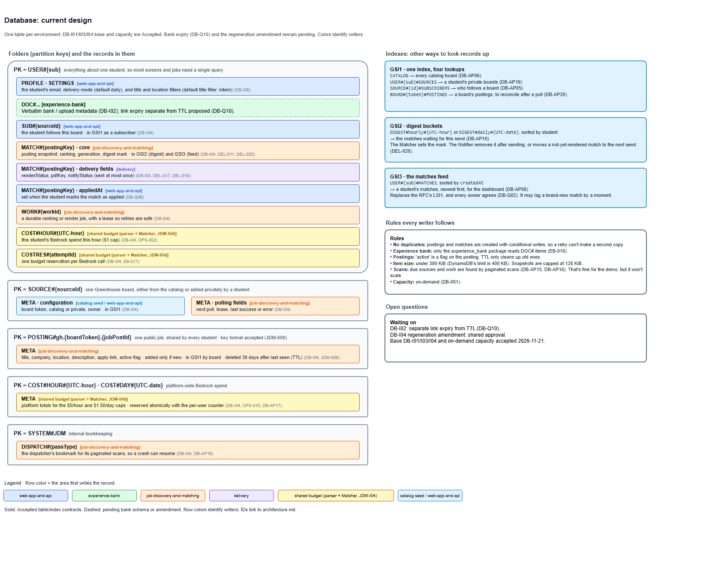

# Database Architecture

Source: RFC 0001 (`architecture/inputs/Froop_inital_architecture.pdf`), Data Model, pp.4–5, and the DynamoDB column of the diagram (p.3). Everything below is `Proposed` until every owner accepts it (shared area). For each item type, the owner of the area that writes it should be the one who proposes it.

## Scope

**Owns:**
- The logical design of the single DynamoDB table: the access patterns it serves, the key formats (`PK`, `SK`), GSI1, GSI2, GSI3, and the TTL attribute.
- The registry of item types: which area writes each one and which areas read it.
- The attribute definitions of every item type, proposed by the area that writes it.
- Conditional-write rules that enforce uniqueness, such as one posting per postingKey and one match per user and posting.

**Does not own:**
- Provisioning the table in each environment, and its Terraform: `build-and-operation` (OPS-I02).
- S3 key layouts: the area that writes each prefix (EB-I01, DEL-I01).
- The code that reads and writes items: each area.
- What the data means to the product, such as what makes a bullet valid or when a match is created. Those rules belong to the area that owns the concept.

## Current Design Diagram

Source: `architecture.drawio`. The diagram shows the design **as it stands now**:
- **Solid borders:** the initial architecture or Accepted decisions.
- **Dashed borders:** Proposed or pending items.
- **Grey boxes:** parts that belong to other areas.

Keep it in step with this file (see "Keeping Area Diagrams Current" in `planning/architecture/AGENTS.md`).

## Initial Architecture

> **Frozen baseline.** This is RFC 0001 *as originally submitted* (`architecture/inputs/Froop_inital_architecture.pdf`), transcribed without changes. It is never updated when decisions change the design. The current design is in **Decisions** below, and the whole current system is in `architecture/revised-rfc/`.

- **AWS Services, DynamoDB (p.4):** "Database to store our info". Why: "Access patterns are well defined and key based; serverless; and works with un/semistructured data"
- **Data Model (p.4):** "All app data, from user profiles to job matches, lives in DynamoDB. S3 holds uploaded files and generated resume PDFs."
- **Access patterns (p.4–5):**
  - "Get or update a user's profile and settings"
  - "Save, list, or delete a user's experience bank"
  - "Add a posting only if it's new"
  - "Find users subscribed to a source, then filter by their settings"
  - "Create a match once per user and posting; list a user's matches, newest first"
  - "Manage a user's private sources and subscriptions"
  - "List catalog sources; find matches waiting for a digest; cap Bedrock spend per hour"
- **Table design, single table (p.5):**
  - "Partition key: USER#{cognito sub}, SOURCE#{id}, POSTING#{postingKey}, or COST#{hour}"
  - "Sort key: PROFILE, SETTINGS, DOC#... (uploads, roles, bullets, skills), SUB#{sourceId}, MATCH#{postingKey}, or META"
  - "postingKey: a hash of normalized company, title, and location, so the same job from two sources gets one key. Conditional puts block duplicate postings and matches."
  - "Postings store title, company, location, full description, apply link, and the sources that listed them. Postings expire 30 days after last seen."
  - GSIs: "GSI1: a source's subscribers, and all catalog sources"; "GSI2: matches waiting for a digest"; "LSI1: matches by created date"
- **Security (p.7):** "All user data in DynamoDB and S3 is stored under that ID, so users can only see their own data."
- **Diagram, DynamoDB column (p.3):** "DynamoDB (single table): users · settings, sources · subscriptions, postings (TTL 30 d), experience bank, matches, hourly cost counters"

## Architecture Review

_None yet._

## Decisions

### DB-001: The table uses on-demand capacity
Accepted by: Ryan Fusco (2026-11-19), Graham Cohick (2026-11-19), Luke Campbell (2026-11-21).
**Luke's reasoning:** On-demand fits intermittent discovery, upload and digest traffic without an initial capacity-tuning task. It does not impose a hard spending limit.
Status: Accepted (2026-11-21)
Date: 2026-11-19
Context: Answers DB-Q04. Traffic comes in bursts (scrapes, digests, uploads) and the table is idle most of the day (RFC p.3).
Decision: The table and its three GSIs use DynamoDB on-demand capacity in every environment.
Alternatives:
- Provisioned capacity with auto scaling. Rejected: it needs capacity planning, and it charges for idle capacity, which the budget can't afford (OPS-009).
Consequences:
- There's no capacity to tune before Phase 5. Load Planning can revisit this if a load target needs it.
- Cost scales with requests, so it's covered by the monthly budget alert (OPS-009).

## Access Patterns

Every way the data is read or written. They come from the RFC (pp.4–5) and the decisions since. Rows follow their defining contracts; DB-I02 and the regeneration amendment remain Proposed. Nothing goes into the table design unless a row here needs it.

| ID | Access pattern | Needed by | Served by | Source |
|---|---|---|---|---|
| DB-AP01 | Get or update a user's profile and settings | web-app-and-api | `USER#{sub}` / `PROFILE`, `SETTINGS` | RFC p.4 |
| DB-AP02 | Get a user's current bank: resolve the current-upload pointer, then read that upload's items | experience-bank (through its package, EB-010) | `USER#{sub}` / `DOC#…` | RFC p.5, EB-008 |
| DB-AP03 | Replace a user's bank: write the new upload's items, switch the pointer, delete the old items | experience-bank | `USER#{sub}` / `DOC#…` | EB-002, EB-008 |
| DB-AP04 | Add a posting only if it's new | job-discovery-and-matching | `POSTING#{postingKey}` / `META`, conditional put | RFC p.5 |
| DB-AP05 | Find the users subscribed to a source, then filter by their settings | job-discovery-and-matching | GSI1 `SOURCE#{sourceId}#SUBSCRIBERS` (DB-I04) | RFC p.5 |
| DB-AP06 | List catalog sources | job-discovery-and-matching | GSI1 `CATALOG` (DB-I04) | RFC p.5 |
| DB-AP07 | Create a match once per user and posting, with a copy of the posting details | job-discovery-and-matching | `USER#{sub}` / `MATCH#{postingKey}`, conditional put | RFC p.5, DB-Q05 |
| DB-AP08 | List a user's matches, newest first | web-app-and-api | GSI3 `USER#{sub}#MATCHES`, sorted by `createdAt` (DB-Q02, DB-I04) | RFC p.5 |
| DB-AP09 | Manage a user's private sources and subscriptions | web-app-and-api writes; job-discovery-and-matching reads (DB-I04) | `SOURCE#{id}` / `META`; `USER#{sub}` / `SUB#{sourceId}` | RFC p.5 |
| DB-AP10 | Find matches waiting for a digest | delivery (the Notifier) | GSI2 `DIGEST#{mode}#{window}`. The Matcher sets the mark (DEL-011, DEL-020). | RFC p.5, DEL-011, DEL-020 |
| DB-AP11 | Update a match's delivery state, conditionally | delivery | `USER#{sub}` / `MATCH#{postingKey}` | DB-I03 |
| DB-AP12 | *Superseded by DB-AP17.* Check, and add to, the cost caps: per-user hourly, platform hourly, and platform daily | experience-bank, job-discovery-and-matching | `COST#{hour}`, `COST#{day}`, `USER#{sub}` / `COST#{hour}` (DB-Q07) | RFC p.5, OPS-002, OPS-010 |
| DB-AP13 | Find a user's matches in the regeneration window: posting still active, not marked applied | job-discovery-and-matching | `USER#{sub}` / `MATCH#…`, filtered on `appliedAt`, then a check that the posting exists | DEL-014 |
| DB-AP14 | Mark a match as applied, or unmark it | web-app-and-api | `USER#{sub}` / `MATCH#{postingKey}` (DB-Q06) | DEL-014 |
| DB-AP15 | Enumerate due/enabled sources | dispatcher | Paginated filtered scan, DB-I04 | JDM-003 |
| DB-AP16 | Recover due work and expired leases | dispatcher/Matcher | Paginated filtered scan, DB-I04 | JDM-004 |
| DB-AP17 | Reserve budget once across three counters | parser/Matcher | Transaction + reservation ID, DB-I04 | JDM-006 |
| DB-AP18 | Persist dispatcher continuation/lease | dispatcher | SYSTEM#JDM / DISPATCH#{passType} | JDM-003 |
| DB-AP19 | List a user's private sources | web-app-and-api | GSI1 `USER#{sub}#SOURCES` (DB-I04) | RFC p.5, DB-I04 |
| DB-AP20 | List a board's postings, to reconcile after a complete poll | job-discovery-and-matching | GSI1 `BOARD#{boardToken}#POSTINGS` (DB-I04) | JDM-002, DB-I04 |

## Item Types

The item types listed in RFC p.5. Rows follow their defining contracts; DB-I02 and the regeneration amendment remain Proposed.

| Item type | `PK` | `SK` | Written by (area) | Read by | Definition |
|---|---|---|---|---|---|
| Profile | `USER#{sub}` | `PROFILE` | web-app-and-api | delivery (email address) | DB-I05 |
| Settings | `USER#{sub}` | `SETTINGS` | web-app-and-api | job-discovery-and-matching, delivery | DB-I05 |
| Experience (uploads, roles, bullets, skills) | `USER#{sub}` | `DOC#…` | experience-bank | experience-bank only. Other areas go through its package, EB-I03 (EB-010). | DB-I02 |
| Subscription | `USER#{sub}` | `SUB#{sourceId}` | web-app-and-api (DB-I04, answers DB-Q03) | job-discovery-and-matching, web-app-and-api | DB-Q01 |
| Match | `USER#{sub}` | `MATCH#{postingKey}` | job-discovery-and-matching (including the digest mark, DEL-011), plus delivery state from delivery and the applied flag from web-app-and-api (DB-Q06) | web-app-and-api, delivery | DB-Q01, DB-I03 |
| Source | `SOURCE#{id}` | `META` | catalog seed (catalog sources), web-app-and-api (private sources), job-discovery-and-matching (polling fields only) (DB-I04, answers DB-Q03) | job-discovery-and-matching, web-app-and-api | DB-Q01 |
| Posting | `POSTING#{postingKey}` | `META` | job-discovery-and-matching | delivery, web-app-and-api | DB-Q01 |
| Cost counter (platform hourly and daily; per-user hourly as `USER#{sub}` / `COST#HOUR#…`, DB-I04) | `COST#HOUR#{UTC-hour}`, `COST#DAY#{UTC-date}` | `META` | job-discovery-and-matching, experience-bank (EB-017, through JDM-I04) | job-discovery-and-matching, experience-bank | DB-Q01 |
| Work | USER#{sub} | WORK#{workId} | job-discovery-and-matching | JDM workers | DB-I04 |
| Dispatcher checkpoint | SYSTEM#JDM | DISPATCH#{passType} | job-discovery-and-matching | dispatcher | DB-I04 |
| Cost reservation | USER#{sub} | COSTRES#{attemptId} | parser/Matcher via JDM-I04 | parser/Matcher | DB-I04 |

## Interfaces

### Provides

#### DB-I01: Table conventions
**Luke's reasoning (2026-11-21):** One table and three access-pattern indexes avoid a second store; GSI3 preserves stable match keys while supporting the date-ordered feed.
Status: Accepted (2026-11-21)
Consumers: all areas, build-and-operation (provisions it)
Contract:
- **Table:** a single table with generic key attributes `PK` and `SK`, using the formats in Item Types.
- **GSI1:** four lookups (DB-I04): `CATALOG` → every catalog board (DB-AP06); `USER#{sub}#SOURCES` → a student's private boards (DB-AP19); `SOURCE#{sourceId}#SUBSCRIBERS` → who follows a board (DB-AP05); `BOARD#{boardToken}#POSTINGS` → a board's postings, for reconciliation (DB-AP20).
- **GSI2:** matches waiting for a digest, bucketed by send window: `DIGEST#hourly#{UTC-hour}` or `DIGEST#daily#{UTC-date}`, sorted by `{sub}#{createdAt}#{postingKey}` (DEL-020).
- **GSI3:** a user's matches by creation date: `USER#{sub}#MATCHES` / `{createdAt}#{postingKey}` (DB-I04). It replaces the RFC's LSI1, so the table has no local secondary index (DB-Q02).
- **Capacity:** on-demand (DB-001).
- **TTL:** postings expire 30 days after they were last seen.

Every item carries an item-type attribute. A new item type needs a new row in Item Types before anything writes it.
Accepted by: Ryan Fusco (2026-11-19), Graham Cohick (2026-11-19). Luke Campbell (2026-11-21).

#### DB-I02: Experience items
**Luke's answer (2026-11-21):** Agree bank ownership, verbatim fields, current-version pointer and fixed statuses. Withhold final schema acceptance until DB-Q10 separates upload-link expiry from TTL. Canonical/dictionary fields are deferred with EB-007, not required in v1.
Status: Proposed
Written by: experience-bank
Consumers: experience-bank only. The Matcher, the Renderer, and the API read and delete through the experience bank package (EB-I03, EB-010).
Contract: Item types under `PK=USER#{sub}`, `SK=DOC#…`:
- **Upload record:** `docId`, file name, status (`awaiting_file`, `pending`, `parsed`, `parsed_with_unclassified`, `failed`; `expired` is reported once `expiresAt` passes with no file), error reason, upload time, `expiresAt`, and the student's `regenerate` choice (EB-019). Only `.tex` files are accepted (EB-001).
- **Section:** its heading (`source` and `text`), its category (`education`, `experience`, `projects`, `technical_skills`, `awards`, `certifications`, `publications`, `leadership`, or `other`), and its position (EB-016, Proposed).
- **Entry (role, education entry, or project):** a stable ID, the entry type, its section, its position, and its heading fields (for example title, organization, and dates), each with `source` and `text` (EB-012).
- **Bullet:** a stable `bulletId`, `source`, `text`, the entry it belongs to, and its position.
- **Skill category:** its name (for example `Languages`) with `source` and `text`, and its position (EB-016, Proposed).
- **Skill:** `source`, `text`, its skill category, its position, and a derived `canonical` term with the dictionary version that produced it (EB-007, Proposed).
- **Unclassified section:** `source` and `text` for a leftover section that hasn't been classified yet, because the cost cap was reached (EB-013).
- **Header block:** `source` and `text` (EB-014).
- **Current-upload pointer:** a per-user item naming the current `docId` (EB-008, Proposed).

The exact sort-key formats follow DB-I01. `source` and `text` are never modified after they're written. A new upload replaces the whole set (EB-002).
Accepted by: Ryan Fusco (2026-11-19, writer: experience-bank), Graham Cohick (2026-11-19). Luke answered 2026-11-21: final acceptance awaits DB-Q10.

#### DB-I03: Match delivery state
**Luke's reasoning (2026-11-21):** Conditional delivery updates protect current generations; S3 history avoids an ever-growing item. Matcher-owned digest marks agree with JDM-007.
Status: Accepted (2026-11-21)
Written by: delivery (on Match items, which job-discovery-and-matching writes). The digest mark is the exception: the Matcher sets it (DEL-011).
Consumers: web-app-and-api (shows the state), job-discovery-and-matching
Contract: Attributes on `USER#{sub}` / `MATCH#{postingKey}`:
- `renderStatus` (pending, rendered, skipped, failed), `renderReason` (for example `bank_replaced`, DEL-003), `renderedAt`
- `pdfKey`: the current resume, `resume/{sub}/{postingKey}/g{generation}.pdf` (DEL-009). Earlier resumes are listed from that S3 folder, not stored on the item (DB-Q08).
- `generation` and `requestId` of the latest render request. Every delivery-state write is conditional on `generation` (DEL-017).
- `notifyStatus` (pending, sending, sent, failed), `sendingSince`, `sentAt`. Emails are sent at most once (DEL-018).
- the GSI2 keys that mark a match as waiting for a digest (format above, DEL-020). The Matcher writes them when it creates the match (for hourly and daily students). The Notifier removes them after sending, or when the match was skipped or failed, and moves still-pending matches to the next window's bucket (DEL-011, DEL-020).

Writes are conditional updates, so a duplicate SQS message changes nothing.
Accepted by: Graham Cohick (2026-11-18), Ryan Fusco (2026-11-19, writer of the delivery fields). Luke Campbell (2026-11-21).

#### DB-I04: Greenhouse discovery, durable work and budget records
**Luke's acceptance scope (2026-11-21):** Accept the base contract: durable work, paginated recovery, immutable snapshots and transactional cost reservations give retries a recoverable result. The pending regeneration amendment still requires separate shared approval after WEB-Q08. DB-I01/I03 are now Accepted; DB-I02 remains Proposed.
Status: Accepted (2026-11-21; regeneration amendment excluded)
Consumers: job-discovery-and-matching, web-app-and-api, delivery, experience-bank, build-and-operation
Contract:
- **Access patterns added:** DB-AP15 list all enabled/due sources; DB-AP16 recover due work/expired leases; DB-AP17 uniquely reserve budget and atomically increment three counters; DB-AP18 checkpoint dispatcher scans. Initial implementation uses paginated filtered scans for AP15/16, with persisted cursors for AP18; do not claim this scales indefinitely.
- **Source:** `PK=SOURCE#{sourceId}, SK=META`; `itemType=Source`, `provider=greenhouse`, `boardToken`, `visibility=catalog|private`, `ownerSub` (private only), `displayName`, `enabled`, `nextPollAt`, `refreshAllowedAt`, `leaseUntil`, `leaseGeneration`, `lastSuccessAt`, `lastErrorCode`, timestamps. Catalog seed writes catalog configuration; API writes private configuration; dispatcher/scraper only update operational fields. Catalog GSI1 keys `CATALOG` / `SOURCE#{sourceId}`; private sources GSI1 keys `USER#{sub}#SOURCES` / `SOURCE#{sourceId}`. Private ownership checked on the base record.
- **Subscription:** `PK=USER#{sub}, SK=SUB#{sourceId}`; `itemType=Subscription`, `sourceId`, `createdAt`; GSI1 keys `SOURCE#{sourceId}#SUBSCRIBERS` / `USER#{sub}`. API writes; Matcher reads and confirms authoritative membership after GSI lookup. Duplicate creation is conditional; deletion is idempotent. JDM-I01 owns validation semantics.
- **Posting:** `PK=POSTING#{postingKey}, SK=META`; `itemType=Posting`, `provider`, `boardToken`, string `jobPostId`, title, company display name from source metadata, location, plain-text description, HTTPS apply URL, `firstSeenAt`, `lastSeenAt`, `providerUpdatedAt` if supplied, `active`, `expiresAt` (epoch seconds). GSI1 keys `BOARD#{boardToken}#POSTINGS` / `POSTING#{postingKey}` enable complete-board reconciliation. No user source membership is stored in this public item. Reader checks active/expiry, independently of TTL.
- **Match core:** existing `USER#{sub}` / `MATCH#{postingKey}`; `itemType=Match`, `postingKey`, immutable `postingSnapshot` (title/company/location/apply URL/plain-text description), `createdAt`, `docId`, `requestId`, `generation`, `deliveryMode`, `rankingVersion` (dictionaryVersion deferred with EB-I02). JDM owns core/ranking fields, delivery owns DB-I03 fields, API owns `appliedAt`. Atomic conditional creation includes digest mark for new hourly/daily matches. Snapshot over 128 KiB UTF-8 fails visibly; serialize every item below an application ceiling of 300 KiB, leaving room for delivery fields. PDF history is listed from the S3 match folder (DEL-009, JDM-008); no pdfHistory array or separate history items (DB-Q08).
- **Work:** `PK=USER#{sub}, SK=WORK#{workId}`; `itemType=Work`, `postingKey`, `sourceId`, `reason`, `requestId`, `generation`, `docId`, `state`, `nextAttemptAt`, `leaseOwner`, `leaseUntil`, `leaseGeneration`, `attemptCount`, `createdAt`, `errorCode`, persisted `renderPayload` (maximum 200 KiB), and `rankingVersion`. States: pending, waiting_bank, deferred_budget, ranking, render_pending, complete, failed, blocked_configuration. Pending work has no TTL; terminal records retained for deduplication while matches remain. Claims/commits check fencing generation; stale workers cannot mutate current match generations. Pending work and match creation are transactionally consistent per JDM-004. Work stores a posting reference before match creation; an expired/closed posting can terminate unmatched work visibly.
- **Dispatcher checkpoint:** `PK=SYSTEM#JDM, SK=DISPATCH#{passType}`; `itemType=DispatchCheckpoint`, serialized `lastEvaluatedKey`, pass start time, lease owner/expiry/generation. Dispatcher updates conditionally; crash resumes or safely restarts the pass.
- **Cost counters:** `PK=COST#HOUR#{UTC-hour}, SK=META`; `PK=COST#DAY#{UTC-date}, SK=META`; per-user `PK=USER#{sub}, SK=COST#HOUR#{UTC-hour}`. `itemType=CostCounter`, integer `reservedMicroUsd`, window start/end, expiry at least seven days after window. Both parser and Matcher use JDM-I04; neither bypasses it.
- **Reservation:** `PK=USER#{sub}, SK=COSTRES#{attemptId}`; `itemType=CostReservation`, upper bound, caller, model/pricing version, window IDs, createdAt, expiry. A single transaction conditionally creates it and increments all three counters within caps. Separate invocations require separate attempt IDs. Unknown outcome consumes reservation conservatively.
- **Matches newest first (DB-Q02):** propose a GSI3 instead of LSI1: `GSI3PK=USER#{sub}#MATCHES`, `GSI3SK={createdAt}#{postingKey}`. Keep the stable match primary key for deduplication. Projection contains keys/basic feed fields; details come from base reads. Feed is eventually consistent; return newly created match directly where immediate visibility is required.
- **Digest index:** preserve DB-I03 ownership, but GSI2 keys and timing are defined by DB-I03/DEL-020 and agreed by Luke under JDM-007; overall shared schema approval remains pending (DB-Q09). *Ryan Fusco's answer (2026-11-18): buckets by send window, with hourly sends at the top of each UTC hour and daily sends at 13:00 UTC (DEL-020, DB-I01, DB-I03).*
Accepted by: Ryan Fusco (2026-11-19; the complexity risk in JDM-Q04 still stands), Graham Cohick (2026-11-19; the pending regeneration amendment below comes back to him separately). Luke Campbell (2026-11-21). DB-I01/I03 are Accepted; DB-I02 remains Proposed pending DB-Q10.

#### DB-I05: Profile and Settings items
Status: Accepted (2026-11-19). Proposed by Graham Cohick, whose area writes both items (answers his part of DB-Q01). Accepted by: Graham Cohick (2026-11-18), Luke Campbell (2026-11-18; JDM-009), Ryan Fusco (2026-11-19).
Written by: web-app-and-api
Consumers: delivery (the email address and delivery mode), job-discovery-and-matching (the filters and delivery mode)
Contract:
- **Profile:** `PK=USER#{sub}`, `SK=PROFILE`; `itemType=Profile`, `sub`, `email`, `createdAt`, `updatedAt`.
  - `email` is the student's verified email address, read from Cognito when the item is created (WEB-003). It isn't updated if the address later changes in Cognito.
- **Settings:** `PK=USER#{sub}`, `SK=SETTINGS`; `itemType=Settings`, `deliveryMode`, `titleIncludes`, `titleExcludes`, `locationIncludes`, `updatedAt`.
  - `deliveryMode`: `instant`, `hourly`, or `daily`. Default: `daily`.
  - `titleIncludes`, `titleExcludes`, `locationIncludes`: lists of strings. Defaults: `titleIncludes` is `["intern"]`, and the other two are empty.
  - **Limits:** each list holds at most 20 terms. Each term is 1 to 60 characters after trimming, and a list has no two terms that differ only by case. The API enforces this (WEB-008), so readers can rely on it.
  - **Meaning:** how the Matcher applies the filters is defined by `job-discovery-and-matching` (JDM-005). This contract only fixes their names, types, and limits.
- **Creation:** the API creates both items together, with a conditional write, the first time a signed-in student calls `GET /me` (WEB-003). A student can't subscribe to a source before then.
- **Updates:** `PUT /me` replaces the whole Settings item. No other area writes either item.
- **A missing Settings item** means the student has never opened the dashboard. Readers do no work for that student, and don't assume defaults.
- **A changed delivery mode** applies to matches created afterwards. A match keeps the `deliveryMode` it was created with (DB-I04).
- **Timestamps** are ISO 8601 in UTC.

Why the default title filter: empty filters mean no restriction (JDM-005), so a new student who subscribes to a large board would otherwise trigger a ranking call for every posting on it. Whether `intern` also matches "Internship" depends on how the Matcher compares terms (WEB-Q06).
Accepted by: Graham Cohick (2026-11-18), Luke Campbell (2026-11-18; JDM-009), Ryan Fusco (2026-11-19).

**Pending regeneration amendment (JDM-I05):** add workType, targetDocId, requestedAt, fanout cursor and per-match request idempotency/active-request fields to DB-I04 only after Graham/Ryan agree. API conditionally creates command records, JDM transitions them. Existing DB-I04 is not silently accepted by this proposal.

### Consumes
- **Provisioning of the table in each environment:** OPS-I02 from `build-and-operation`.

## Open Questions

**Luke’s answers to DB-Q08/09 (2026-11-18):** accept S3-folder PDF history (DEL-009) and next-window digest keys/timing (DEL-020), per JDM-007/008. These no longer wait on Luke; shared DB contracts still need all owners.

Proposed answers at source (2026-11-18): DB-Q01 discovery-owned fields above; DB-Q02 GSI3; DB-Q03 API configuration writes/JDM operational writes; DB-Q05 immutable bounded snapshot; DB-Q07 transactional counters and unique reservations (Ryan Fusco agrees, 2026-11-18: EB-017). Ryan and Graham still need to agree. New questions: **DB-Q08** (Ryan/Luke): replace unbounded DB-I03 `pdfHistory` with child records before delivery implementation. *Ryan Fusco's answer (2026-11-18): drop `pdfHistory` entirely; history is the S3 folder `resume/{sub}/{postingKey}/` (DEL-009). DB-I03 is updated above, Proposed until every owner accepts.* **DB-Q09** (Ryan/Luke): define digest GSI2 keys and timing before JDM-T07. *Ryan Fusco's answer (2026-11-18): DEL-020.* Both block final DB-I04 acceptance.

- **DB-Q01: What attributes do the remaining item types have?** That's Profile, Settings, Subscription, Match (apart from the delivery state), Source, Posting, and Cost counter. The owner of the area that writes each type needs to propose them.
  - **Luke’s answer (2026-11-18):** Luke’s discovery-owned attributes are supplied in DB-I04. Profile/Settings remain Graham’s responsibility. Keeping the definitions together avoids competing schemas.
  - *Graham Cohick's answer for Profile and Settings (2026-11-18): DB-I05, Proposed until every owner accepts it. Luke Campbell's proposal for the other types is DB-I04.*
  - Owner: Graham Cohick (Profile, Settings), Luke Campbell (Subscription, Match, Source, Posting, Cost counter)
  - Blocks: DB-I01 acceptance, delivery's use of postings and settings
- **DB-Q02: LSI1 has to be decided before the first deploy.** *Proposed answer: GSI3 (DB-I04). Luke Campbell proposed it and Ryan Fusco agrees (2026-11-18). Graham Cohick agrees (2026-11-18), so every owner agrees: the table has GSI3 and no local secondary index. DB-I01 and DB-I04, which define GSI3, stay Proposed until every owner accepts them as a whole.* A local secondary index can only be created along with the table. It also limits each user's partition to 10 GB, and every user's data lives in one partition. The alternatives are a GSI, or sorting matches by an `SK` that includes the date.
  - **Luke’s answer (2026-11-18):** Agree GSI3 and no LSI1: stable primary keys preserve deduplication, while a separate date index serves the feed. Graham already agreed to GSI3 (2026-11-18); full shared-schema approval remains separate.
  - Owner: Ryan Fusco, Luke Campbell
  - Blocks: DB-I01, the first deploy of the `data` module
- **DB-Q03: Who writes Subscription items, and Source items for private pages?** They're created through the API (`POST /subscriptions`, `POST /sources`), but `job-discovery-and-matching` owns the concept. *Proposed answer (Luke Campbell, DB-I04): `web-app-and-api` writes Subscription items and the configuration of private Source items, and `job-discovery-and-matching` updates only a source's polling fields. Graham Cohick agrees (2026-11-18). The attribute definitions in DB-I04 stay Proposed until every owner accepts them.*
  - **Luke’s answer (2026-11-18):** API writes user source configuration and subscriptions; catalog seed writes catalog configuration; JDM writes poll state, postings and matches. The authenticated API already owns user commands, so another writer service is unnecessary. Graham already agreed to this write split (2026-11-18); the complete DB-I04 schema remains Proposed.
  - Owner: Graham Cohick, Luke Campbell
  - Blocks: Item Types
- **DB-Q04: Which capacity mode should the table use?** *Answered by Ryan Fusco (2026-11-19): on-demand (DB-001), Proposed until every owner accepts.* Recommendation: on-demand. Traffic comes in bursts and is idle most of the day (RFC p.3), and on-demand needs no capacity planning before Phase 5.
  - Owner: Ryan Fusco
  - Blocks: DB-I01
- **DB-Q05: Matches need their own copy of the posting details.** Postings expire 30 days after last seen, but matches and resumes never expire (DEL-007). A match has to stay viewable, and able to be re-ranked (DEL-014), after its posting is gone. Recommendation: when the Matcher creates a match, it copies the posting's title, company, location, apply link, and description onto the match item. That copy is never updated.
  - **Luke’s answer (2026-11-18):** Agree immutable title/company/location/apply-link/description snapshot with the DB-I04 size bound. Historical matches and regeneration must work after posting expiry.
  - Owner: Luke Campbell (writes Match items), Ryan Fusco
  - Blocks: DEL-004 emails, the dashboard's match view, DEL-008
- **DB-Q06: Where does the "applied" flag on a match live?** Regeneration skips matches the student has applied to (DEL-014). Recommendation: an `appliedAt` attribute on the match, set and cleared by `web-app-and-api` from the dashboard. *Graham Cohick accepts the recommendation (2026-11-18): `web-app-and-api` writes `appliedAt` (DB-AP14). **Ryan Fusco confirms (2026-11-19).** Resolved: both owners agree.*
  - Owner: Graham Cohick, Ryan Fusco
  - Blocks: DEL-014

- **DB-Q07: Per-user and daily cost counters.** OPS-002 and OPS-010 cap Bedrock spend at $1 per hour per user, $5 per hour for the platform, and $1.50 per day for the platform. The RFC only has one `COST#{hour}` counter. Recommendation:
  - **Luke’s answer (2026-11-18):** Agree one transactional reservation across hourly user, hourly platform and daily platform counters using JDM-I04; both parser and Matcher use it. This prevents independent callers from overspending.
  - Keep `PK=COST#{hour}, SK=META` as the hourly platform total.
  - Add `PK=COST#{day}, SK=META` as the daily platform total.
  - Add `PK=USER#{sub}, SK=COST#{hour}` for each user.
  - Give each a TTL a few days out.
  - Callers update all three in one transaction, conditioned on none exceeding its cap.
  - Owner: Luke Campbell (writes the cost counters), Ryan Fusco
  - Blocks: OPS-002, OPS-010, EB-017

- **DB-Q10: Separate upload-link expiry from item deletion.** Owner: Ryan Fusco (bank writer), Graham Cohick and Luke Campbell (shared schema). Blocks: final DB-I02 acceptance and DB-T02/T03.
  - **Luke's proposed answer (2026-11-21):** Persist the 15-minute deadline as uploadExpiresAt; keep the public create_upload response's expiresAt field unchanged. Reserve the table TTL attribute expiresAt for intentional record deletion. Current upload metadata and its current-bank items have no TTL; link expiry alone must never delete them. Apply retention/cleanup only when an item is no longer current, under the bank cleanup policy.
  - Reasoning: DB-T01 selects expiresAt as the table TTL attribute, while EB-019/DB-I02 reuse that name for the link deadline. [DynamoDB TTL documentation](https://docs.aws.amazon.com/amazondynamodb/latest/developerguide/time-to-live-ttl-how-to.html) specifies one attribute name for deletion eligibility. Luke agrees to the proposed separation; Ryan and Graham must confirm it before the shared schema is changed.

## Requests From Other Areas

Pointers to items defined in other areas that this area's owner has to act on. Answer each one where it's defined, then delete its row (see "Coordinating Across Areas" in `planning/architecture/AGENTS.md`).

| ID | Defined in | What's needed |
|---|---|---|
| JDM-Q03, DB-I04 | `job-discovery-and-matching/architecture.md`; this file | Review the complete discovery/work/cost schema, GSI3 proposal and open digest/history details with all owners. |
