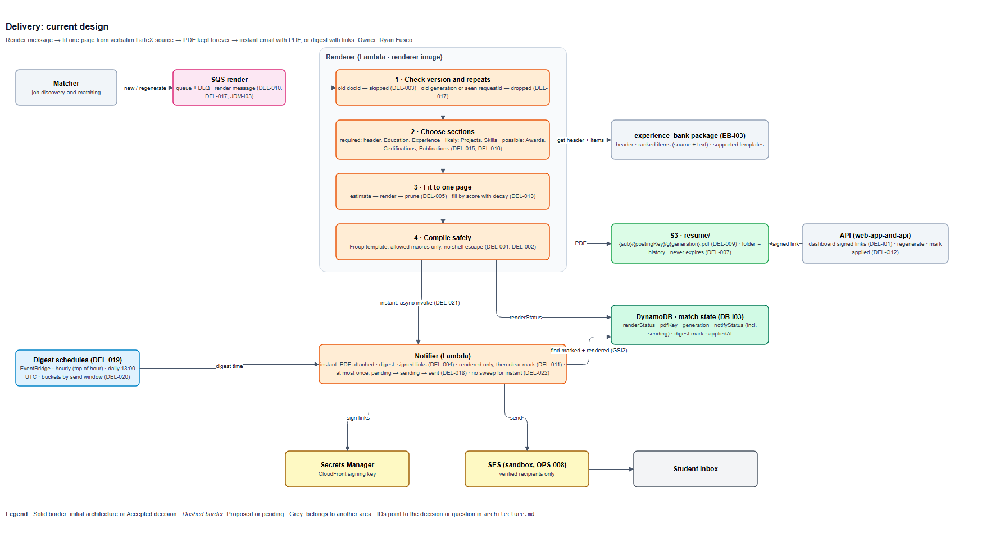

# Delivery Architecture

Source: RFC 0001 (`architecture/inputs/Froop_inital_architecture.pdf`), pp.1–5, 7–8, and the "Delivery" diagram lane. Items are `Proposed` until the owner accepts them. Accepted decisions override the Initial Architecture.

## Scope

**Owns:**
- **The Renderer Lambda** (container image with LaTeX):
  - Takes messages from SQS render.
  - Gets the header block and the candidate items from the experience bank package (EB-I03).
  - Fits the highest-ranked items onto one page by estimating, rendering, and pruning (DEL-005), using the section tiers (DEL-015) and the fill order (DEL-013).
  - Builds the resume from each item's LaTeX `source` (EB-012), keeping only the macros the Froop template defines (DEL-001, DEL-002).
  - Writes the PDF to `resume/` (DEL-I01).
  - For instant delivery, hands off to the Notifier with an asynchronous invoke (DEL-021).
- **The Froop resume template:** the layout, and definitions for the macros of every template that `experience-bank` supports. For now that's Jake's Resume (EB-015).
- **The `resume/` prefix layout.** Resumes are kept for as long as the match exists (DEL-007). The bucket itself comes from `build-and-operation`.
- **The Notifier Lambda:**
  - Sends instant emails with the PDF attached.
  - Sends hourly or daily digests with signed links (DEL-004) when delivery's own digest schedules fire (DEL-019).
  - Sends each email at most once (DEL-018).
  - Finds matches the Matcher marked as waiting for a digest, sends only the ones already rendered, and clears the mark once they're sent or skipped (DEL-011).
- **Email content and SES templates.**
- **Regenerating resumes after a new upload,** when the student asks for it (DEL-008).
- **The meaning of delivery state on each match:** rendered, emailed, waiting for a digest, or skipped. A retried message must never render twice or send twice (SQS delivers at least once). How that state is stored is defined in `database` (DB-I03).

**Does not own:**
- Creating matches, and ranking experiences, projects, bullets, and skills for a posting: `job-discovery-and-matching` (the Matcher). Ryan Fusco contributes. Delivery decides how many of the ranked items fit (DEL-005).
- Marking matches as waiting for a digest: the Matcher (DEL-011).
- Recording which matches the student has applied to: `web-app-and-api` (DB-Q06).
- The bank's content, the header block, and the list of supported templates: `experience-bank`.
- How items are stored in the table: `database`.
- The dashboard, `GET /matches/{postingKey}` signed links, the CloudFront distribution, the user's delivery settings (`PUT /me`), and the "regenerate?" choice in the upload flow: `web-app-and-api`.
- The buckets, the SES identity (sandbox for now, OPS-008), the signing-key secret, ECR images, and alarms: `build-and-operation`.

## Current Design Diagram

Source: `architecture.drawio`. The diagram shows the design **as it stands now**:
- **Solid borders:** the initial architecture or Accepted decisions.
- **Dashed borders:** Proposed or pending items.
- **Grey boxes:** parts that belong to other areas.

Keep it in step with this file (see "Keeping Area Diagrams Current" in `planning/architecture/AGENTS.md`).

## Initial Architecture

> **Frozen baseline.** This is RFC 0001 *as originally submitted* (`architecture/inputs/Froop_inital_architecture.pdf`), transcribed without changes. It is never updated when decisions change the design. The current design is in **Decisions** below, and the whole current system is in `architecture/revised-rfc/`.

- **Summary (p.1):** "For each match, an AI model selects and orders the student's bullets and skills without editing a word, and renders a one-page LaTeX resume. Students get the PDF by email, instantly or in a digest, and browse all matches in a dashboard"
- **Goal 4 (p.2):** "Get a one-page PDF resume for each job match."
- **Non-Goals (p.2):** "No AI-written resume text"
- **AWS Services (p.4):**
  - SES: "Sends match emails and digests". Why: "Uses IAM instead of a third party email API key"
  - ECR: "Stores the container images built by CI". Why: "Chromium and LaTeX are too large for Lambda's zip limit"
  - Secrets Manager: "Stores the CloudFront signing key". Why: "Keeps the key out of git; only the api and notifier Lambdas can read it"
- **Data Model, access pattern (p.5):** "find matches waiting for a digest"
- **Data Model, GSIs (p.5):** "GSI2: matches waiting for a digest"
- **Data Model, S3 (p.5):** "resume/{sub}/{postingKey}.pdf stores the generated resumes. Served through expiring CloudFront signed URLs; deleted after 30 days."
- **Security (p.7):** "resume links expire" and "The only secret is the CloudFront signing key. It is kept in Secrets Manager, and only the api and notifier can read it."
- **Observability (p.7–8):** "Custom metrics count postings found, matches, PDFs rendered, emails sent, and Bedrock spend per hour"
- **Demo step 4 (p.8):** "Open the match email and its attached PDF. Every line matches a bullet in the bank, and the resume fits on one page."
- **Risks (p.8):** "We're not sure of the best way to give users their per-job-personalized resumes. Email attachments are simplest but can be sent to spam, signed links need a key to manage, and dashboard links make users sign in first"
- **Diagram, Delivery lane (p.3):**
  - "SQS render (queue + DLQ)" → "Renderer (Lambda · LaTeX image · 1 page)"
  - Renderer → "PDF" → "S3 · resumes/ (private · lifecycle 30 d)" (step 8)
  - Renderer → "instant cadence" → "Notifier (Lambda · instant/hourly/daily)"
  - EventBridge Scheduler → "digest schedule" → Notifier
  - Notifier → "SES (email digest)" (step 9) → "Student (inbox)"
  - Renderer → DynamoDB

## Architecture Review

1. **Rendering from student LaTeX means running student code.**
   - **Finding:** under EB-012, the Renderer builds resumes from each item's LaTeX `source`. Compiling that source with arbitrary macros could read files, run shell commands, or loop forever.
   - **Impact:** remote code execution in the Renderer Lambda, which has access to S3 and DynamoDB.
   - **Recommendation:** allow only the macros the Froop template defines, and compile with shell escape off, file access restricted, and a time limit (DEL-001, DEL-002).
2. **A selected bullet can disappear before rendering.**
   - **Finding:** EB-002 replaces the whole bank on a new upload. A render message queued before the upload refers to items that no longer exist.
   - **Recommendation:** treat this as an expected outcome. Mark the match as skipped, and don't retry (DEL-003). The student can regenerate (DEL-008).
3. **Retries can send the same email twice.**
   - **Finding:** SQS delivers at least once.
   - **Recommendation:** conditional state updates on the match (DB-I03). The Notifier sends only when it wins the `pending` → `sent` transition.
4. **The resume header has no source.** The RFC doesn't say where the name and contact details come from. Resolved by EB-014 and DEL-006.
5. **How the resume reaches the student is unresolved.** The RFC raises this as a risk (p.8). Resolved by DEL-004.
6. **Resumes expire, but students need them later.**
   - **Finding:** the RFC deletes PDFs after 30 days. A student who gets an interview a month later can't see the resume they applied with.
   - **Recommendation:** keep resumes for as long as the match exists (DEL-007), and never overwrite one (DEL-009).
7. **"One page" has no mechanism.**
   - **Finding:** nothing in the RFC decides how many bullets fit on a page.
   - **Recommendation:** estimate how much fits, then render and prune (DEL-005).

## Decisions

### DEL-001: One Froop resume template that defines every supported template's macros
Status: Accepted (Ryan Fusco, 2026-11-19)
Date: 2026-11-16
Context: Review item 1, and EB-012 and EB-015.
Decision: The Renderer uses a single Froop template, owned by this area. It defines the layout and every macro in the supported-template list from the experience bank package (EB-015). For now, that's Jake's Resume's macros. The student's own preamble is never used.
Alternatives:
- Reuse the student's own preamble. Rejected: it runs untrusted code, and every resume would look different.
Consequences:
- When a template is added to the shared list, its macros have to be defined here too. A test should check that every macro in `supported_templates()` is defined in the template.
- All generated resumes share one look.

### DEL-002: Compile only allowed macros, with hardened settings
Status: Accepted (Ryan Fusco, 2026-11-19)
Date: 2026-11-16
Context: Review item 1, and EB-009.
Decision:
- **Allowed macros:** before compiling, every item's `source` is checked against the macros the template defines plus a short safe list (`\textbf`, `\textit`, `\emph`, `\href`, `\&`, `\%`, …). Any other macro is stripped down to its text arguments, or the item is rejected.
- **Hardened compile:** run `pdflatex` (or similar) with `-no-shell-escape`, with `openin_any` and `openout_any` set to paranoid, inside a temporary directory, under a time limit.
Alternatives:
- Trust `source` because the parser checked it. Rejected: defense in depth, since the Renderer is where code actually runs.
Consequences:
- An item may render with less formatting than the student wrote, but the words never change.
- The Renderer image needs a TeX distribution with only the packages the template uses.

### DEL-003: Skip rendering when the bank has been replaced
Status: Accepted (Ryan Fusco, 2026-11-19)
Date: 2026-11-16
Context: Review item 2, and EB-002.
Decision: Every render message carries the `docId` of the upload its items came from, plus its `generation` (DEL-010, DEL-017). If the `docId` is no longer the student's current upload, the generation is older than the match's current one, or `get_items` (EB-I03) reports missing IDs, the Renderer:
- sets the match's `renderStatus` to `skipped`, with the reason `bank_replaced`
- sends no email
- deletes the message without retrying
Alternatives:
- Render with whatever items are left. Rejected: it produces a weaker resume the Matcher never chose.
- Retry. Rejected: the items will never come back.
Consequences:
- DB-I03 includes the `skipped` status.
- Skipped matches can get a resume later if the student chooses to regenerate (DEL-008).

### DEL-004: Instant emails attach the PDF, and digests use signed links
Status: Accepted (Ryan Fusco, 2026-11-17)
Date: 2026-11-17
Context: Answers DEL-Q01, and RFC Risks (p.8).
Decision:
- **Instant delivery:** one email per match, with the resume PDF attached and the posting details in the body.
- **Hourly and daily digests** (send times and buckets: DEL-020): one email listing the new matches. Each has a CloudFront signed link to its resume, valid for a limited time (suggestion: 7 days).
- **After a link expires,** the student opens the match in the dashboard, which signs a fresh link (`GET /matches/{postingKey}`).
Alternatives:
- Attachments everywhere. Rejected: large digests are more likely to be flagged as spam.
- Links everywhere. Rejected: Demo step 4 and instant emails are simpler with the attachment.
Consequences:
- Only the Notifier needs the signing key for emails. That matches the RFC (api and notifier).
- SES messages with attachments are sent as raw MIME.

### DEL-005: Fit to one page by estimating, then rendering and pruning (owned by Delivery)
Status: Accepted (Ryan Fusco, 2026-11-17)
Date: 2026-11-17
Context: Answers DEL-Q02. Review item 7. Building the resume is tightly coupled to matching, so the hand-off between them has to be simple.
Decision:
- **Split of work:** the Matcher ranks every relevant item and sends the full ranked list, which is longer than one page (DEL-010). Delivery decides how many of those items fit, because the fit depends on the template, which Delivery owns.
- **Estimate.** Use a line budget calibrated to the Froop template (for example, about 58 usable lines on one page). Costs:
  - the header block: fixed
  - each section heading: 2 lines
  - each role heading: 2 lines
  - each bullet: `ceil(len(text) / charsPerLine)` lines
  - skills: by total characters

  Add items in rank order. A bullet whose role or section isn't on the page yet also brings in that heading's cost. Stop when the next item won't fit.
- **Render and check.** Compile the PDF and count its pages.
  - If it's over one page, drop the lowest-ranked bullet and render again, up to a fixed number of attempts (suggestion: 5).
  - If the last item dropped would leave a role with no bullets, drop the role's heading too.
- **Fill.** If the page ends up well under full, the Renderer may try adding the next-ranked item once.
- **Calibration:** the template constants are tuned against sample Jake's Resume uploads and checked in tests.
Alternatives:
- Estimate only. Rejected: estimates miss on long words and line wraps.
- Render and prune only. Rejected: too many compiles when starting from the whole bank.
- The Matcher owns the fit. Rejected: it would need to know the template's layout.
Consequences:
- The render message has to carry a ranked list with more items than one page (DEL-010).
- Some sections always appear, whatever their rank (DEL-015).
- A metric for the number of render attempts per resume shows when the estimate needs tuning.

### DEL-006: The resume header comes from the experience bank
Status: Accepted (Ryan Fusco, 2026-11-17)
Date: 2026-11-17
Context: Answers DEL-Q03. Review item 4.
Decision: Every resume starts with the header block extracted from the student's current upload (EB-014). It's rendered from its `source`, under the same macro rules as everything else (DEL-002).
Alternatives:
- Profile fields in `web-app-and-api`. Rejected: they would duplicate data the upload already has.
Consequences:
- If an upload has no header block, the resume renders without one, and the upload status already tells the student (EB-014).

### DEL-007: Resumes are kept for as long as the match exists
Status: Accepted (Ryan Fusco, 2026-11-17)
Date: 2026-11-17
Context: Answers DEL-Q05. Review item 6. Students need to look back at a match, and the resume they applied with, long after it was created (for example, at an interview a month later).
Decision:
- **Postings** still expire 30 days after they were last seen.
- **Matches and their resume PDFs never expire.** The 30-day deletion of `resume/` objects is removed.
- **Posting details on the match:** since a posting can expire while its match lives on, the match has to keep its own copy of the posting details shown to students (DB-Q05).
Alternatives:
- Delete PDFs after 30 days and re-render on demand. Rejected: the re-rendered resume may differ from the one the student sent, because the bank may have been replaced.
Consequences:
- **Storage grows over time.** It's small, since resumes are tens of KB each. An S3 lifecycle rule may move PDFs older than 30 days to Standard-IA to lower the cost, but must never delete them.
- **What changes:** the RFC Data Model (S3) and the diagram label.

### DEL-008: The student chooses whether a new upload regenerates resumes for existing matches
Status: Accepted (Ryan Fusco, 2026-11-17)
Date: 2026-11-17
Context: Answers DEL-Q08. After a new upload, some students want resumes rebuilt with their new experience, and others have already applied and want nothing to change.
Decision:
- **The choice:** when a student uploads a new `.tex` file, they choose "keep my existing resumes" (the default) or "regenerate resumes for my existing matches".
- **Regenerating:**
  - The Matcher re-ranks the new bank for each affected match.
  - Delivery renders a new resume for it, including matches that were skipped (DEL-003).
  - Older resumes are kept (DEL-009).
- **Notifications:** regenerated resumes don't trigger new emails. They show up in the dashboard.
Alternatives:
- Always regenerate. Rejected: it changes resumes students may already have sent.
- Never regenerate. Rejected: students lose the benefit of their updated experience.
Consequences:
- `web-app-and-api` has to offer the choice when uploading (DEL-Q12).
- `job-discovery-and-matching` has to support re-ranking existing matches (DEL-Q13).
- Which matches count as "existing" is set by DEL-014.

### DEL-009: Version resume PDFs by generation, so a regeneration never overwrites one
Status: Accepted (Ryan Fusco, 2026-11-18)
Date: 2026-11-17 (revised 2026-11-18: key by generation instead of `docId`; history from S3 instead of a list)
Context: Follows from DEL-007 and DEL-008. If a regeneration overwrote `resume/{sub}/{postingKey}.pdf`, the resume the student actually applied with would be lost. Keying by `docId` alone wasn't enough, because a per-match regeneration with the same upload (DEL-014) reuses the `docId` (review items C2 and Q1).
Decision:
- **Key:** `resume/{sub}/{postingKey}/g{generation}.pdf`, using the generation from DEL-017. Every render request gets its own file.
- **On the match:** only `pdfKey` (the current resume) and the `docId` it was built from.
- **History:** a match's earlier resumes are the other files under `resume/{sub}/{postingKey}/`. The dashboard lists that folder. The match doesn't keep a growing list of keys.
Alternatives:
- Key by `docId` (the earlier draft). Rejected: per-match regeneration with the same upload overwrote the file.
- Overwrite in place. Rejected: it loses the resume the student applied with.
- S3 object versioning. Rejected: it's harder to list and link to specific versions from the dashboard.
- A growing `pdfHistory` list on the match. Rejected: the folder listing already gives the history (DB-Q08).
Consequences:
- DEL-I01 and DB-I03 change.
- The dashboard can show every earlier resume for a match by listing its folder.
- `postingKey` appears in the key, so it must be safe in S3 keys and URLs (DEL-Q15).

### DEL-010: The render message carries ranked experiences, projects, and skills by category
Status: Accepted (Ryan Fusco, 2026-11-17). Extended by DEL-017. The message is defined by `job-discovery-and-matching`, so Luke Campbell must also accept it (DEL-Q13).
Date: 2026-11-17
Context: Answers DEL-Q04. The Renderer needs a ranking it can trim to one page (DEL-005).
Decision: Each message on SQS render contains:
- **`sub`, `postingKey`:** whose resume it is, and for which posting.
- **`docId`:** the upload the IDs came from. A mismatch with the current upload means the bank was replaced (DEL-003).
- **`rankedExperiences`:** experience entries (roles), best first. Each one is `{ roleId, score, rankedBullets: [{ bulletId, score }] }`, with the bullets best first.
- **`rankedProjects`:** project entries, in the same shape: `{ projectId, score, rankedBullets: [...] }`.
- **`skills`:** one entry per category from the resume's skills section, such as Languages, Frameworks, Libraries, and Developer Tools. Each is its own category: `{ category, score, rankedSkills: [skillId, ...] }`. Categories are ranked, and the skills within each category are ranked.
- **`reason`:** `new_match` or `regenerate` (DEL-008). A regenerated resume sends no email.

Education and Awards aren't ranked. The Renderer takes them from the bank as they are (DEL-015, DEL-013).
Alternatives:
- One flat ranked list of every item. Rejected: it loses the role-to-bullet and category-to-skill structure the template needs.
Consequences:
- `experience-bank` has to expose projects as entries with their own bullets, and skills grouped by their verbatim category (EB-016).
- The message stays well under the SQS 256 KB limit, because it carries IDs, not text.

### DEL-011: The Matcher marks matches for the next digest, and the Notifier sends only rendered ones
Status: Accepted (Ryan Fusco, 2026-11-17). The marking is done by `job-discovery-and-matching`, so Luke Campbell must also accept it (DEL-Q13).
Date: 2026-11-17
Context: Answers DEL-Q06. Students on hourly or daily digests get one email listing their new matches. The Notifier finds those matches through a database index (GSI2) that lists only matches marked "waiting for digest".
Decision:
- **Marking:** when the Matcher creates a match for a student whose delivery mode is hourly or daily, it marks the match as waiting for a digest, in the same write that creates the match.
- **At each digest, the Notifier:**
  - Includes only marked matches whose `renderStatus` is `rendered`, then clears their mark with a conditional update, so a retry never sends twice.
  - Leaves `pending` matches marked, so they go in the next digest.
  - Clears the mark on `skipped` and `failed` matches without emailing them.
- **Regenerations** (`reason: regenerate`) are never marked.
Alternatives:
- The Renderer marks after rendering. Rejected by the owner: marking belongs with creating the match.
Consequences:
- DB-I03: the GSI2 keys are written by the Matcher and cleared by the Notifier.
- A match rendered just after a digest waits for the next one.

### DEL-012: Education and Experience are required, and Projects and Technical Skills are optional
Status: Superseded by DEL-015. This recorded the owner's answer to DEL-Q09 incorrectly: Awards was excluded here but should be allowed.
Date: 2026-11-17
Context: Answers DEL-Q09.
Decision: Every resume contains:
- **Always:**
  - the header block (DEL-006)
  - **Education:** every education entry in the bank, in the student's order
  - **Experience:** at least the top-ranked role with its top-ranked bullet
- **When they fit:** **Projects** and **Technical Skills**.
- **Never:** any other section in the bank (for example Leadership or Awards).

Fitting (DEL-005) never removes the header, Education, or the last Experience role.
Alternatives:
- Every section ranked equally. Rejected: Education and Experience are expected on every resume.
Consequences:
- `experience-bank` has to label each section as one of education, experience, projects, technical skills, or other (EB-016).

### DEL-013: Fill and prune by score, with no fixed number of bullets per entry
Status: Accepted (Ryan Fusco, 2026-11-19)
Date: 2026-11-17 (revised 2026-11-17: there's no fixed bullet count; scores decide)
Context: How DEL-005's estimate applies to the ranking in DEL-010 and the section tiers in DEL-015. How many bullets an entry gets depends on the posting. A role might need one bullet for one posting and three for another, because its third bullet matters for that job.
Decision:
1. **Required:** the header, all of Education, and the top-ranked experience role with its top bullet.
2. **Fill by score.** Every remaining candidate goes into one pool:
   - each experience and project bullet
   - each Technical Skills category line
   - each entry from a possible section (Awards, Certifications, Publications; DEL-016), only once the likely sections have no candidates left that fit

   Take the candidate with the highest **effective score** that still fits the estimate. A bullet whose role or project isn't on the page yet also brings in that heading's cost.
3. **Effective score.** It's the Matcher's score, with a gentle discount for each bullet an entry already has: `score × decay^(bullets already included from that entry)`, for example with `decay = 0.85`. Without the discount, one role could take the whole page. With it, an entry still gets a 3rd or 4th bullet when those bullets score well. There is no cap on bullets per entry.
4. **Prune by score.** When a render runs over one page, remove the included candidate with the lowest effective score, never one from step 1. A role or project left with no bullets is removed with them. Then render again.
5. **Possible sections** (Awards, Certifications, Publications) aren't ranked by the Matcher (DEL-010). Their entries are taken from the bank in the student's order, section by section as they appear in the upload, and pruned from the end.

`decay` and the estimate constants are tuned together against sample resumes (DEL-005).
Alternatives:
- A fixed number of bullets per entry (the earlier draft of this decision). Rejected by the owner: an entry may need more or fewer bullets depending on the posting.
- Pure score order with no discount. Rejected: one strong role can crowd out every other entry and the skills.
Consequences:
- The Matcher's bullet scores have to be comparable across entries, not just within one entry. This needs adding to the render message definition (DEL-Q13).
- Tests check the required items and the one-page limit, rather than a fixed layout.

### DEL-014: Which matches regenerate after a new upload
Status: Accepted (Ryan Fusco, 2026-11-17)
Date: 2026-11-17
Context: Answers DEL-Q10 and DEL-Q11. Builds on DEL-008.
Decision:
- **When a student opts in during upload,** resumes are regenerated for every match whose posting is still active (not yet expired) and that the student hasn't marked as applied. For those matches, the Matcher re-ranks against the new bank and sends `reason: regenerate`.
- **Matches outside that window are left exactly as they are.** That means postings that have expired, or matches the student marked as applied.
- **Per-match regeneration:** the student can also regenerate any single match from the dashboard. The Matcher then ranks it using the match's own copy of the posting details (DB-Q05).
Alternatives:
- Regenerate all matches. Rejected: it changes resumes the student may already have sent.
Consequences:
- **Applied flag:** matches need a flag for whether the student has applied, set from the dashboard (DB-Q06).
- **`web-app-and-api` needs:** the opt-in on upload, a "mark as applied" action, and a per-match "regenerate" action (DEL-Q12).
- **`job-discovery-and-matching` has to:** find the matches in the window and re-rank them (DEL-Q13).
- **Skipped matches** (DEL-003) in the window get a resume this way.
- **Old resumes are kept** (DEL-009).

### DEL-015: Section tiers: required, likely, possible, and excluded
Status: Accepted (Ryan Fusco, 2026-11-17)
Date: 2026-11-17
Context: Answers DEL-Q09 correctly, and supersedes DEL-012.
Decision: Every resume is built from these tiers:
- **Required (always included):**
  - the header block (DEL-006)
  - **Education:** every education entry, in the student's order
  - **Experience:** at least the top-ranked role with its top-ranked bullet
- **Likely (included whenever they fit):** **Projects** and **Technical Skills**.
- **Possible (included only if there's room after the likely sections):** **Awards**.
- **Excluded (never included):** **Leadership**.
- **Any other section:** excluded until it's assigned a tier (see DEL-016).

Fitting (DEL-005, DEL-013) never removes the header, Education, or the last Experience role.
Alternatives:
- Every section ranked equally. Rejected: Education and Experience are expected on every resume, and Leadership is never wanted.
Consequences:
- `experience-bank` has to label sections with categories that include `awards` and `leadership` (EB-016).

### DEL-016: Certifications and Publications are possible, and every other section is excluded
Status: Accepted (Ryan Fusco, 2026-11-17)
Date: 2026-11-17
Context: Answers DEL-Q14. DEL-015 didn't cover sections such as Certifications, Publications, Volunteering, and Relevant Coursework.
Decision: Building on DEL-015:
- **Possible** (included only if there's room after the likely sections): Awards, **Certifications**, and **Publications**.
- **Excluded:** Leadership, and every section not listed in DEL-015 or here, for example Volunteering, Relevant Coursework, Interests, and References.

A new section type needs a new decision to be assigned a tier.
Alternatives:
- Treat every unlisted section as possible. Rejected: it can fill the space with content that's less relevant to the posting.
Consequences:
- `experience-bank` labels sections `certifications` and `publications` (EB-016). Every unlisted heading falls into `other`, which is never rendered.

### DEL-017: The render message carries a request ID and a generation, and the Renderer drops repeats and stale work
Status: Accepted (Ryan Fusco, 2026-11-18). Extends DEL-010. Luke Campbell defines the message (JDM-I03).
Date: 2026-11-18
Context: Answers C1 from the review of Luke Campbell's JDM-I03. With only `docId`, the Renderer can't tell a retried message from a new one, and a slow, older regeneration could overwrite a newer resume, because both use the same upload.
Decision: The render message (DEL-010) gains three fields:
- `schemaVersion`: the message format version (starts at 1).
- `requestId`: identifies one render request. Retries of the same request keep the same ID.
- `generation`: a per-match counter that goes up by 1 for each regeneration request. A new match starts at 1.

The Renderer:
- **Drops repeats:** a message whose `(sub, postingKey, docId, requestId)` has already been rendered is acknowledged and dropped.
- **Drops stale work:** a message whose `generation` is lower than the match's current generation is dropped. Every write to the match's delivery state is conditional on the generation.
- **Accepts only one version:** an unknown `schemaVersion` fails visibly and goes to the DLQ.
Alternatives:
- Rely only on conditional writes to `renderStatus`. Rejected: it can't stop an older regeneration that finishes last.
Consequences:
- DEL-003 also checks `generation`, not just `docId`.
- Resume keys include the generation (DEL-009).
- DB-I03 records the current `generation` and `requestId`.

### DEL-018: Emails are sent at most once
Status: Accepted (Ryan Fusco, 2026-11-18). Narrowed by DEL-022 (2026-11-23).
Date: 2026-11-18
Context: Answers Q3 from the review (part of JDM-Q02). SES can't guarantee exactly-once delivery. If the Notifier sends and then crashes before recording it, a retry sends again. The delivery ground rule says a student hears about each match at most once.
Decision:
1. Before sending, the Notifier changes `notifyStatus` from `pending` to `sending` with a conditional write. If that fails, another attempt already owns the email, so it stops.
2. It sends through SES.
3. It changes `sending` to `sent`.
- **Stuck emails:** a match left in `sending` for more than 15 minutes (a crash between steps 1 and 3) is marked `failed` by the next Notifier run and is **not** sent again. The resume is still in the dashboard. *(Narrowed by DEL-022: this sweep applies to digest matches only.)*
- **Digests:** the same rule applies to every match in a digest. The digest email lists only matches the Notifier moved to `sending`.
Alternatives:
- At least once: send first, then record. Rejected: a crash can cause a duplicate email.
Consequences:
- DB-I03 `notifyStatus` gains `sending`.
- A rare crash can lose an email, but never doubles one.

### DEL-019: Delivery owns the digest schedules
Status: Accepted (Ryan Fusco, 2026-11-18)
Date: 2026-11-18
Context: Answers C4 from the review. Delivery described the digest schedule as something it consumes from `build-and-operation`. Luke Campbell's OPS-011 and JDM-003 call it a delivery resource. No area owned its definition.
Decision:
- Delivery defines two EventBridge schedules that trigger the Notifier: **hourly**, at the top of each hour, and **daily**, at 13:00 UTC (DEL-020).
- They live with the Notifier in the `resumes` Terraform module. `build-and-operation` provisions them like any other resource.
Alternatives:
- `build-and-operation` owns them. Rejected: they exist only to trigger the Notifier.
Consequences:
- The delivery row in the Requirements Intake lists both schedules.
- The delivery diagram shows the schedule as delivery's own, not as another area's part.

### DEL-020: Digest marks name the send window they belong to
Status: Accepted (Ryan Fusco, 2026-11-18). The key format is in DB-I03 (shared database area, Proposed until every owner accepts).
Date: 2026-11-18
Context: Answers Q2 from the review (DB-Q09 on the delivery side) and DEL-Q16. The Notifier needs a fast way to find the matches waiting for each digest.
Decision:
- **Send times:** hourly digests go out at the top of each UTC hour. Daily digests go out at **13:00 UTC** (8:00 a.m. Eastern Standard Time; fixed in UTC, so it doesn't move with daylight saving).
- **The mark:** when the Matcher creates a match for an hourly or daily student (DEL-011), it sets:
  - `GSI2PK = DIGEST#hourly#{UTC-hour of the next send}` (for example `DIGEST#hourly#2026-11-20T15`), or `DIGEST#daily#{UTC-date of the next 13:00 send}` (for example `DIGEST#daily#2026-11-21`)
  - `GSI2SK = {sub}#{createdAt}#{postingKey}`, so each student's matches sit together, oldest first.
- **At each send, the Notifier:**
  - Reads the bucket for this window.
  - Also reads the earlier buckets it may have missed (the last 24 hourly buckets, or the last 7 daily buckets), so a failed run doesn't strand matches.
  - Matches that are `rendered` go in the email (DEL-018), and then their GSI2 fields are removed.
  - Matches still `pending` are moved to the next window's bucket.
  - Matches that are `skipped` or `failed` lose the mark, and no email is sent.
Alternatives:
- One bucket per mode (`DIGEST#hourly`). Rejected by the owner, in favor of splitting by send window: each query reads only one window's matches.
Consequences:
- The Matcher computes the bucket from the student's delivery mode and the send times above (JDM-007).
- DEL-Q16 is answered: 13:00 UTC.

### DEL-021: The Renderer hands instant matches to the Notifier with an asynchronous invoke
Status: Accepted (Ryan Fusco, 2026-11-23)
Date: 2026-11-23
Context: DEL-T04 says the Renderer "hands off to the Notifier" for instant matches, and both the delivery and revised-RFC diagrams draw that arrow, but no decision said how. The only Notifier triggers were the digest schedules (DEL-019).
Decision:
- After a `new_match` render for an instant-mode match succeeds and its delivery state is written, the Renderer invokes the Notifier asynchronously (Lambda `InvocationType=Event`) with `{schemaVersion: 1, mode: "instant", sub, postingKey, generation}`.
- The Notifier re-reads the match and sends only if `renderStatus` is `rendered`, the `generation` matches, and `notifyStatus` is `pending`. The at-most-once rule (DEL-018) makes a repeated invoke harmless.
- A `regenerate` render never invokes the Notifier (DEL-008).
- If the invoke call itself fails, the Renderer logs it and does not fail the render. The resume is still in the dashboard, and the email is lost, as DEL-018 already accepts.
Alternatives:
- An SQS notify queue. Rejected: another queue, DLQ, and alarm for one message type, with no gain over Lambda's own async retries.
- DynamoDB Streams on the match item. Rejected: a new service to provision and filter, for one transition.
Consequences:
- The Renderer's role gains `lambda:InvokeFunction` on the Notifier only (DEL-T07, Requirements Intake).
- The Notifier has three triggers: the instant invoke, and the hourly and daily schedules.

### DEL-022: No sweep for instant emails stuck in `sending`
Status: Accepted (Ryan Fusco, 2026-11-23). Narrows DEL-018.
Date: 2026-11-23
Context: DEL-018 says a match stuck in `sending` for more than 15 minutes is marked `failed` by the next Notifier run. Digest matches can be found that way, because they keep their GSI2 mark until sent. Instant matches have no mark and no index, so nothing can find them without a scan.
Decision:
- **Digest matches:** unchanged. A run that finds a marked match in `sending` for more than 15 minutes marks it `failed` and removes its mark.
- **Instant matches:** no sweep in v1. A crash between `sending` and `sent` leaves the match in `sending`. No email is resent, and the resume is still in the dashboard.
Alternatives:
- A new index or a table scan for `sending` matches. Rejected: an extra index or scan for a rare crash, in a version with only demo users.
Consequences:
- The dashboard may show `notifyStatus: sending` on such a match. That's accepted for v1.

### DEL-023: The Renderer's allowed commands come from the experience-bank package
Status: Accepted (Ryan Fusco, 2026-11-24). Replaces DEL-002's "short safe list"; the rest of DEL-002 stands.
Date: 2026-11-24
Context: DEL-002's safe list named only `\textbf`, `\textit`, `\emph`, `\href`, `\&`, and `\%`. Jake's header also uses `\underline`, `\Huge`, `\scshape`, `\small`, `\vspace`, and `$|$`, which are standard LaTeX rather than template macros, so the Renderer would have stripped them and the header would lose its formatting.
Decision:
- The Renderer allows the macros the Froop template defines (`supported_templates()`) plus exactly the commands in `allowed_commands()` from the experience-bank package (EB-I03): EB-023's formatting and layout commands, escapes, and math symbols.
- Any other command is still reduced to its text arguments (DEL-002).
- None of the allowed commands reads or writes files or runs anything.
Alternatives:
- A separate list in the Renderer. Rejected: it would drift from the parser's (the reason for EB-015's single list).
Consequences:
- DEL-T02 criterion 1 changes. EB-I03 gains `allowed_commands()`.

## Interfaces

### Provides

#### DEL-I01: Resume PDF objects
Status: Accepted
Consumers: web-app-and-api (signs dashboard links)
Contract:
- **Key and access:** `resume/{sub}/{postingKey}/g{generation}.pdf` (DEL-009), private, and served only through CloudFront signed URLs.
- **History:** every file under `resume/{sub}/{postingKey}/` is a resume for that match. The newest generation is current.
- **Lifetime:** never deleted while the match exists (DEL-007).
- **Missing PDF:** an object may not exist yet (still rendering) or may have been skipped (DEL-003). The match's `renderStatus` (DB-I03) says which.
Accepted by: Graham Cohick (2026-11-18, consumer: web-app-and-api), Ryan Fusco (2026-11-19, provider).

### Consumes
- **The SQS render message:** JDM-I03 from `job-discovery-and-matching`. Ryan Fusco accepted it on 2026-11-18 as the consumer. It covers DEL-010 and DEL-017.
- **The header block, ranked items (`source` and `text`), the supported-template list, and the allowed commands (`allowed_commands()`, DEL-023):** EB-I03, the experience bank package (EB-010, EB-014, EB-015). This area doesn't read experience items from the table directly.
- **Match delivery state:** DB-I03 in `database`. Delivery writes it.
- **Posting details kept on the match** (title, company, location, apply link), used in emails: DB-Q05.
- **User settings** (delivery mode, email address): item types in `database`, not defined yet (DB-Q01).
- **The student's "regenerate?" choice** for each upload: from `web-app-and-api` (DEL-Q12).
- **Infrastructure from `build-and-operation`:** the CloudFront signing key from Secrets Manager, SES, the Renderer image with LaTeX, buckets, and alarms (OPS-I01–I04). It also provisions the digest schedules, which delivery defines (DEL-019).

## Open Questions

Answered: DEL-Q01 (DEL-004), DEL-Q02 (DEL-005), DEL-Q03 (DEL-006), DEL-Q04 (DEL-010), DEL-Q05 (DEL-007), DEL-Q06 (DEL-011), DEL-Q07 (EB-015), DEL-Q08 (DEL-008), DEL-Q09 (DEL-015, which supersedes DEL-012), DEL-Q10 and DEL-Q11 (DEL-014), DEL-Q14 (DEL-016).

Review of Luke Campbell's contribution (2026-11-18): C1 → DEL-017, C2 and Q1 → DEL-009 revised, C4 → DEL-019, Q3 → DEL-018, C3 → DEL-Q15, Q2 and DEL-Q16 → DEL-020.

- **DEL-Q12: `web-app-and-api` needs to provide three things for DEL-008 and DEL-014.**
  - A "regenerate resumes for my existing matches?" choice when uploading (default: no).
  - A "mark as applied" action on a match, which sets the applied flag (DB-Q06).
  - A per-match "regenerate" action, for example `POST /matches/{postingKey}/regenerate`.
  - *Graham Cohick's answer (2026-11-18): WEB-001 (Accepted) provides all three: a `regenerate` choice on `POST /uploads` (default: no), `PUT` and `DELETE /matches/{postingKey}/applied`, and `POST /matches/{postingKey}/regenerate`. Still open: how the choice and the request reach the Matcher, and that regeneration waits for a successful parse (WEB-Q03, for Luke Campbell and Ryan Fusco).*
  - *Graham Cohick's final answer (2026-11-19): the mechanics are settled. Luke Campbell's JDM-I05 carries both requests to the Matcher, and the API's side is WEB-013 (Accepted). Nothing in DEL-Q12 still waits on him.*
  - Owner: Graham Cohick
  - Blocks: DEL-008, DEL-014
- **DEL-Q13: Luke Campbell needs to accept the Matcher's side of three decisions.**
  - **DEL-010:** the render message: its fields, and ranking roles with their bullets, projects with their bullets, and skills by category. Bullet scores also have to be comparable across entries (DEL-013).
  - **DEL-011:** marking matches for the next digest when it creates them.
  - **DEL-014:**
    - re-ranking only the matches in the window when a student opts in after an upload
    - re-ranking one match on request, using the match's own copy of the posting details (DB-Q05)

  Ryan Fusco can propose these in `job-discovery-and-matching` as a contributor.
  - **Status (2026-11-18):** Luke Campbell's proposed answers are JDM-007 and JDM-I03. Ryan Fusco accepted JDM-I03 as the consumer, including the generation extension (DEL-017). **Answered by Luke Campbell (2026-11-18):** accepts JDM-007/I03, DEL-010/011/014/017 and the DEL-020 digest windows; rationale in JDM-008. No remaining Luke-side blocker.
  - Owner: Luke Campbell
  - Blocks: DEL-010, DEL-011, DEL-014
- **DEL-Q15: Use a URL-safe separator in `postingKey`.** JDM-002 proposes `gh:{boardToken}:{jobPostId}`. The key appears in S3 keys (DEL-009), CloudFront signed URLs, and `/matches/{postingKey}`. Colons get percent-encoded inconsistently, which breaks signed-URL checks. Board tokens are limited to `[A-Za-z0-9_-]` (JDM-I01), so `.` can't appear in a token. **Ryan Fusco's recommendation (2026-11-18):** `gh.{boardToken}.{jobPostId}`.
  - **Answered by Luke Campbell (2026-11-18):** use `gh.{boardToken}.{jobPostId}` per Accepted JDM-008. Dot-separated provider IDs are unambiguous under the board-token grammar and avoid extra separator encoding. Colons are not inherently forbidden; use consistent URL construction/signing regardless. DEL-Q15 is resolved.
  - Owner: Luke Campbell (JDM-008)
  - Blocks: DEL-009 keys, DEL-I01
## Requests From Other Areas

Pointers to items defined in other areas that this area's owner has to act on. Answer each one where it's defined, then delete its row (see "Coordinating Across Areas" in `planning/architecture/AGENTS.md`).

| ID | Defined in | What's needed |
|---|---|---|
| _None yet._ | | |
