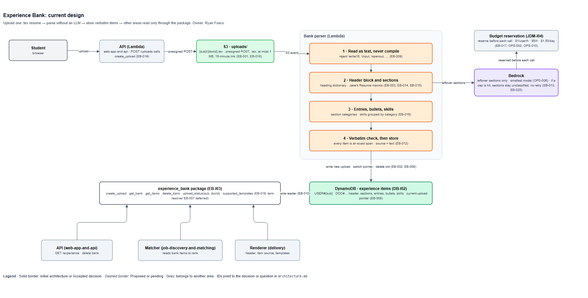

# Experience Bank Architecture

Source: RFC 0001 (`architecture/inputs/Froop_inital_architecture.pdf`), pp.1–2, 4–6, 8, and the "Experience Bank" diagram lane. Items are `Proposed` until the owner accepts them. Accepted decisions override the Initial Architecture.

## Scope

**Owns:**
- **The upload rules:** exactly one LaTeX source file (`.tex`) per upload, holding the student's complete resume or CV, and its size limit (EB-001, EB-I01).
- **The Bank parser:**
  - It reads the uploaded LaTeX without running it (EB-009).
  - It finds the header block and the sections, and pulls out roles, bullets, and skills without an LLM (EB-014, EB-015).
  - It sends only the sections it can't place to Bedrock (EB-003).
- **The verbatim guarantee:** every stored role, bullet, and skill is an exact span of the uploaded file.
- **Replacing the bank:** a successful upload replaces the student's entire bank. A failed one leaves the current bank untouched (EB-002, EB-008).
- **The term resolver,** which maps skill terms to a standard form for matching without changing the stored text (EB-007, EB-I02).
- **The meaning of each item:** what uploads, roles, bullets, and skills are, and the rules they follow. How they're stored is defined in `database` (DB-I02).
- **Upload status** (pending, parsed, failed, and the reason), so the dashboard can show progress and errors.

**Does not own:**
- The upload, list, and delete endpoints (`POST /uploads`, `GET /experience`, `DELETE /uploads/{docId}`), presigned URLs, and sign-in: `web-app-and-api`. They follow EB-I01 and use EB-I03.
- Choosing and ordering bullets for a job: `job-discovery-and-matching` (the Matcher). Ryan Fusco contributes.
- Rendering bullets into a resume: `delivery`.
- How items are stored in the table: `database`.
- The bucket, table, Lambda image, IAM role, and alarms themselves: `build-and-operation` provisions them from the Requirements Intake.

## Current Design Diagram

Source: `architecture.drawio`. The diagram shows the design **as it stands now**:
- **Solid borders:** the initial architecture or Accepted decisions.
- **Dashed borders:** Proposed or pending items.
- **Grey boxes:** parts that belong to other areas.

Keep it in step with this file (see "Keeping Area Diagrams Current" in `planning/architecture/AGENTS.md`).

## Initial Architecture

> **Frozen baseline.** This is RFC 0001 *as originally submitted* (`architecture/inputs/Froop_inital_architecture.pdf`), transcribed without changes. It is never updated when decisions change the design. The current design is in **Decisions** below, and the whole current system is in `architecture/revised-rfc/`.

- **Summary (p.1):** "Students upload everything they've done (resumes, scanned PDFs, text), and splits it into an experience bank of verbatim bullets."
- **Goal 3 (p.2):** "Upload a resume and see it split into bullets that match the original text exactly."
- **Non-Goals (p.2):** "No AI-written resume text"
- **AWS Services, Bedrock (p.4):** "All LLM tasks (requirement extraction, advanced parsing, resume item selection)"
- **Data Model, access pattern (p.5):** "Save, list, or delete a user's experience bank"
- **Data Model, sort key (p.5):** "DOC#... (uploads, roles, bullets, skills)"
- **Data Model, S3 (p.5):** "uploads/{sub}/{docId} stores original resumes. Uploaded with a presigned PUT; each upload triggers the parser"
- **API (p.5–6):**
  - `POST /uploads`: "Get a presigned URL to upload one file"
  - `DELETE /uploads/{docId}`: "Delete an upload and its bullets"
  - `GET /experience`: "List the experience bank"
- **Demo step 1 (p.8):** "Sign up and upload a scanned PDF resume. The parsed bullets match the original text word for word."
- **Diagram, Experience Bank lane (p.3):** "S3 · uploads/ (private · presigned PUT)" → event → "Bank parser (Lambda · PDF/DOCX/TXT)" → "Bedrock (split text · pick bullet IDs)"; the Bank parser → DynamoDB: "verbatim bank items".

## Architecture Review

1. **Free-form input makes "verbatim" hard to guarantee.**
   - **Finding:** the given design accepts PDFs (including scanned ones), DOCX, and TXT, and splits them with an LLM.
   - **Impact:**
     - Scanned PDFs need OCR, so the "original text" is the OCR's guess.
     - LLM splitting can quietly change words.
     - Every upload costs Bedrock money.
   - **Recommendation:** accept only a LaTeX source file and parse it deterministically. This became EB-001 and EB-003.
2. **Several uploads create duplicates and unclear coverage.**
   - **Finding:** banking several documents per student means overlapping and duplicated bullets, and no clear "current" version.
   - **Recommendation:** each upload is the student's complete resume or CV, and it replaces the whole bank. This became EB-002 and EB-005.
3. **LaTeX is a programming language.**
   - **Finding:** compiling an uploaded `.tex` file could read files, run shell commands (`\write18`), or loop forever.
   - **Impact:** a security problem in the parser, and again in `delivery` if user source reaches the renderer.
   - **Recommendation:** never compile or run the uploaded file, and reject dangerous commands at upload. This became EB-009. `delivery` handles its side in DEL-001 and DEL-002.
4. **These decisions change the submitted RFC.**
   - **Finding:** the Summary, Demo step 1, the parser's file types, and `DELETE /uploads/{docId}` (one upload, not several) no longer match.
   - **Impact:** the demo script, the API, and the proposal text the course graded all diverge from the design.
   - **Recommendation:** get the group to agree, and update the API with Graham Cohick (EB-Q10).

## Decisions

### EB-001: Accept only a single LaTeX resume or CV
Status: Accepted (Ryan Fusco, 2026-11-13)
Date: 2026-11-13
Context: Answers EB-Q01 (how to read scanned PDFs). Review item 1.
Decision: An upload is exactly one `.tex` file holding the student's complete resume or CV. PDF, DOCX, TXT, and multi-file LaTeX projects (`\input`, `\include`) are rejected.
Alternatives:
- Keep all formats and add OCR (Textract or Tesseract) or multimodal Bedrock. Rejected: higher cost, a weaker verbatim guarantee, and a larger parser image.
Consequences:
- Students without a LaTeX resume can't use Froop. This is acceptable for the target users, but the group should confirm it.
- RFC Demo step 1 changes (EB-Q10).
- The parser image needs no OCR.

### EB-002: A new upload replaces the whole bank
Status: Accepted (Ryan Fusco, 2026-11-13)
Date: 2026-11-13
Context: Answers EB-Q04 and EB-Q05. Review item 2.
Decision: Each upload is treated as the student's complete experience. When it parses successfully, every item from the previous upload is replaced. If parsing fails, the previous bank stays as it was.
Alternatives:
- Merge uploads into one bank. Rejected: it causes duplicates and leaves no clear source of truth.
Consequences:
- Matches and resumes that already exist aren't changed.
- A render still in progress that refers to a replaced bullet will find the bullet missing. `delivery` must fail that render cleanly rather than crash.
- `DELETE /uploads/{docId}` becomes "delete my bank" (EB-Q10).

### EB-003: Parse by section without an LLM, and use Bedrock only for leftover sections
Status: Accepted (Ryan Fusco, 2026-11-13)
Date: 2026-11-13
Context: Answers EB-Q02 (how verbatim is enforced).
Decision:
1. The parser reads the LaTeX without running it.
2. It finds section headings (`\section`, `\section*`, and the heading macros of supported templates, EB-015).
3. It maps each heading to a category (experience, education, projects, skills, and so on) using a heading dictionary, for example "Work Experience", "Professional Experience", and "Employment" all map to experience.
4. Within each section, it pulls out roles (from subheading macros) and bullets (from `\item`) as exact source spans.
5. Only sections whose heading isn't recognized, or whose content can't be parsed, go to Bedrock. Bedrock returns a category and the exact spans. The parser keeps a span only if it appears character for character in the source. A span that doesn't is rejected and logged.
Alternatives:
- LLM splitting of everything (the initial architecture). Rejected: cost, and the risk of altered text.
Consequences:
- Most uploads make no Bedrock calls.
- The heading dictionary and the list of supported template macros have to be maintained.
- The verbatim check is a test that can be automated (Goal 3).

### EB-004: Parser Bedrock calls count toward the hourly cost cap
Status: Superseded by EB-017 (the mechanism; parser calls still count toward the caps)
Date: 2026-11-13
Context: Answers EB-Q03.
Decision: Before calling Bedrock, the parser checks the shared hourly cost counter and adds to it, the same way the Matcher does.
Alternatives:
- A separate budget for parsing. Rejected: one cap is simpler to alarm on.
Consequences:
- `job-discovery-and-matching` owns the counter, so the parser needs read and write access to it, and Luke Campbell has to agree.
- What happens when the cap is reached is set by EB-013.

### EB-005: Duplicate entries are kept as separate items
Status: Accepted (Ryan Fusco, 2026-11-13)
Date: 2026-11-13
Context: Answers EB-Q05.
Decision: Repeated text in an upload, such as the same bullet under two roles, produces separate items with their own IDs. Nothing is merged or removed. Since EB-002 makes each upload the whole bank, duplicates across uploads can't happen.
Alternatives:
- Merge identical text. Rejected: the same bullet under different roles means different things.
Consequences:
- The Matcher may pick two items with the same text. It can choose to avoid that, but the bank doesn't.

### EB-006: Skills are stored verbatim
Status: Accepted (Ryan Fusco, 2026-11-13)
Date: 2026-11-13
Context: Answers EB-Q06.
Decision: Each skill is stored exactly as written in the upload. Any normalization is a separate derived value used only for matching (EB-007), and never appears on a rendered resume.
Alternatives:
- Rewrite skills into a standard form. Rejected: that breaks the non-goal "no AI-written resume text".
Consequences:
- Matching needs the term resolver to compare "JS" with "JavaScript".

### EB-007: Add a dictionary-based term resolver for matching
Status: Deferred (Ryan Fusco, 2026-11-18). Not in this version. The Matcher makes one ranking call per posting with no extracted requirement terms (JDM-005), and that call already matches synonyms such as JS and JavaScript (review item C6). Revisit if deterministic skill matching is needed later.
Date: 2026-11-13
Context: Follows from EB-006. A posting may ask for "JavaScript" while the student wrote "JS".
Decision:
- **What it is:** a resolver that maps any skill or requirement term to a canonical term, using a versioned dictionary file in the repo.
- **Dictionary entries:** each canonical term lists its aliases, for example `JavaScript: [JS, Javascript, ECMAScript]` and `Node.js: [Node, NodeJS, node.js]`.
- **Lookup:** case-insensitive, and ignoring spaces and punctuation (`.`, `-`, `_`).
- **Unknown terms:** they resolve to their own normalized form. They're also logged and counted, so the dictionary can grow from real uploads.
- **No LLM:** the resolver never calls one.
- **Where results go:** they're stored only as a derived `canonical` value next to the verbatim skill. `delivery` always renders the verbatim text.
- **Who uses it:** `job-discovery-and-matching` runs the same resolver on terms in postings, so both sides compare canonical values (EB-I02).
Alternatives:
- LLM normalization. Rejected: cost, and different results each run.
- Fuzzy string matching only. Rejected: it can't connect aliases that look nothing alike (`k8s` and `Kubernetes`).
- No normalization. Rejected: it misses obvious matches.
Consequences:
- A small dictionary has to be seeded and maintained.
- Luke Campbell has to agree to use it for posting terms.

### EB-008: Replace the bank by switching a "current version" pointer
Status: Accepted (Ryan Fusco, 2026-11-19)
Date: 2026-11-13
Context: How to carry out EB-002 safely. A resume can produce more than 100 items, which is more than one DynamoDB transaction can write, so deleting and rewriting in place could leave a half-replaced bank.
Decision:
1. The parser writes the new upload's items under that upload's `docId`.
2. Then, in a single write, it moves a per-user "current upload" pointer to the new `docId`.
3. Readers resolve the pointer first, and only see items from the current upload.
4. Items from the old upload are deleted afterwards. A TTL is a safety net.
Alternatives:
- Delete, then write. Rejected: readers could see an empty or partial bank, and a failure halfway through loses data.
Consequences:
- DB-I02 needs a pointer item, and every reader has to resolve it, which strengthens the case for shared code (now EB-010).

### EB-009: Never compile or run uploaded LaTeX
Status: Accepted (Ryan Fusco, 2026-11-19)
Date: 2026-11-13
Context: Review item 3.
Decision:
- **Parse only:** the parser treats the upload as text. It never runs `latex`, `pdflatex`, or anything similar on the file.
- **Reject dangerous commands at upload:** `\write18`, `\input`, `\include`, `\openin`, `\openout`, `\read`, `\catcode`, and `\csname`-based tricks.
- **Limits:** the file size has a limit, and so does parse time.
Alternatives:
- Compile to check the file. Rejected: running untrusted code.
Consequences:
- `delivery` must also never compile user-supplied macros (EB-012).

### EB-010: Other areas use the bank through a shared package owned by this area
Status: Accepted (Ryan Fusco, 2026-11-16)
Date: 2026-11-16
Context: Answers EB-Q07. Several areas read the bank: the API (`GET /experience`, delete), the Matcher, and the Renderer. EB-008 means every reader has to resolve the current-upload pointer correctly.
Decision:
- **The package:** this area owns a Python package in the repo (for example `libs/experience_bank`). It's built into every image that needs it, and it's the only supported way to read or delete the bank.
- **Contents:** bank reads and deletion, plus the term resolver (EB-I03).
- **Direct table access:** other areas don't query experience items directly.
Alternatives:
- Each area queries the table directly. Rejected: the pointer and schema logic would be copied across codebases.
- A separate experience-bank service. Rejected: extra latency, cost, and deployment for no real gain at this scale.
Consequences:
- The repo layout has to support shared libraries (now OPS-007).
- DB-I02 becomes internal to this area. Other areas consume EB-I03 instead.
- Graham Cohick and Luke Campbell have to accept EB-I03.

### EB-011: Support standard sections and a few popular templates, and send the rest to the leftover path
Status: Superseded by EB-015
Date: 2026-11-16
Context: Answers EB-Q08. Resume templates use different macros.
Decision:
- **One supported template for now:** Jake's Resume (`\resumeSubheading`, `\resumeItem`, `\resumeProjectHeading`, `\resumeSubHeadingListStart`/`End`, `\resumeItemListStart`/`End`).
- **Simple custom macros:** a `\newcommand` in the file's own preamble whose body is plain text with arguments is expanded during parsing, without running anything.
- **Everything else:** content the parser still can't place goes to the leftover path (EB-003).
Alternatives:
- Support any LaTeX by compiling it. Rejected by EB-009.
- Support one template only. Rejected: too restrictive for students.
Consequences:
- The list of supported templates is part of the parser's documentation and tests.
- The demo resume should use a supported template.

### EB-012: Store both the LaTeX source and the plain text of every item
Status: Accepted (Ryan Fusco, 2026-11-16)
Date: 2026-11-16
Context: Answers EB-Q09. Building a new resume is easier from the original LaTeX, while matching and the dashboard need plain text.
Decision: Each role, bullet, and skill stores:
- `source`: the exact LaTeX span from the upload.
- `text`: plain text derived from `source` deterministically, by expanding supported macros and turning escapes such as `\&` back into the character.

Both are verbatim in the sense of Goal 3: nothing is added, removed, or reworded. `delivery` builds resumes from `source`, so the student's formatting survives. Before it does, it removes or rejects any macro that its own template doesn't define. Matching and the dashboard use `text`.
Alternatives:
- Store plain text only. Rejected: it loses formatting and makes rebuilding the resume harder.
- Store source only. Rejected: every reader would have to understand LaTeX.
Consequences:
- DB-I02 gains `source` and `text` fields.
- The delivery template has to define, or safely strip, the macros of the supported templates (EB-011).

### EB-013: Over the cost cap, accept the upload and mark leftovers unclassified
Status: Accepted (Ryan Fusco, 2026-11-16)
Date: 2026-11-16
Context: Answers EB-Q11.
Decision: If the hourly cost cap is reached while the parser has leftover sections, the upload still succeeds:
- Sections parsed without the LLM are banked as usual and replace the old bank (EB-002).
- Leftover sections are stored, marked `unclassified`, and retried after the cap resets.
- The upload status becomes "parsed, with unclassified sections", and the dashboard shows it.
Alternatives:
- Fail the upload and keep the old bank. Rejected: the deterministic sections are usually most of the resume.
Consequences:
- The upload status gains a value.
- The Matcher ignores unclassified items until they're classified.
- A retry mechanism is needed. It could be a scheduled pass, or a retry queued for after the cap window.

### EB-014: Extract the resume header block verbatim
Status: Accepted (Ryan Fusco, 2026-11-17)
Date: 2026-11-17
Context: Answers EB-Q12. `delivery` needs the student's name and contact details for every resume (DEL-006).
Decision: The parser extracts the header block deterministically. That's the content before the first section, usually a `center` environment with the name, phone, email, and links. It's stored once per upload with `source` and `text` (EB-012) and returned by `get_bank` (EB-I03). It's not a selectable item, so the Matcher never ranks it.
Alternatives:
- Header fields in the user profile (`web-app-and-api`). Rejected: the uploaded resume already has them, verbatim.
Consequences:
- DB-I02 gains a header block item.
- If no header is found, the upload is still parsed, and its status notes the missing header, so the student can fix the file.

### EB-015: Support one template (Jake's Resume), listed in the shared package
Status: Accepted (Ryan Fusco, 2026-11-17)
Date: 2026-11-17
Context: Answers EB-Q13 and DEL-Q07. Supersedes EB-011, which planned for two or three templates.
Decision:
- **Always supported:** `\section`/`\section*` and `itemize`/`enumerate` with `\item`.
- **One supported template for now:** Jake's Resume (`\resumeSubheading`, `\resumeItem`, `\resumeProjectHeading`, `\resumeSubHeadingListStart`/`End`, `\resumeItemListStart`/`End`).
- **Simple custom macros:** a `\newcommand` in the file's own preamble whose body is plain text with arguments is still expanded during parsing, without running anything.
- **Everything else** goes to the leftover path (EB-003).
- **Where the list lives:** the supported templates and their macros are a single list in the experience bank package (EB-I03). The parser uses it to read uploads, and `delivery` uses it to define those macros in its template (DEL-001). Adding a template means one change to that list, plus its definitions in the delivery template.
Alternatives:
- Two or three templates now (EB-011). Rejected for now: one template is enough to build and demo, and more can be added through the shared list.
- Separate lists in the parser and in `delivery`. Rejected: they would drift apart.
Consequences:
- Students using other templates still get their standard sections and `\item` bullets, and anything else goes to the leftover path, which uses Bedrock and counts against the cost cap.
- The demo resume uses Jake's Resume.

### EB-016: Label each section by category, and keep skills grouped by their own category
Status: Accepted (Ryan Fusco, 2026-11-19)
Date: 2026-11-17
Context: `delivery` builds resumes from section tiers (DEL-015), and the Matcher ranks projects with their bullets and skills within categories (DEL-010).
Decision:
- **Section categories:** every section gets one category: `education`, `experience`, `projects`, `technical_skills`, `awards`, `certifications`, `publications`, `leadership`, or `other`. The category comes from the heading dictionary (EB-003). The section's own heading text is still stored verbatim.
- **Entries:** in Jake's Resume, `\resumeSubheading` entries under experience are roles, entries under education are education entries, and `\resumeProjectHeading` entries are projects. Each entry owns its `\resumeItem` bullets, in their original order.
- **Skills:** each category line in the skills section (for example `\textbf{Languages}{: Java, Python, C/C++}`) becomes a skill category. Its name (`Languages`) is stored verbatim. Each comma-separated value becomes one skill item, with its own `source` and `text`.
- **Every section is banked,** whatever its category. Which ones appear on a resume is decided by `delivery` (DEL-015).
Alternatives:
- Treat skills as one free-text line. Rejected: the Matcher couldn't rank individual skills within a category.
Consequences:
- DB-I02 gains education entries, project entries, skill categories, and a section category on each item.
- `get_bank` (EB-I03) returns items grouped by section category, with skills grouped by skill category.
- Splitting skills on commas has to respect braces and escaped characters. For example, `C/C++` is one skill, and so is `Node.js`.

### EB-017: The parser reserves Bedrock budget through the shared reservation package
Status: Accepted (Ryan Fusco, 2026-11-18). Supersedes EB-004's mechanism; parser calls still count toward the caps.
Date: 2026-11-18
Context: Answers C5 from the review of Luke Campbell's JDM-006 and JDM-I04. Checking a counter and then adding to it lets two callers both pass the check and overspend.
Decision:
- Before every Bedrock call, the parser calls `reserve(...)` from the shared reservation package (JDM-I04), using a new attempt ID for each call.
- The package atomically reserves a worst-case cost (input tokens plus the configured maximum output tokens) against the per-user hourly, platform hourly, and platform daily counters.
- **Deferred:** the leftover sections stay `unclassified` (EB-013) and are retried at the returned `nextAttemptAt`.
- **Blocked configuration:** the upload status notes that the leftovers couldn't be classified.
- Counter keys follow DB-I04 (`COST#HOUR#…`, `COST#DAY#…`, and per-user `USER#{sub}` / `COST#HOUR#…`).
- **Keeping the overcount small:** the parser's maximum output tokens are kept close to real usage, and its actual token usage is logged, so the cap isn't wasted on overestimates.
Alternatives:
- Check, then add (EB-004 as written). Rejected: it can overspend when calls happen at the same moment.
Consequences:
- The parser depends on a package owned by `job-discovery-and-matching`.
- No refunds in v1, so each reservation may count more than the call really cost.

### EB-018: Uploads use a presigned POST, so S3 enforces the size limit
Status: Accepted (Ryan Fusco, 2026-11-19)
Date: 2026-11-19
Context: Answers WEB-Q01 (Graham Cohick). A presigned PUT can't make S3 enforce a size range. A presigned POST policy can.
Decision: The upload link is a **presigned POST** whose policy fixes:
- the key, `uploads/{sub}/{docId}.tex`
- the content type, `application/x-tex`
- the size range, 1 byte to 1 MB
- an expiry of 15 minutes

The browser sends the file as multipart form data to the URL and fields the API returns. The experience-bank package builds the policy (EB-019), so its rules live in one place.
Alternatives:
- A presigned PUT (EB-I01 as first drafted). Rejected: S3 can't enforce the size limit.
Consequences:
- EB-I01 changes from PUT to POST.
- The API returns `{url, fields}` in `upload` (WEB-I01).
- The uploads bucket must allow POST from the dashboard's origin (OPS-I02).

### EB-019: The package creates the upload record, and an unused link expires
Status: Accepted (Ryan Fusco, 2026-11-19)
Date: 2026-11-19
Context: Answers WEB-Q02 (Graham Cohick) and the per-upload status lookup in JDM-I05 (Luke Campbell). The API issues the `docId`, but only this area may write `DOC#` items (EB-010). The dashboard must show "pending" once a file is sent, and must not show it forever if no file ever arrives.
Decision:
- **`create_upload(sub, regenerate=False)`** (new in EB-I03):
  - generates the `docId`
  - writes the upload record with status `awaiting_file`, the link's expiry time, and the student's "regenerate?" choice
  - returns `{docId, url, fields, expiresAt}` (EB-018)

  The API calls it from `POST /uploads`.
- **When the file arrives,** the parser moves the record to `pending`, then to `parsed`, `parsed_with_unclassified`, or `failed`.
- **When no file arrives:** after the link expires, `upload_status` reports `expired`. Nothing has to clean up.
- **Status values**, one fixed list used by every reader: `none` (the student has never uploaded), `awaiting_file`, `pending`, `parsed`, `parsed_with_unclassified`, `failed`, and `expired`. A `failed` status has a reason.
- **`upload_status(sub, docId=None)`:** with no `docId`, it reports the student's latest upload. With a `docId`, it reports that upload, and whether it is the student's current bank. The Matcher uses the second form to wait for an upload before regenerating (JDM-I05).
- **A new upload doesn't touch the current bank** until it parses successfully (EB-002, EB-008). An `awaiting_file` or `expired` upload never replaces it.
Alternatives:
- The API writes the upload record. Rejected: it breaks EB-010.
- The parser creates the record when the file arrives. Rejected: the dashboard couldn't show anything between "link issued" and "file parsed".
Consequences:
- **EB-I03** gains `create_upload` and the `docId` form of `upload_status`. The consumers accepted EB-I03 before these were added, so they need to accept the extension.
- **DB-I02's upload record** gains `awaiting_file`, `expired`, `expiresAt`, and `regenerate`.
- **The API stores the regenerate choice through this package.** Luke Campbell's dispatcher reads it through `upload_status` (JDM-I05). That's one record, not two.

## Interfaces

### Provides

#### EB-I01: Upload object contract
Status: Proposed (revised 2026-11-19: presigned POST, EB-018)
Consumers: web-app-and-api
Contract:
- **Key:** `uploads/{sub}/{docId}.tex`, where `sub` comes from the Cognito token and never from the request (RFC p.7).
- **Upload:** one object per **presigned POST** (EB-018). The policy fixes the key, the content type `application/x-tex`, a size of 1 byte to 1 MB, and a 15-minute expiry. `create_upload` builds it (EB-019).
- **User identity:** the parser takes the user from the key, so the key layout is part of the security model.
- **Replacement:** a new upload replaces the bank only once it has parsed successfully (EB-002).
Accepted by: Ryan Fusco (2026-11-19, provider), Graham Cohick (2026-11-19, consumer: web-app-and-api). Both owners have accepted; the Status line is Ryan Fusco's to update.

#### EB-I02: Term resolver
Status: Deferred with EB-007 (2026-11-18)
Consumers: job-discovery-and-matching
Contract:
- **Function:** `resolve(term) -> canonical`. It's deterministic, makes no network calls, and always returns the same result for the same dictionary version.
- **Exposes:** the dictionary version, so stored `canonical` values can be recomputed when the dictionary changes.
- **Packaging:** shipped inside the experience-bank package (EB-I03).
Accepted by: —

#### EB-I03: Experience bank package
**Luke's extension acceptance (2026-11-21):** Accept create_upload and upload_status(sub, docId), the fixed status list and isCurrentBank: they let JDM wait for the requested successful current bank without reading DOC items. All consumers have accepted the extension; Ryan can finalize its status. WEB-Q08 separately clarifies that the WORK record triggers regeneration, and DB-Q10 separates link expiry from data retention.
Status: Accepted (base contract). The EB-019 extension is Proposed until the consumers accept it.
Consumers: web-app-and-api (`GET /experience`, delete), job-discovery-and-matching (the Matcher), delivery (the Renderer)
Contract: A Python package owned by this area (EB-010). It is the only supported way to use the bank:
- `get_bank(sub)`: the current upload's `docId`, status, and header block (EB-014). Then its items grouped by section category (EB-016): education entries, roles, projects (each with their bullets), skills grouped by skill category, and `other` sections. Every item has `source` and `text` (EB-012).
- `get_items(sub, ids)`: specific items by ID. Missing IDs (replaced by a newer upload) are reported, not raised as errors.
- `delete_bank(sub)`: deletes the bank and the uploaded file
- `create_upload(sub, regenerate=False)`: issues a `docId`, writes the upload record (`awaiting_file`), and returns the presigned POST (EB-018, EB-019). *(extension, Proposed)*
- `upload_status(sub, docId=None)`: `none`, `awaiting_file`, `pending`, `parsed`, `parsed_with_unclassified`, `failed` (with a reason), or `expired`. With a `docId`, it reports that upload and whether it is the current bank (EB-019). *(the `docId` form and the full status list are the extension, Proposed)*
- `resolve(term)`: the term resolver (EB-I02). Deferred with EB-007, so it isn't in v1.
- `supported_templates()`: the supported templates and their macros (EB-015), used by the parser and by the delivery template

Function names may change before acceptance. What a function returns may change only with the consumers' agreement.
Accepted by: Graham Cohick (2026-11-18, consumer: web-app-and-api), Luke Campbell (2026-11-18, consumer: job-discovery-and-matching; JDM-008). Ryan Fusco (2026-11-19, provider). The base contract is Accepted. **Extension (EB-019):** `create_upload`, `upload_status(sub, docId)`, and the fixed status list are Proposed. Graham Cohick accepted the extension (2026-11-19, consumer: web-app-and-api). Luke Campbell accepts the extension (2026-11-21; reasoning above).

### Consumes
- **Experience items:** DB-I02 in `database`. This area writes them and is now their only direct reader (EB-010). It proposes changes to them as a contributor there. Pending changes: the current-upload pointer (EB-008), the `source` and `text` fields (EB-012), the `unclassified` marker and new status value (EB-013), the header block (EB-014), the section categories, entries, and skill categories (EB-016), and the upload record's new statuses, `expiresAt`, and `regenerate` (EB-019).
- **The user's Cognito `sub`:** through the upload key (EB-I01), which `web-app-and-api` issues.
- **Bedrock, and the shared reservation package:** JDM-I04, owned by `job-discovery-and-matching` (EB-017). Ryan Fusco accepted it on 2026-11-18 as the consumer.
- **The uploads bucket with event notifications, the shared table, the parser Lambda image, and its IAM role:** from `build-and-operation` (OPS-I01, OPS-I02, OPS-I03).

## Open Questions

Answered: EB-Q01–Q06 (EB-001 to EB-006), EB-Q07 (EB-010), EB-Q08 (EB-011, since superseded by EB-015), EB-Q09 (EB-012), EB-Q11 (EB-013), EB-Q12 (EB-014), EB-Q13 (EB-015). Review of Luke Campbell's contribution (2026-11-18): C5 → EB-017, C6 → EB-007 deferred. Review of Graham Cohick's contribution (2026-11-19): WEB-Q01 → EB-018, WEB-Q02 and the JDM-I05 status lookup → EB-019.

- **EB-Q10: The API, and the shared sections of the RFC, still need updating for EB-001 and EB-002.** The revised RFC (`architecture/revised-rfc/`) now covers this area's sections: the Summary, Goal 3, Bedrock's role, the Data Model, the upload file type, and Demo step 1. Still open:
  - `DELETE /uploads/{docId}` needs to become something like `DELETE /experience`. It's marked pending in the revised RFC.
    - *Answered by Graham Cohick (2026-11-18): it becomes `DELETE /experience` (WEB-001, Accepted). The revised RFC is updated.*
  - The group needs to confirm the Summary, Goal 3, and Demo step 1 changes, since those are shared sections. *Ryan Fusco asked Graham Cohick and Luke Campbell to confirm (2026-11-19), through their Requests From Other Areas tables. Graham Cohick confirms the wording (2026-11-19). Luke Campbell confirms the Summary, Goal 3 and Demo step 1 (2026-11-21): one LaTeX resume and verbatim bullets match the agreed Matcher inputs and avoid text generation. Shared wording is now agreed.*
  - Owner: Graham Cohick (API), group (shared sections)
  - Blocks: EB-I01 acceptance

## Requests From Other Areas

Pointers to items defined in other areas that this area's owner has to act on. Answer each one where it's defined, then delete its row (see "Coordinating Across Areas" in `planning/architecture/AGENTS.md`).

| ID | Defined in | What's needed |
|---|---|---|
| WEB-Q08 | `web-app-and-api/architecture.md` | With Luke Campbell: confirm that the JDM-I05 work record, not the `regenerate` value on the upload record (EB-019), is what triggers upload regeneration, and say what that value is then for. |
| _None yet._ | | |
| DB-Q10 | database/architecture.md | Ryan: agree a separate upload link deadline from table TTL; active upload metadata must survive link expiry. |
