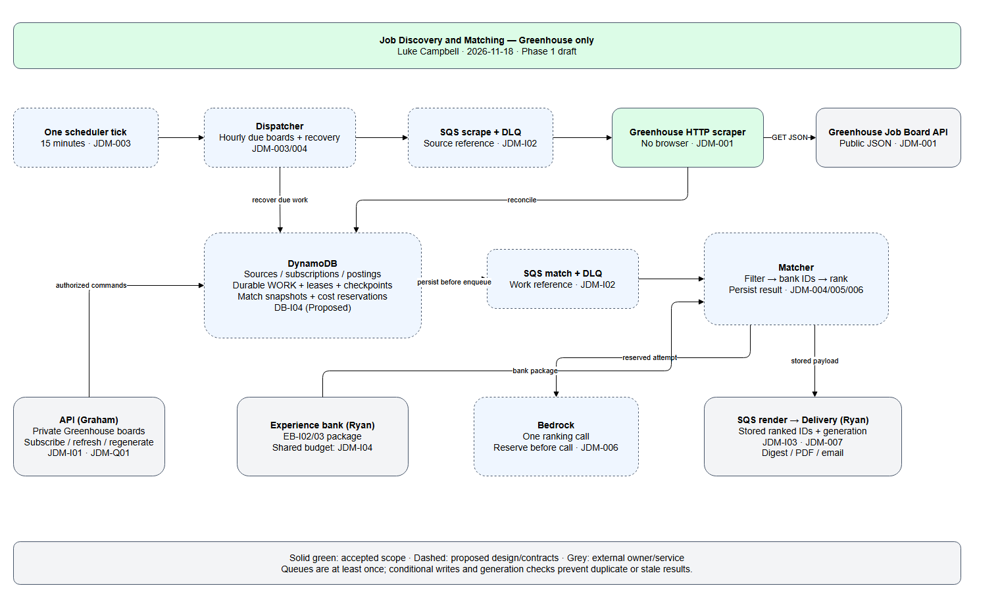

# Job Discovery and Matching Architecture

Source: RFC 0001 (`architecture/inputs/Froop_inital_architecture.pdf`). See "Where Each Area's Material Is" in `planning/architecture/AGENTS.md` for this area's lane and pages. Items are `Proposed` until the owner accepts them. Accepted decisions override the Initial Architecture.

## Scope

**Owns:** Greenhouse board catalog and user-added Greenhouse sources; subscriptions as a domain concept; scheduled/manual discovery; posting identity and lifecycle; filtering, matching, ranking, cost accounting, and durable handoff to delivery. Luke Campbell owns this area; Ryan Fusco contributes to ranking.

**Does not own:** sign-in, public endpoints, settings and dashboard (Graham / web-app-and-api); resume parsing and term dictionary (Ryan / experience-bank); PDF rendering and email (Ryan / delivery); table definitions (shared database); provisioning and deployment (shared build-and-operation).

**Current scope:** Greenhouse only, explicitly requested by Luke on 2026-11-18. No GitHub, Lever, Ashby, arbitrary careers pages, Chromium, Playwright, or LLM webpage extraction. A user-added source means a public Greenhouse board saved privately to that user, not an authenticated/private Greenhouse API. Initial Architecture below remains the historical baseline.

## Current Design Diagram

Source: `architecture.drawio`. The diagram shows the design **as it stands now**:
- **Solid borders:** the initial architecture or Accepted decisions.
- **Dashed borders:** Proposed or pending items.
- **Grey boxes:** parts that belong to other areas.

Keep it in step with this file (see "Keeping Area Diagrams Current" in `planning/architecture/AGENTS.md`).

## Initial Architecture

> **Frozen baseline.** This is RFC 0001 *as originally submitted* (`architecture/inputs/Froop_inital_architecture.pdf`), transcribed without changes. It is never updated when decisions change the design. The current design is in **Decisions** below, and the whole current system is in `architecture/revised-rfc/`.

- **Summary (p.1):** "Froop finds new internship/job postings and builds a tailored one-page resume for each match from the student's own words." "On a schedule, it checks a built-in catalog of GitHub internship lists and Greenhouse, Lever, and Ashby boards, plus any private pages a student adds. For each match, an AI model selects and orders the student's bullets and skills without editing a word"
- **Motivation (p.2):** "Internship postings are spread across hundreds of job boards" "It finds postings automatically and builds each resume only from text the student wrote."
- **Goal 1 (p.2):** "Be able to run the same sources twice and get no duplicate postings, even when two sources list the same job."
- **Goal 2 (p.2):** "See new postings from the catalog and from a private page we add, including one that needs JavaScript."
- **Non-Goals (p.2):** "No AI-written resume text, No sharing user-added sources between users"
- **AWS Services (p.4):**
  - EventBridge Scheduler: "Starts scrapes and digest emails on a schedule". Why: "No server running all day just to wake up a few times"
  - SQS: "Queues work between the scraper, matcher, and renderer". Why: "Handles bursts and retries failures without losing work"
  - Bedrock: "All LLM tasks (requirement extraction, advanced parsing, resume item selection)". Why: "Managed LLM with IAM; don't need to worry about GPU/server and can call whenever work is done"
  - ECR: "Chromium and LaTeX are too large for Lambda's zip limit"
- **Data Model, access patterns (p.5):** "Add a posting only if it's new"; "Find users subscribed to a source, then filter by their settings"; "Create a match once per user and posting; list a user's matches, newest first"; "Manage a user's private sources and subscriptions"; "List catalog sources; find matches waiting for a digest; cap Bedrock spend per hour"
- **Data Model, table design (p.5):** "postingKey: a hash of normalized company, title, and location, so the same job from two sources gets one key. Conditional puts block duplicate postings and matches." "Postings store title, company, location, full description, apply link, and the sources that listed them. Postings expire 30 days after last seen." "GSI1: a source's subscribers, and all catalog sources"; "LSI1: matches by created date"
- **API (p.6):** the sources, subscriptions, and matches endpoints (the full table is in `web-app-and-api/architecture.md`), and "409 - sources already added or already subscribed"; "429 - refresh requested too often"
- **Infrastructure as Code (p.7):** "The job catalog is data, so a seed script loads it from a JSON file in the repo."
- **Security (p.7):** "Job boards need no keys"
- **Observability (p.7):** "Every Lambda logs JSON to CloudWatch with the source and posting IDs, so we can trace one posting from scrape to email."
- **Demo steps 2, 3, 5 (p.8):** "Add a private careers page that needs JavaScript, then trigger a refresh. New postings from that page and from the catalog show up in the feed." "Trigger the refresh again. No new postings or emails appear, and a job listed on both a Greenhouse board and the GitHub list shows up once. (Goal 1)" "Point a source at a broken URL and show the alarm email while the other sources keep updating."
- **Risks (p.8):** "Using chromium in lambda, which Claude has said requires a large image and a lot of memory. None of us have used Bedrock yet."
- **Alternatives Considered (p.8):** "We considered Fargate but chose Lambda, because the work is idle most of the day, and container-image Lambdas can run Chromium" "We considered an LLM scraper for every source, but Greenhouse, Lever, and Ashby have JSON APIs that are cheaper and more reliable. We only use LLM extraction for pages users add."
- **Diagram, Job Discovery and Matching lane (p.3):**
  - "EventBridge Scheduler (per-source · catalog · digest)" → (1) → "SQS scrape (queue + DLQ)" → (2) → "Scraper (Lambda · Playwright image)"
  - EventBridge Scheduler → "Catalog dispatcher (Lambda · fan-out)" → SQS scrape
  - Scraper → "fetch" (3) → "Job sites (Greenhouse · Lever · Ashby · GitHub · JS)"
  - Scraper → (4) "new postings only (conditional put) · matches" → DynamoDB
  - Scraper → (5) → "SQS match (queue + DLQ)" → "Matcher (Lambda · cost cap check)"
  - Matcher → (6) → "Bedrock (split text · pick bullet IDs)"
  - Matcher → (7) → "SQS render (queue + DLQ)"
  - EventBridge Scheduler → "digest schedule" → Notifier

## Architecture Review

1. Multiple board formats and JavaScript scraping multiply failure modes and image size. Use one HTTP JSON adapter (JDM-001).
2. Hashing company/title/location merges distinct openings and changes identity when labels change. Use board token plus Greenhouse job-post ID (JDM-002).
3. A database write followed by SQS send can fail between steps. Persist resumable work and reconcile it; queue delivery is at least once (JDM-004).
4. New subscribers must receive existing active postings, not only globally new postings. Reconcile all active postings for a source on each successful poll (JDM-003).
5. AI ranking every job before filtering wastes budget. Apply explicit user filters first, then one structured ranking call per eligible user/posting/bank revision (JDM-005).
6. Checking spend after a call permits concurrent overspend. Reserve a conservative upper bound atomically before calling, and defer durably when unavailable (JDM-006).
7. A posting disappearing from a failed or incomplete response is not evidence it closed. Change availability only after a complete valid board response (JDM-002).
8. The original JavaScript and cross-provider demo no longer represents the requested product. SYS-Q04 records the group-level demo change; it does not block drafting this Greenhouse design.

## Decisions

Decision authority: JDM-001 records Luke's explicit instruction. The remaining choices are concrete recommendations made under Luke's request to use best judgment, kept Proposed where implementation or another owner's contract still needs agreement. No approval is attributed to Ryan or Graham.

### JDM-001: Discover jobs only through the Greenhouse Job Board API
Status: Accepted (Luke Campbell, explicit scope instruction, 2026-11-18)
Date: 2026-11-18
Context: Luke requested Greenhouse only to simplify the project.
Decision: Use the public Job Board API, not Harvest. Fetch `GET https://boards-api.greenhouse.io/v1/boards/{board_token}/jobs?content=true`. GET access requires no authentication. Accept a board token or a recognized Greenhouse board URL; extract a validated token, then construct the API URL on the fixed host. Do not fetch arbitrary submitted URLs or follow redirects to arbitrary hosts. The provider supplies post IDs and descriptions. No browser or LLM is needed to extract listings.
Reasoning: One adapter removes browser packaging, website-specific selectors, and three other provider integrations while retaining discovery and tailored resumes.
Alternatives: General-purpose scraping and other providers are out of scope for this version.
Consequences: API help text, catalog data, scraper image requirements, demo and diagrams need the Greenhouse scope. Group-owned goal/demo wording is tracked in SYS-Q04. Board choice is explicit; this API is not a global search of every Greenhouse customer.
Evidence: [Greenhouse Job Board API](https://docs.greenhouse.io/job-board), Authentication and List jobs, checked 2026-11-18.

### JDM-002: Use stable provider identity and explicit availability
Status: Proposed
Date: 2026-11-18
Context: Greenhouse-only discovery does not need fuzzy cross-provider deduplication.
Decision: `postingKey = gh:{boardToken}:{jobPostId}`; use the API's job-post `id`, not `internal_job_id`. Preserve the validated board token's spelling. Catalog sources use `gh:{boardToken}`; user-added sources use `private:{sub}:gh:{boardToken}`. Shared posting records contain only public job content; never expose another user's private source or subscription. The same board added through either route maps to the same posting. Distinct post IDs remain distinct, even if titles match.
Reasoning: Stable provider keys avoid accidental merging and make repeated discovery idempotent.
Alternatives: Company/title/location hashes and fuzzy merging are unnecessary and less reliable here.
Consequences: On a complete successful poll, upsert observations, set `lastSeenAt`, `expiresAt = lastSeenAt + 30 days`, and mark absent postings inactive for that board. Failed/oversized/malformed responses leave availability unchanged. Read paths check active state and expiry explicitly; TTL deletion is not the availability clock. Matches retain an immutable bounded posting snapshot. A reopened same-ID job does not create a second match or email. See DB-I04.

### JDM-003: One recurring dispatcher, with hourly board polling
Status: Proposed
Date: 2026-11-18
Context: Per-source schedules are extra lifecycle work for this small project.
Decision: One dispatcher runs every 15 minutes, enqueues due source polls (hourly by default), and resumes due work. Manual refresh uses the same queue with an atomic five-minute source cooldown. Start with a small curated Greenhouse catalog. User-added boards remain supported. API writes source/subscription records through the agreed JDM validation contract (JDM-I01); the seed script writes catalog entries. Scraper rechecks source existence and authorization scope before working. Digest scheduling remains delivery's separate concern.
Reasoning: A single dispatcher avoids creating/deleting schedules with every source and also handles deferred work.
Alternatives: One schedule per source is deferred until scale justifies it.
Consequences: A successful poll reconciles every active posting with current subscribers, rechecking authoritative subscriptions rather than trusting a stale subscriber index alone. This handles new subscribers, missing banks, and prior enqueue failures. Dispatcher uses paginated, filtered table scans initially, checkpointing across bounded invocations; this is a small-demo tradeoff, not a scaling claim. OPS-I05 covers resources and limits; DB-I04 covers access patterns. Failed sources are isolated and visible.

### JDM-004: Persist work before queueing; make retries safe
Status: Proposed
Date: 2026-11-18
Context: DynamoDB writes and SQS sends are not one transaction.
Decision: Store per-user work under `WORK#` before sending a match-queue reference. New-match work ID is deterministic for `(sub, postingKey)`; regeneration uses `(sub, postingKey, requestId)`. Queue messages refer to work IDs. Claim work with a conditional lease and fencing generation. Persist ranking output before delivery, then transactionally create/update the match and mark the work `render_pending`. Send the stored render payload and mark work `complete` only after SQS acknowledges. Dispatcher retries due work and expired leases. Every state update checks lease ownership/generation; duplicate messages cannot overwrite newer work.
Reasoning: A crash can cause a repeated send, but cannot permanently lose a committed match. Saving ranking output also avoids needless repeat AI calls.
Alternatives: DynamoDB Streams/outbox infrastructure is deferred; silent best-effort enqueue is rejected.
Consequences: Renderer must deduplicate by `(sub, postingKey, docId, requestId)` and reject stale generations (JDM-I03). Only one render-changing operation per match is active at a time; regeneration waits until the prior delivery operation is terminal, preventing old workers replacing new PDFs. New-match conditional creation preserves one match per user/posting. Recheck subscription before starting a new match; regeneration authorizes the owned match instead. DLQ messages remain recoverable by operator redrive; exhausted attempts are `failed`, not automatically requeued forever. Digest/email exactly-once behavior requires delivery review (JDM-Q02).

### JDM-005: Filter deterministically, then rank existing bank IDs in one call
Status: Proposed
Date: 2026-11-18
Context: Discovery and resume tailoring have different responsibilities.
Decision: All subscribed postings passing configured filters become candidates. Empty filters mean no restriction. Within title or location include lists use OR; across dimensions use AND; exclusions win. Match case-insensitive normalized plain text; do not infer remote eligibility from missing location. API settings schema must agree (JDM-Q01). Read the bank only through EB-I03 and normalize skill terms with EB-I02. Missing bank leaves work `waiting_bank`; exclude unclassified sections. One Bedrock call ranks role/project/bullet/skill IDs using the job description and bank, with no generated resume text or separate requirement-extraction call.
Reasoning: Explainable filtering limits AI spend. One ranking call is simpler than a separate extraction pipeline, and ID validation preserves the student's words.
Alternatives: AI decides whether a user qualifies, or rewrites resume bullets: rejected for opacity and verbatim risks.
Consequences: Ranking returns finite scores in [0,1], with one common relevance rubric across roles, projects, and their bullets. Validate all IDs against the same `docId`, parent relationships, uniqueness, allowed sections, ordering and score ranges. Stable ID breaks ties. Reject malformed/hallucinated output; one bounded retry reserves a fresh cost allowance, then visible failure. Job descriptions are untrusted data, never instructions or executable HTML. Recheck bank version before commit; changed bank returns to `waiting_bank`/rerank instead of rendering stale IDs. Requests over configured model input/output limits fail visibly rather than silently dropping resume sections.

### JDM-006: Share conservative cost reservations; defer without a retry storm
Status: Proposed
Date: 2026-11-18
Context: Matcher and bank parser share the proposed hourly and daily caps.
Decision: JDM-I04 provides a shared reservation package to both callers. Reserve integer micro-USD against all three counters atomically before every attempt: $1/user/hour, $5/platform/hour, $1.50/platform/UTC day, configurable per OPS-002/010. Use a configured model price and an upper bound from input tokens plus maximum output tokens. Each attempt gets a unique reservation ID; uncertain outcomes remain charged conservatively and cannot be reused for another invocation. Record actual usage separately; no refund in v1. Missing/unknown pricing fails closed.
Reasoning: Conservative accounting is simpler than safe refund/reconciliation and prevents concurrent calls from passing independent checks.
Alternatives: Check-after-call and SQS retrying until midnight are rejected.
Consequences: When denied, persist `deferred_budget` and `nextAttemptAt` at the latest reset among the exhausted windows, then acknowledge SQS. Dispatcher resumes later. A single call larger than a whole cap becomes `blocked_configuration`, not an infinite daily retry. Bank-ready work and backlog use oldest-due-first ordering within bounded pages. $1.50/day can consume $46.50 in a 31-day month; it is not a guarantee that total AWS charges fit $50. Parser and Matcher use the same shared package (EB-004, DB-I04); model choice remains an OPS configuration decision.

### JDM-007: Preserve delivery's ranked payload, digest and regeneration behavior
Status: Proposed
Date: 2026-11-18
Context: DEL-010/011/014 already describe Ryan's expected Matcher behavior.
Decision: Supply the ranked shape in JDM-I03. New hourly/daily matches get the DB-I03 digest mark atomically with creation. Regenerations get no new digest mark and no email. Upload-triggered regeneration selects owned, unapplied matches whose postings are active and unexpired; per-match regeneration uses the retained posting snapshot even when the posting has closed. Read current bank and emit `reason: regenerate`.
Reasoning: This preserves Ryan's product behavior while making retry and stale-version handling explicit.
Alternatives: Regenerate every historical match automatically: rejected because users may already have submitted those resumes.
Consequences: Delivery must agree the request/generation extensions and DB must finalize digest index keys. Luke's recommended agreement is recorded here; existing Accepted decisions in Ryan's files are not rewritten. See JDM-Q02 and DB-I04.

## Interfaces

### Provides

#### JDM-I01: Greenhouse sources, subscriptions and refresh
Status: Proposed
Consumers: web-app-and-api
Contract: Shared source validation accepts a token matching `[A-Za-z0-9_-]{1,128}` or HTTPS board URL on `boards.greenhouse.io` / `job-boards.greenhouse.io` with a single token path. Reject arbitrary hosts, credentials, ports, extra paths and unsupported providers; token input handles boards not covered by the URL parser. Catalog IDs and private IDs follow JDM-002. API derives `sub` from JWT, writes sources/subscriptions (DB-I04), and authorizes catalog access or private-source ownership. Refresh persists `nextPollAt=now` subject to cooldown before best-effort queue send, so dispatcher recovers failed sends. Deletion disables future work; unsubscribe does not delete historical matches. 400 invalid source, 404 missing/not owned, 409 duplicate, 429 cooldown. Returns source state and `lastSuccessAt`/`lastErrorCode`; errors contain no resume data. Subscription creation takes effect by the next successful poll.
Accepted by: —; awaiting Graham and Luke review of final contract.

#### JDM-I02: Internal work queues
Status: Proposed
Consumers: JDM dispatcher, scraper, Matcher; build-and-operation
Contract: UTF-8 JSON with `schemaVersion: 1`. Scrape payload `{sourceId, requestId}`; source record supplies the validated board token and scope. Match payload `{sub, workId}`; canonical work record supplies posting, reason and current generation. No arbitrary URLs or resume text in queues. Unknown versions/malformed payloads are rejected with structured errors and bounded retry/DLQ handling. Source/work IDs are opaque strings to infrastructure. All handlers are idempotent; partial SQS batch failures report only failed messages.
Accepted by: —

#### JDM-I03: Render request
Status: Proposed
Consumers: delivery
Contract: `schemaVersion:1`, `sub`, `postingKey`, `docId`, `requestId`, `generation`, `reason` (`new_match` or `regenerate`), `rankedExperiences:[{roleId,score,rankedBullets:[{bulletId,score}]}]`, `rankedProjects:[{projectId,score,rankedBullets:[{bulletId,score}]}]`, `skills:[{category,score,rankedSkills:[skillId]}]`. Scores use JDM-005. Education and allowed unranked sections come from EB-I03. No rewritten text. Serialize at most 200 KiB (an application limit); oversized output fails visibly. Same work retry sends byte-equivalent stored payload. Delivery uses generation and request ID for conditional ownership and deduplication, preserves old PDFs, and suppresses regeneration email. Final schema/digest keys need Ryan and database agreement.
Accepted by: —

#### JDM-I04: Shared Bedrock budget reservation
Status: Proposed
Consumers: experience-bank, Matcher; database and build-and-operation
Contract: `reserve(sub, attemptId, upperBoundMicroUsd, nowUtc)` returns `reserved`, `already_reserved` (not permission to invoke again), `deferred(nextAttemptAt)`, or `blocked_configuration`. Transaction writes one unique reservation and increments three counters only if all caps permit it. Counter window identifiers are UTC and unambiguous (`HOUR#...`, `DAY#...`). Retry of the transaction with the same attempt cannot double charge; a new actual invocation needs a new attempt ID. Counters/reservations remain at least seven days beyond the window. Crash/timeout after reserving may waste allowance but never release uncertain spend. Caller logs actual tokens and estimated cost separately without logging bank/job content. See JDM-006 and DB-I04.
Accepted by: —

### Consumes

- EB-I02 term resolver and EB-I03 bank package; use `get_bank`, resolve and dictionary version; never read bank items directly. Proposed interfaces still need provider acceptance.
- DB-I01 table conventions, DB-I03 delivery fields and DB-I04 discovery/work/cost schema. JDM proposes replacing LSI1 with a matches-by-date GSI; existing shared conventions remain pending agreement.
- OPS-I01 to OPS-I04 deployment, storage, permissions and metrics; proposed amended intake OPS-I05.
- API-owned settings, authenticated commands and upload-completion/regeneration signal: JDM-Q01 asks Graham for the producer contract. No invented WEB task IDs.

## Open Questions

- **JDM-Q01:** Graham: agree JDM-I01, settings (`titleIncludes`, `titleExcludes`, `locationIncludes`, `deliveryMode`), and durable regeneration command producer contract. Upload regeneration must wait for successful bank replacement; per-match commands must authorize `sub` and use an idempotent request ID. Blocks JDM-T03/T07/T09; API implementation task IDs do not exist yet.
- **JDM-Q02:** Ryan: agree JDM-I03 generation/deduplication contract, EB-I02/03 usage, and JDM-I04 parser cost reservations. Confirm how SES send/record failures are reconciled: an SQS/digest conditional write alone cannot guarantee exactly-once external email. Blocks JDM-T06/T08/T09 and full duplicate-email demo signoff. Provider implementation task IDs do not exist yet.
- **JDM-Q03:** Group: accept DB-I04 and OPS-I05, including GSI instead of LSI1 and dispatcher scan tradeoff; attach DB/OPS task IDs when written. Blocks integration/deploy, not completion of this planning draft.
- **SYS-Q04 (defined in architecture/AGENTS.md):** Group confirmation of Greenhouse-only shared goals and demo. Requested product scope is settled by Luke; group-owned document signoff remains outstanding.

### Planning exit check (2026-11-18)
- Scope and review drafted; frozen baseline preserved.
- Major recommendations have rationale; only explicit Greenhouse scope is Accepted.
- Interfaces drafted on provider side with requests to consumers; shared acceptances outstanding.
- Ordered implementation plan exists; blocked tasks name unresolved contracts.
- Current diagram includes proposals with dashed borders.
- Area stays Draft until cross-area contracts are agreed; no phase change or application code is part of this work.

## Requests From Other Areas

Update 2026-11-18: recommended answers now appear in JDM-003 to JDM-007, DB-I04 and OPS-I05. These original pointers remain until affected owners agree; they are no longer unanswered design work. SYS-Q01/02 shared ownership and SYS-Q03 ingestion placement are recommended, not recorded as group acceptance.

Pointers to items defined in other areas that this area's owner has to act on. Answer each one where it's defined, then delete its row (see "Coordinating Across Areas" in `planning/architecture/AGENTS.md`).

| ID | Defined in | What's needed |
|---|---|---|
| SYS-Q01 | `architecture/AGENTS.md` | Confirm shared ownership of `build-and-operation`, with Ryan Fusco coordinating. |
| SYS-Q02 | `architecture/AGENTS.md` | Confirm shared ownership of `database`, with Ryan Fusco coordinating. |
| SYS-Q03 | `architecture/AGENTS.md` | Group: confirm which Terraform module holds each area's resources, including whether the Matcher sits in `ingestion` or `resumes`. |
| DEL-Q13 | `delivery/architecture.md` | Accept the Matcher's side of three decisions: DEL-010 (the render message, with ranked experiences, projects, and skills by category; scores comparable across entries), DEL-011 (marking matches for the next digest), and DEL-014 (re-ranking matches when a student regenerates). |
| EB-004 | `experience-bank/architecture.md` | Agree that the Bank parser also reads and writes the `COST#` counter this area owns. |
| EB-I02 | `experience-bank/architecture.md` | Accept the term resolver, and use it on terms from postings (EB-007). |
| EB-I03 | `experience-bank/architecture.md` | Accept the experience-bank package as the Matcher's way to read the bank. Unclassified items are excluded (EB-013). |
| DB-Q01 | `database/architecture.md` | Propose the attributes of Subscription, Match, Source, Posting, and Cost counter items. |
| DB-Q02 | `database/architecture.md` | Decide with Ryan Fusco whether to keep LSI1, before the first deploy. |
| DB-Q03 | `database/architecture.md` | Decide with Graham Cohick who writes Subscription items and private Source items. |
| DB-Q05 | `database/architecture.md` | Copy the posting details onto each match when creating it. Matches never expire, but postings do (DEL-007). |
| DB-I01 to DB-I03 | `database/architecture.md` | As a co-owner, accept the table conventions, the experience items, and the match delivery state. The Matcher writes the digest mark. |
| DB-Q07 | `database/architecture.md` | Add per-user hourly and daily platform cost counters next to the hourly platform counter (OPS-002, OPS-010). |
| OPS-002, OPS-010 | `build-and-operation/architecture.md` | Decide what the Matcher does when a cost cap is reached (hourly per-user, hourly platform, or daily platform). For example, defer the ranking until the cap resets. |
| OPS-Q07 | `build-and-operation/architecture.md` | Confirm this area's row in the Requirements Intake. |
| OPS-001 to OPS-007, OPS-I01 to OPS-I04 | `build-and-operation/architecture.md` | As a co-owner, accept or challenge Ryan Fusco's answers: the state lock, the hourly caps, the image split, CI, the Bedrock model and region (OPS-006 sets a separate model for each Matcher task), and the repo layout. Also accept the four contracts. |
| OPS-008 to OPS-010 | `build-and-operation/architecture.md` | As a co-owner, accept staying in the SES sandbox, the $50 monthly budget alert, and the $1.50 daily Bedrock cap. |
