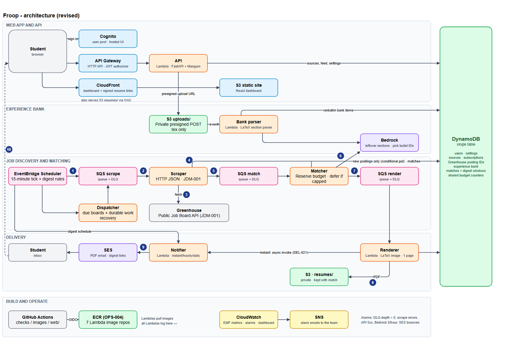

# RFC 0001: Froop (Revised)

| Field | Value |
|---|---|
| Status | Revised. It reflects Accepted decisions only. |
| Based on | `architecture/inputs/Froop_inital_architecture.pdf` (RFC 0001, last updated 2026-11-03) |
| Repository | https://github.com/lukeacampbell/Froop |
| Last updated | 2026-11-23 |

This is the current version of the Froop architecture proposal. It starts from the submitted RFC and applies every **Accepted** decision from `planning/architecture/<area>/architecture.md`. Text marked *(pending XX-Q00)* is still as originally submitted, because the open question that would change it isn't answered yet.

## Change Log

| Date | Decision | Sections changed |
|---|---|---|
| 2026-11-16 | EB-001: Accept only a single LaTeX resume or CV | Summary, Goals, Architecture diagram, Data Model, API, Demo Plan |
| 2026-11-16 | EB-002: A new upload replaces the whole bank | Summary, Data Model |
| 2026-11-16 | EB-003: Parse by section without an LLM; Bedrock only for leftover sections | AWS Services (Bedrock), Architecture diagram |
| 2026-11-16 | EB-004: Parser Bedrock calls count toward the hourly cost cap | Data Model |
| 2026-11-16 | EB-012: Store each item's LaTeX source and its plain text | Data Model |
| 2026-11-16 | EB-013: Over the cost cap, accept the upload and mark leftovers unclassified | Data Model |
| 2026-11-17 | EB-014: Extract the resume header block verbatim | Data Model |
| 2026-11-17 | EB-015: Support one template (Jake's Resume), listed in the shared package | Summary |
| 2026-11-17 | DEL-004: Instant emails attach the PDF, and digests use signed links | Summary, Architecture diagram, Risks |
| 2026-11-17 | DEL-005: Fit to one page by estimating, then rendering and pruning | Summary |
| 2026-11-17 | DEL-006: The resume header comes from the experience bank | Data Model |
| 2026-11-17 | DEL-007: Resumes are kept for as long as the match exists | Data Model, Architecture diagram |
| 2026-11-17 | DEL-008: The student chooses whether a new upload regenerates resumes for existing matches | Summary |
| 2026-11-17 | DEL-012: Education and Experience are required, and Projects and Technical Skills are optional (superseded by DEL-015) | Summary |
| 2026-11-17 | DEL-015: Section tiers: required, likely, possible, and excluded | Summary |
| 2026-11-17 | DEL-016: Certifications and Publications are possible, and every other section is excluded | Summary |
| 2026-11-17 | DEL-014: Which matches regenerate after a new upload | Summary |
| 2026-11-18 | DEL-009: Version resume PDFs by generation | Data Model |
| 2026-11-18 | JDM-001: Greenhouse-only discovery | Architecture diagram, AWS Services, API source constraint, Risks, Alternatives; shared Summary/Goals/Demo marked pending SYS-Q04 |
| 2026-11-18 | WEB-001: The revised endpoint list | API |
| 2026-11-18 | WEB-002: Sign in with the authorization code flow and PKCE, and send the access token | Security |
| 2026-11-18 | WEB-003: Create Profile and Settings on the first `GET /me` | Data Model, API |
| 2026-11-18 | WEB-004: Self sign-up is a setting for each environment, off by default | Security |
| 2026-11-18 | WEB-005: API security rules | Security |
| 2026-11-18 | WEB-006: The matches feed is paginated | API |
| 2026-11-18 | WEB-007: Dashboard resume links are signed on request and expire after 15 minutes | API, Security |
| 2026-11-18 | WEB-008: Settings are validated, and `PUT /me` replaces them whole | API |
| 2026-11-18 | WEB-010: Cross-origin access through API Gateway CORS, and hash-based routes | Security |
| 2026-11-18 | JDM-006/007/008; JDM-I03/I04 | Data Model: provider key, budget deferral, digest timing, bank access and render handoff |
| 2026-11-18 | JDM-009; SYS-Q01/02/04 | Source/filter behavior; confirmed shared ownership; Greenhouse Summary, Goals and Demo |
| 2026-11-19 | EB-008: Replace the bank by switching a "current version" pointer | Data Model |
| 2026-11-19 | EB-009 and DEL-002: Uploaded LaTeX is never run as code | Security |
| 2026-11-19 | EB-016: Label each section by category | Data Model |
| 2026-11-19 | EB-018: Uploads use a presigned POST | Data Model (S3), API |
| 2026-11-19 | WEB-013: The API's side of regeneration | API |
| 2026-11-19 | EB-019: The package creates the upload record, and an unused link expires | Data Model, API |
| 2026-11-19 | DB-I05: Profile and Settings items (accepted by every owner) | Data Model |
| 2026-11-21 | SYS-Q05 and WEB-012: no self-service account deletion | Non-Goals |
| 2026-11-21 | OPS-001 to OPS-012 accepted by every owner | AWS Services (ECR), Infrastructure as Code, CI/CD |
| 2026-11-21 | DB-001, DB-I01, DB-I03, and DB-I04 (base) accepted by every owner | Data Model |
| 2026-11-23 | OPS-I01 to OPS-I04 accepted by every owner | Infrastructure as Code, Security, Observability (no text change) |
| 2026-11-23 | EB-I01 and the EB-019 extension to EB-I03 accepted by every owner | Data Model (no text change) |
| 2026-11-23 | JDM-011 (WEB-Q08) and the EB-019 amendment: the work record alone triggers regeneration after an upload | Data Model, API |
| 2026-11-23 | DB-Q10 and DB-I02: the upload-link deadline is separate from TTL; experience items accepted by every owner | Data Model |
| 2026-11-23 | EB-020: no automatic retry of unclassified sections | Data Model |
| 2026-11-23 | DEL-021: the Renderer invokes the Notifier for instant emails; DEL-022: no sweep for stuck instant emails | Architecture diagram, Security |
| 2026-11-23 | WEB-012 and WEB-I01 accepted | Non-Goals, API (no text change) |

## Team

| Name | Pitt username | GitHub | Owns |
|---|---|---|---|
| Luke Campbell | lac405 | lukeacampbell | Scheduler & Scraper |
| Ryan Fusco | raf172 | rfusco | Resume |
| Graham Cohick | gmc134 | gmcohick424 | App & platform |

Shared platform/database ownership is confirmed (SYS-Q01/02): Ryan coordinates; Ryan, Graham and Luke share decision authority. The detailed area owners are listed in `planning/architecture/AGENTS.md`.

> **Current discovery scope:** Greenhouse only. All owners agree to the shared scope/demo wording (SYS-Q04). JDM-006/007/008/009 and JDM-I03/I04 record accepted cost, delivery, identity and filter behavior. Regeneration intake JDM-I05 and its JDM-011 clarification are Accepted. Other proposals, including the DB-I04 regeneration amendment, remain pending.

## Summary

Froop finds new internship and job postings and builds a tailored one-page resume for each match from the student's own words.
- **Upload:** students upload their complete resume or CV as a single LaTeX (`.tex`) file. The Jake's Resume template is fully supported. Froop splits the file by section into an experience bank of verbatim bullets, roles, and skills, plus the resume's header. A new upload replaces the bank. The student chooses whether to regenerate resumes for existing matches whose postings are still active and that they haven't applied to. Any single match can also be regenerated from the dashboard.
- **Discovery:** on a schedule, Froop checks a curated catalog of Greenhouse boards and public Greenhouse boards a student adds privately. Listings come from the Job Board API.
- **Tailoring:** for each match, an AI model ranks the student's bullets and skills without editing a word. Froop fits the highest-ranked ones onto a one-page LaTeX resume. Every resume has the student's header, Education, and Experience. It adds Projects and Technical Skills whenever they fit, and Awards, Certifications, or Publications if there's still room. Leadership and any other section are never included.
- **Results:**
  - Students get the PDF attached to an instant email, or as links in an hourly or daily digest.
  - They browse all matches, and the resumes made for them, in a dashboard for as long as they like.

## Motivation

Internship postings are spread across hundreds of job boards, and tailoring a resume for each application is slow. AI resume tools speed this up by rewriting bullets, which can invent or inflate claims. Froop is for students applying broadly. It finds postings automatically and builds each resume only from text the student wrote.

## Goals and Non-Goals

### Goals

- **Goal 1:** Repeatedly discover the same Greenhouse post, including through catalog and private references to the same board, without duplicate postings or user matches.
- **Goal 2:** Discover postings from the Greenhouse catalog and a user-added Greenhouse board.
- **Goal 3:** Upload a LaTeX resume and see it split into bullets that match the original text exactly.
- **Goal 4:** Get a one-page PDF resume for each job match.

### Non-Goals

- No self-service account deletion in this version; the team handles data deletion manually on request (SYS-Q05; all three owners agree).

No mobile app, No AI-written resume text, No sharing user-added sources between users

## Architecture

Source: `architecture.drawio`. Revised labels:
- S3 `uploads/` (`.tex` only)
- Bank parser (LaTeX section parser)
- Bedrock (leftover sections · pick bullet IDs)
- S3 `resumes/` (kept with match)
- SES (PDF email · digest links)

## AWS Services

| # | Service | Role in our system | Why this and not an alternative |
|---|---|---|---|
| 1 | Lambda | Compute | Tasks come in bursts; the server would be idle most of the time |
| 2 | API Gateway | Rest API | Simplicity and development ease |
| 3 | Cognito | Authz + Authn | Also easy and integrates w/ ^ We will not need to store passwords ourselves |
| 4 | DynamoDB | Database to store our info | Access patterns are well defined and key based; serverless; and works with un/semistructured data |
| 5 | S3 | Object storage (user uploads) | Cheap; time/event based actions |
| 6 | CloudFront | CDN for website + resumes | Time based credentials |
| 7 | EventBridge Scheduler | Starts scrapes and digest emails on a schedule | No server running all day just to wake up a few times |
| 8 | SQS | Queues work between the scraper, matcher, and renderer | Handles bursts and retries failures without losing work |
| 9 | Bedrock | All LLM tasks (requirement extraction, classifying resume sections the parser can't place, resume item selection) *(pending JDM-005: one ranking call per posting, with no separate requirement extraction)* | Managed LLM with IAM; don't need to worry about GPU/server and can call whenever work is done |
| 10 | SES | Sends match emails and digests | Uses IAM instead of a third party email API key |
| 11 | ECR | Stores the container images built by CI | LaTeX needs a container image; the Greenhouse HTTP scraper no longer needs Chromium (JDM-001) |
| 12 | CloudWatch | Custom metrics, alarms, and a dashboard | Lambda already sends log and metrics here |
| 13 | SNS | Send alarm emails to the team | Built in way for CloudWatch alarms to notify people |
| 14 | Secrets Manager | Stores the CloudFront signing key | Keeps the key out of git; only the api and notifier Lambdas can read it |

## Data Model

All app data, from user profiles to job matches, lives in DynamoDB. S3 holds uploaded files and generated resume PDFs.

### DynamoDB

**Access patterns:**
- Get or update a user's profile and settings
- Save, list, or delete a user's experience bank. Saving replaces the whole bank.
- Add a posting only if it's new
- Find users subscribed to a source, then filter by their settings
- Create a match once per user and posting; list a user's matches, newest first
- Manage a user's private sources and subscriptions
- List catalog sources; find matches waiting for a digest; cap Bedrock spend per hour (the cap covers both resume parsing and matching)

**Table design (single table):**
- **Partition key:** `USER#{cognito sub}`, `SOURCE#{id}`, `POSTING#{postingKey}`, or `COST#{hour}`
- **Sort key:** `PROFILE`, `SETTINGS`, `DOC#...` (uploads, roles, bullets, skills), `SUB#{sourceId}`, `MATCH#{postingKey}`, or `META`
- **Profile and settings:** created the first time a signed-in student opens the dashboard (`GET /me`), with the email address from Cognito and default settings: daily delivery, a title filter of `intern`, and no other filters. Each filter list holds at most 20 terms of 1 to 60 characters (DB-I05).
- **Experience items:** each role, bullet, and skill stores both its exact LaTeX `source` and its plain `text`. Both come from the uploaded file without any rewording. Plain text is used for matching and the dashboard, and the source is used to build new resumes.
- **Header block:** each upload also stores its header block (name and contact details) verbatim, and every generated resume starts with it.
- **Matches:** matches never expire, so students can look back at them later. Postings still expire.
- **Upload status:** an upload records its status: `awaiting_file` (link issued), `pending` (file arrived), `parsed`, `parsed_with_unclassified` (when the Bedrock cost cap was reached), or `failed`. A link that's never used reports `expired`, and a student who never uploaded reports `none` (EB-019). Sections left unclassified at the cost cap aren't retried automatically; uploading again tries again (EB-020).
- **Replacing the bank:** a new upload's items are written under its own `docId` and become current in one pointer switch, so no reader ever sees a half-replaced bank (EB-008). Every section is labeled with a category, and skills keep their own categories (EB-016).
- **postingKey (JDM-008):** `gh.{boardToken}.{jobPostId}`. The same Greenhouse post reached through catalog/private sources has one identity; distinct provider post IDs stay distinct. Conditional puts block duplicate postings and matches.
- **Postings:** public provider records store title, company, location, description and apply link; source/subscription records hold membership separately. Postings expire 30 days after last seen; readers check expiry without waiting for TTL deletion (DB-I04).
- **Capacity and durable work:** on-demand table and GSIs (DB-001). DB-I04 defines durable WORK records, dispatcher checkpoints and cost reservations. Pending work has no TTL; recovery scans are paginated. Upload-link deadlines are stored apart from TTL, so a current bank never expires (DB-Q10, DB-I02). The DB-I04 regeneration amendment remains pending.
- **Indexes:**
  - GSI1: catalog sources, private sources, source subscribers and board postings (DB-I01/I04).
  - GSI2: matches waiting for the next hourly UTC or daily 13:00 UTC digest window (DB-I03; DEL-020).
  - GSI3: matches by created date; stable match primary keys remain unchanged. No LSI (DB-I01/I04).

### Accepted JDM handoffs (2026-11-18)

- JDM-009 defines dot-separated source IDs (base64url owner key for private sources) and normalized literal substring filters. The intern default matches Internship, with Internal documented as a possible false positive. DB-I05 is Accepted by all three owners.

- JDM-I03 carries ranked bank IDs plus request ID and generation; regeneration sends no email. JDM-007 agrees next-hour UTC / daily 13:00 UTC digest marks at match creation, targeting strictly future windows. DB-I03 delivery state is Accepted.
- JDM-006/I04 reserve a conservative upper bound against user-hour, platform-hour and platform-day caps before a Bedrock attempt. Exhausted caps persist deferred work until the relevant reset; uncertain attempts remain charged conservatively. DB-I04 base and OPS-I05 are Accepted; implementation awaits Phase 2.
- JDM-008 uses EB-I03 as the sole Matcher bank interface; no term resolver/dictionary dependency in v1. Posting snapshots survive posting expiry; PDF history comes from S3, not a second growing database list.

### S3

- `uploads/{sub}/{docId}.tex` stores the uploaded LaTeX resume. It's uploaded with a presigned POST whose policy fixes the key, the content type, a size of up to 1 MB, and a 15-minute expiry (EB-018), and each upload triggers the parser. Only `.tex` files are accepted.
- `resume/{sub}/{postingKey}/g{generation}.pdf` stores the generated resumes, one file per render request. A regeneration never overwrites an earlier resume, and a match's history is its folder. They're served through expiring CloudFront signed URLs, and kept for as long as the match exists.
- `sub` keeps users' data separate, and everything is private.

## API

Discovery sources are limited to Greenhouse boards (JDM-001). Arbitrary careers pages are no longer supported. Source validation and ownership follow Accepted JDM-I01: validated board tokens/recognized Greenhouse URLs, authenticated user ownership and durable refresh intake.

| Method | Path | Auth Required? | Description |
|---|---|---|---|
| GET | /health | no | Health check |
| GET | /me | yes | Get profile and settings. The first call creates them, with default settings. |
| PUT | /me | yes | Replace settings (delivery mode, filters). Invalid settings are rejected. |
| POST | /uploads | yes | Get a link to upload one LaTeX (`.tex`) file, and record the "regenerate?" choice on the upload record for display (EB-019). When the student opts in, a regeneration work record is saved before the link is returned, and that record alone triggers regeneration once the upload parses (WEB-013, JDM-011). |
| GET | /experience | yes | List the experience bank, with the upload's status (EB-019) |
| DELETE | /experience | yes | Delete the experience bank and the uploaded file |
| GET | /sources | yes | List catalog sources and the user's private sources |
| POST | /sources | yes | Add a private Greenhouse board, by board token or board URL |
| DELETE | /sources/{sourceId} | yes | Delete a private source |
| POST | /sources/{sourceId}/refresh | yes | Check a source now |
| POST | /subscriptions/{sourceId} | yes | Subscribe to a source |
| DELETE | /subscriptions/{sourceId} | yes | Unsubscribe from a source |
| GET | /matches | yes | List matches, newest first, a page at a time |
| GET | /matches/{postingKey} | yes | Get one match with its delivery state, a signed link to its current resume, and its earlier resumes |
| PUT | /matches/{postingKey}/applied | yes | Mark a match as applied |
| DELETE | /matches/{postingKey}/applied | yes | Unmark it |
| POST | /matches/{postingKey}/regenerate | yes | Regenerate the resume for one match. Needs an `Idempotency-Key` header, so a retry doesn't rank twice (WEB-013). |

Errors:
- **401:** missing or invalid token, rejected by API Gateway
- **400:** invalid input, such as a bad board token, invalid settings, or a file that isn't `.tex`
- **404:** not found, or belongs to another user
- **409:** source already added or already subscribed
- **429:** refresh requested too often

## Infrastructure as Code

Accepted OPS choices (2026-11-21): services/, libs/, infra/ and web/ share one repository. Pin Terraform 1.10 or later with native S3 state locking (OPS-001). Use us-east-1 and configurable models per parser/ranking task; select the cheapest model that passes the agreed samples (OPS-006). Keep scraper and renderer images separate; scraper has no browser (OPS-003/011). Configure $1/user-hour, $5/platform-hour and $1.50/platform-day Bedrock caps, plus a $50 monthly AWS budget alert (OPS-002/009/010). Alerts do not stop AWS spending.

**Modules.** Terraform has five modules that match how we split the work:
- `data`: the DynamoDB table and S3 buckets
- `ingestion`
- `resumes`
- `app`
- `ops`: the dashboard and alarm topic

Each module creates its own Lambdas, queues, roles, and alarms.

**Environments and state.** `envs/dev` and `envs/prod` use the same modules with different settings. A small bootstrap setup, run once by hand, creates the state bucket, the GitHub OIDC provider, the CI roles, and the ECR repositories. State is stored in a versioned, encrypted S3 bucket. Each environment has its own state file, and a lock file stops two people from applying at the same time.

**Not in Terraform.** Stay in the SES sandbox with verified demo recipients (OPS-008); production access is deferred. The job catalog is data, so a seed script loads it from a JSON file in the repo.

**Setup.** To set up a new environment, run bootstrap, run `deploy.yml`, then run the seed script. After that, a teammate only needs to clone the repo and push to main.

## CI/CD

`deploy.yml` runs on every push to main:
- PRs and deploys run lint, unit tests, Terraform format/validate and a plan (OPS-005).
- It builds one image per Lambda (API, parser, dispatcher, scraper, Matcher, Renderer, Notifier), using shared bases, and pushes commit-tagged images to seven ECR repositories with last-10 retention (OPS-004).
- It builds web/ and publishes the dashboard assets after the dev Terraform deployment; production publication is manual (OPS-012).
- It runs `terraform apply` for dev. Prod deploys only when we run it by hand.
- It authenticates to AWS with GitHub's OIDC token, so no AWS keys are stored in GitHub.

## Security

- **Authentication:** users sign in with Cognito, through its hosted sign-in page (authorization code flow with PKCE). The dashboard sends the access token with each request, and API Gateway checks it before the API runs. The API can only be reached through API Gateway.
- **Sign-up:** whether students can sign themselves up is a setting for each environment. It is off by default, with accounts created by the team, and turned on for the demo.
- **Keeping users' data apart:** the API gets the user ID from the token, not from the request. All user data in DynamoDB and S3 is stored under that ID, so users can only see their own data. Ownership is checked on the stored record, and another user's record is reported as not found.
- **Links:** upload links only allow one file in the user's own folder, and resume links expire. Links signed for the dashboard expire after 15 minutes, and only for resumes that have finished rendering.
- **Cross-origin access:** the API accepts browser requests only from the dashboard's own address.
- **Logs:** the API never logs tokens, email addresses, or resume text.
- **Uploaded LaTeX is never run as code:** the parser only reads it as text and rejects dangerous commands (EB-009). The Renderer compiles only the macros its own template defines, with shell escape off (DEL-002).
- **IAM:** each Lambda has its own role, with only the access it needs. The Renderer may invoke only the Notifier, to send instant emails (DEL-021).
- **Secrets:** the only secret is the CloudFront signing key. It's kept in Secrets Manager, and only the api and notifier can read it. Job boards need no keys, and CI uses OIDC instead of AWS keys.

## Observability

- **Logs:** every Lambda logs JSON to CloudWatch with the source and posting IDs, so we can trace one posting from scrape to email.
- **Custom metrics** count postings found, matches, PDFs rendered, emails sent, and Bedrock spend per hour.
- **Dashboard:** a CloudWatch dashboard shows those metrics next to queue depth and Lambda errors.
- **Alarms:** we also have spend limits, and alarms email the team.

## Demo Plan

Recorded video.

1. Sign up and upload a LaTeX resume. The parsed bullets match the original text word for word.
2. Add a Greenhouse board privately and trigger a refresh. Show postings from that board and the catalog.
3. Refresh again, including catalog/private references to the same board. Show one posting and one match per provider job ID, with no duplicate email.
4. Open the match email and its attached PDF. Every line matches a bullet in the bank, and the resume fits on one page.
5. Configure an invalid Greenhouse board token in the demo, show the source failure alarm, and show other boards continuing to update.

## Risks and Open Questions

- **Greenhouse availability (JDM-001):** public API failures or changed response shapes can interrupt discovery; browser scraping has been removed.
- **Bedrock:** none of us have used it yet.
- **Delivering the resume:** resolved by DEL-004. Instant emails attach the PDF. Digests carry signed links, so they stay small and are less likely to be marked as spam. Once a link expires, the dashboard signs a fresh one.

Open questions from planning are tracked in each area's `architecture.md` and in "System Open Questions" in `planning/architecture/AGENTS.md`.

## Alternatives Considered

- **Fargate:** we considered it but chose Lambda, because the work is idle most of the day, and the Greenhouse adapter needs only HTTP (JDM-001).
- **Multiple providers and LLM webpage extraction (JDM-001):** removed for this version. Greenhouse Job Board JSON supplies listings; no browser or extraction LLM is needed.
- **Accepting PDF, DOCX, and TXT resumes (EB-001):** we chose LaTeX only. A deterministic section parser can keep the text verbatim with little or no LLM use, while other formats need OCR or LLM splitting.

## AI Usage

Claude was used to brainstorm ideas, help us better understand the chosen services, and draw a diagram of the architecture flow.
