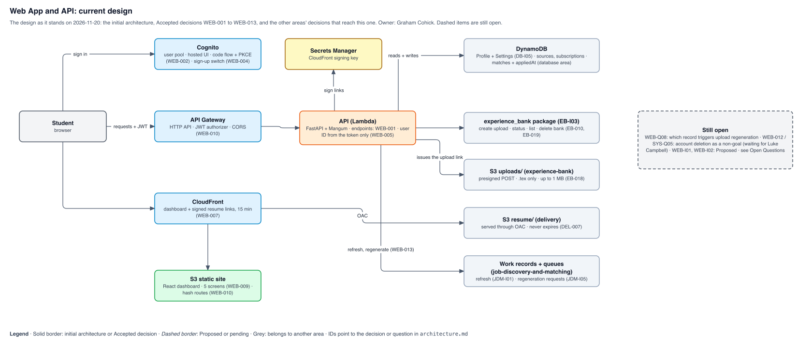

# Web App and API Architecture

Source: RFC 0001 (`architecture/inputs/Froop_inital_architecture.pdf`). See "Where Each Area's Material Is" in `planning/architecture/AGENTS.md` for this area's lane and pages. Items are `Proposed` until the owner accepts them. Accepted decisions override the Initial Architecture.

## Scope

Confirmed by Graham Cohick (2026-11-18). It follows the Areas list in `planning/AGENTS.md` and the "Does not own" lists of the other five areas. The split with `build-and-operation` assumes SYS-Q01 (Graham Cohick and Ryan Fusco agree; waiting for Luke Campbell).

**Owns:**
- **Sign-in.** The Cognito user pool, its app client, and the hosted UI: who can sign up, how a student signs in, and which token the dashboard sends to the API. Every other area identifies a student by the Cognito `sub` this area issues.
- **The public REST API.** The API Gateway routes and JWT authorizer, and the API Lambda (FastAPI and Mangum). That covers the list of endpoints, request validation, the error format, and the rule that the user is always taken from the token and never from the request (RFC p.7).
- **Profile and settings.** What a student's profile and settings mean, when they are created, and writing them (`GET /me`, `PUT /me`). Their attributes are proposed by this area in `database` (DB-Q01).
- **The API's side of other areas' features.** The API is the only public way in, so it carries these actions and writes these items, following rules that the other areas define:
  - Issuing upload links, and listing and deleting the bank (EB-I01, EB-I03).
  - Writing Subscription items and the configuration of private Source items, and requesting a refresh (DB-Q03, JDM-I01).
  - Recording the student's "regenerate?" choice on upload, and the per-match regenerate request (DEL-008, DEL-014, DEL-Q12).
  - Setting and clearing `appliedAt` on a match (DB-Q06).
  - Listing matches, showing one match, and signing links to its resume PDFs for the dashboard (DEL-I01).
- **The React dashboard.** Its screens, its build output, and how it calls the API.
- **CloudFront behavior.** How the distribution routes requests: the dashboard's static files, and the `resume/` path that needs a signed URL.
- **The Terraform `app` module's contents** (SYS-Q03, OPS-011): the resources above, written to `build-and-operation`'s conventions.

**Does not own:**
- The upload rules (file type, size limit, key layout), parsing, and what the bank contains: `experience-bank` (EB-I01, EB-I03). The API never reads experience items from the table directly (EB-010).
- Which sources are valid, how a board token is checked, the refresh cooldown, discovery, matching, and ranking: `job-discovery-and-matching` (JDM-I01). The API calls that area's shared validation and does not redefine it.
- Rendering resumes, the `resume/` key layout, emails, and the signed links inside digest emails: `delivery` (DEL-I01, DEL-004).
- The table's keys, indexes, and item-type registry: `database`. This area proposes Profile and Settings there.
- Terraform conventions, CI/CD, the buckets and table themselves, the signing-key secret, IAM conventions, alarms, and platform settings such as API Gateway throttling values: `build-and-operation`, decided by all owners (SYS-Q01). This area states what it needs in the Requirements Intake (OPS-Q07).

## Current Design Diagram

Source: `architecture.drawio`. The diagram shows the design **as it stands now**:
- **Solid borders:** the initial architecture or Accepted decisions.
- **Dashed borders:** Proposed or pending items.
- **Grey boxes:** parts that belong to other areas.

Keep it in step with this file (see "Keeping Area Diagrams Current" in `planning/architecture/AGENTS.md`).

## Initial Architecture

> **Frozen baseline.** This is RFC 0001 *as originally submitted* (`architecture/inputs/Froop_inital_architecture.pdf`), transcribed without changes. It is never updated when decisions change the design. The current design is in **Decisions** below, and the whole current system is in `architecture/revised-rfc/`.

- **Summary (p.1):** "Students get the PDF by email, instantly or in a digest, and browse all matches in a dashboard"
- **Non-Goals (p.2):** "No mobile app"
- **AWS Services (p.3–4):**
  - Lambda: "Compute". Why: "Tasks come in bursts; the server would be idle most of the time"
  - API Gateway: "Rest API". Why: "Simplicity and development ease"
  - Cognito: "Authz + Authn". Why: "Also easy and integrates w/ ^ We will not need to store passwords ourselves"
  - CloudFront: "CDN for website + resumes". Why: "Time based credentials"
  - Secrets Manager: "Stores the CloudFront signing key". Why: "Keeps the key out of git; only the api and notifier Lambdas can read it"
- **Data Model, access patterns (p.4–5):** "Get or update a user's profile and settings"; "Manage a user's private sources and subscriptions"
- **Data Model, table design (p.5):** "Sort key: PROFILE, SETTINGS, ..."
- **API (p.5–6):**

  | Method | Path | Auth Required? | Description |
  |---|---|---|---|
  | GET | /health | no | Health check |
  | GET | /me | yes | Get profile and settings |
  | PUT | /me | yes | Update settings (delivery mode, filters) |
  | POST | /uploads | yes | Get a presigned URL to upload one file |
  | DELETE | /uploads/{docId} | yes | Delete an upload and its bullets |
  | GET | /experience | yes | List the experience bank |
  | GET | /sources | yes | List catalog sources and the user's private sources |
  | POST | /sources | yes | Add a private page |
  | Delete | /sources/{sourceId} | yes | Delete a private page |
  | POST | /sources/{sourceId}/refresh | yes | Scrape a source now |
  | POST | /subscriptions/{sourceId} | yes | Subscribe to a source |
  | DELETE | /subscriptions/{sourceId} | yes | Unsubscribe from a source |
  | GET | /matches | yes | List matches, newest first |
  | GET | /matches/{postingKey} | yes | Get one match with a signed resume link |

  Errors: "401 - missing or invalid token, rejected by API gateway"; "400 - invalid input, such as a bad URL or file type"; "404 - not found, or belongs to another user"; "409 - sources already added or already subscribed"; "429 - refresh requested too often"
- **Security (p.7):** "Users sign in with Cognito. API Gateway checks each request's token before the API runs." "The API gets the user ID from the token, not from the request. All user data in DynamoDB and S3 is stored under that ID, so users can only see their own data. Upload links only allow one file in the user's own folder, and resume links expire. Each Lambda has its own role with only the access it needs." "The only secret is the CloudFront signing key. It is kept in Secrets Manager, and only the api and notifier can read it."
- **Demo steps 1–2 (p.8):** "Sign up and upload a scanned PDF resume." "Add a private careers page that needs JavaScript, then trigger a refresh. New postings from that page and from the catalog show up in the feed."
- **Diagram, Web App and API lane (p.3):**
  - "Student (browser)" → "sign in" → "Cognito (user pool · hosted UI)"
  - Student → "API Gateway (HTTP API · JWT authorizer)" → "API (Lambda · FastAPI + Mangum)" → "sources, feed, settings" → DynamoDB
  - Student → "CloudFront (dashboard + signed resume links)" → "S3 static site (React dashboard)"; "also serves S3 resumes/ via OAC"
  - API → "presigned upload URL" → "S3 · uploads/"
  - A dashed arrow from "Student (inbox)" back to "Student (browser)" (step 10)

## Architecture Review

Reviewed 2026-11-18 for Graham Cohick, against the Initial Architecture above and the decisions other areas have made since. A recommendation here is not a decision. It becomes one only when it is recorded in Decisions and the owner accepts it.

### The API contract

1. **The endpoint list no longer matches what the other areas decided.**
   - **Finding:** the RFC's API table (p.5–6) describes several uploads of any file type, arbitrary careers pages, and matches that can only be read. Since then: an upload is one `.tex` file that replaces the bank (EB-001, EB-002); sources are Greenhouse boards only (JDM-001); and a student can choose to regenerate on upload, mark a match as applied, and regenerate one match (DEL-008, DEL-014).
   - **Impact:** `DELETE /uploads/{docId}` deletes something that no longer exists on its own, `POST /sources` accepts input the scraper will never fetch, and three actions that `delivery` depends on have no endpoint (DEL-Q12).
   - **Recommendation:** record the revised list as a decision (now WEB-001), and write the full contract as this area's first interface (WEB-I01). Keep every RFC endpoint except as follows:

     | Change | Endpoint | Why |
     |---|---|---|
     | Changed | `POST /uploads` takes a `regenerate` choice (default: no) and returns an upload link for one `.tex` file | EB-001, DEL-008 |
     | Replaced | `DELETE /uploads/{docId}` becomes `DELETE /experience` | EB-002, EB-Q10 |
     | Changed | `GET /experience` also returns the upload's status and failure reason | Review item 3 |
     | Changed | `POST /sources` takes a Greenhouse board token or board URL | JDM-001, JDM-I01 |
     | Added | `PUT` and `DELETE /matches/{postingKey}/applied` | DEL-014, DB-Q06 |
     | Added | `POST /matches/{postingKey}/regenerate` | DEL-014, DEL-Q12 |
     | Changed | `GET /matches` is paginated | Review item 9 |
     | Changed | `GET /matches/{postingKey}` returns the delivery state and the earlier resumes as well as the current link | DB-I03, DEL-009 |

2. **The "regenerate?" choice is made before the bank it applies to exists.**
   - **Finding:** the student makes the choice at `POST /uploads`. The file then goes straight from the browser to S3, the parser runs later, and the API is not involved again. Regeneration must wait until the new bank has replaced the old one (JDM-Q01), and must not happen at all if parsing fails (EB-002).
   - **Impact:** if the API starts regeneration when it receives the choice, the Matcher re-ranks against the old bank. If the choice is only held in the browser, it is lost when the tab closes.
   - **Recommendation:** the API stores the choice durably at `POST /uploads`, tied to the new `docId`. Regeneration starts only once that `docId` is the student's current bank. Which area starts it, and where the choice is stored, has to be agreed with Luke Campbell and Ryan Fusco (WEB-Q03). The per-match regenerate request needs the same care: it carries a request ID so a double click doesn't rank twice, and it is refused while an earlier request for that match is still running.

3. **The dashboard can't tell the student what happened to an upload.**
   - **Finding:** parsing happens after the upload and can fail, or finish with unclassified sections (EB-013). The RFC has no endpoint that reports this. It is also not stated which area writes the "pending" upload record, so an upload link that is issued but never used may or may not leave a record behind.
   - **Impact:** a student whose file was rejected sees an unchanged bank and no explanation. Demo step 1 depends on seeing the parsed result appear.
   - **Recommendation:** return `upload_status` from the bank package (EB-I03) in `GET /experience`, and have the dashboard poll it after an upload until it leaves "pending". Ask Ryan Fusco which area creates the upload record and what an abandoned link leaves behind (WEB-Q02).

4. **A presigned PUT can't enforce the upload size limit.**
   - **Finding:** the RFC (p.6) and EB-I01 say the upload is a presigned PUT with a maximum size. S3 only enforces a size range on a presigned POST, through its policy conditions. A presigned PUT accepts whatever the browser sends, up to 5 GB.
   - **Impact:** the size limit in EB-I01 would only be checked later, by the parser, after the object is already stored and has already triggered a parser run.
   - **Recommendation:** issue a presigned POST whose policy fixes the exact key, the content type, and the size range, and that expires within a few minutes. This changes "presigned PUT" in EB-I01, so it needs Ryan Fusco's agreement (WEB-Q01). The parser keeps its own size check (EB-009).

### Sign-in and identity

5. **The sign-in flow and the token the API accepts aren't specified.**
   - **Finding:** the RFC names "Cognito (user pool · hosted UI)" and a JWT authorizer (p.3) and stops there. It doesn't say which OAuth flow the dashboard uses, whether it sends the ID token or the access token, or which callback URLs each environment allows.
   - **Impact:** these choices set what the API can read from the token. A Cognito access token carries `sub` but no email address, which matters for review item 6. An older flow that returns tokens in the URL would also put them in browser history.
   - **Recommendation:** use the authorization code flow with PKCE and an app client with no secret. The dashboard sends the access token, and the JWT authorizer checks its issuer and client ID. Callback URLs are a Terraform variable for each environment: the CloudFront domain, plus localhost in dev.

6. **Nothing says when a student's Profile and Settings items are created.**
   - **Finding:** the RFC lists `PROFILE` and `SETTINGS` sort keys (p.5) but no step creates them. The Notifier reads the email address from Profile, and the Matcher reads the filters and delivery mode from Settings (DB Item Types).
   - **Impact:** a student who has signed up but never saved settings has neither item. The Matcher has no delivery mode for them and the Notifier has no address.
   - **Recommendation:** create both items, with default settings, the first time a signed-in student calls `GET /me`, which the dashboard does on every load. Read the verified email address from Cognito at that moment. A Cognito post-confirmation trigger would also work, but it adds a Lambda for the same result. Propose the attributes in `database` (DB-Q01), including the four settings Luke Campbell asked for in JDM-Q01.

7. **Anyone who finds the site can sign up and spend the shared Bedrock budget.**
   - **Finding:** the hosted UI allows self sign-up by default. The whole platform shares a $1.50 daily Bedrock cap, and one student may use $1 of it in an hour (OPS-002, OPS-010).
   - **Impact:** a stranger, or a bot, could use up the day's budget and leave the team's own matches deferred until the next day, including on the day the demo is recorded.
   - **Recommendation:** make self sign-up a Terraform setting for each environment. Leave it off, with the team's accounts created by an administrator, and turn it on to record Demo step 1. Email verification stays required either way.

8. **The API trusts API Gateway completely for authentication.**
   - **Finding:** the JWT authorizer checks the token before the API runs (RFC p.7), so the API Lambda itself never verifies one. Separately, private source IDs contain a user's `sub` (`private:{sub}:gh:{boardToken}`, JDM-002), and both source IDs and posting keys contain colons and travel in URL paths.
   - **Impact:** the API has no protection if it is ever reachable another way, such as a function URL or a test harness left enabled. An ID that names another student's `sub` must not be enough to reach that student's source. Colons in paths are encoded inconsistently (DEL-Q15).
   - **Recommendation:**
     - The API takes `sub` only from the authorizer's claims and answers 401 when they are missing. The Lambda gets no function URL.
     - Ownership is checked on the stored record, never read out of the ID (JDM-I01 already requires this).
     - Support DEL-Q15's URL-safe separator for `postingKey`, and ask Luke Campbell for the same in source IDs (WEB-Q04).
     - The API never logs tokens, email addresses, or resume text.

### Matches and resume links

9. **The matches feed has no pagination, and matches never expire.**
   - **Finding:** the RFC says "List matches, newest first" (p.6). Matches are now kept for good (DEL-007), and the feed is read from GSI3, which holds only basic fields and can lag a new match by a moment (DB-Q02).
   - **Impact:** the response grows without limit for an active student. A match the student just acted on may be missing from, or stale in, the next feed read.
   - **Recommendation:** page the feed with a limit and an opaque cursor. After marking a match as applied or regenerating it, the dashboard shows the response of that request and doesn't re-read the feed to confirm it.

10. **Signing dashboard links needs more than the RFC gives the API.**
    - **Finding:** the API signs CloudFront URLs with the key in Secrets Manager (RFC p.4, p.7). Since then, a match can have several resumes, found by listing its S3 folder (DEL-009), and a resume may be missing because it is still rendering, was skipped, or failed (DEL-I01).
    - **Impact:** the API needs permission to list `resume/{sub}/{postingKey}/`, which isn't in its Requirements Intake row. A link signed for a file that doesn't exist gives the student a CloudFront error page.
    - **Recommendation:**
      - Build the path from the token's `sub` and the match's stored `pdfKey`. Never accept a key or path from the browser.
      - Sign a link only when `renderStatus` is `rendered`. Otherwise return the status and its reason.
      - Keep dashboard links short-lived, about 15 minutes, since the dashboard can always ask for a fresh one (DEL-004).
      - Read the signing key once per Lambda instance and keep it in memory.
    - **Alternative considered:** S3 presigned links for the dashboard, which need no signing key. Rejected: the Notifier's digest links last days, which S3 links signed by a Lambda role can't, so CloudFront signing is needed anyway and one method is simpler than two.

11. **Settings have no limits.**
    - **Finding:** `PUT /me` updates "delivery mode, filters" (RFC p.6) with no bounds. The Matcher applies the filters to every posting for every subscriber (JDM-005).
    - **Impact:** very long filter lists make the Settings item large and slow down each filtering pass. An unknown delivery mode would leave matches in no digest and no instant email.
    - **Recommendation:** validate in the API. Delivery mode is one of instant, hourly, or daily. Each filter list has a maximum number of terms and a maximum term length, agreed with Luke Campbell in JDM-Q01. `PUT /me` replaces the whole settings object.

### The dashboard and hosting

12. **The dashboard's screens aren't defined anywhere.**
    - **Finding:** the RFC says students "browse all matches in a dashboard" (p.1) and nothing more.
    - **Impact:** there is nothing to break into tasks or write acceptance criteria against, and the newer actions have no agreed place in the interface.
    - **Recommendation:** record a short screen list as a decision: Resume (upload with the regenerate choice, status, the parsed bank, delete), Sources (catalog, private boards, subscribe, refresh), Matches (the feed), one Match (posting details, resume link and earlier resumes, delivery state, applied, regenerate), and Settings.

13. **The dashboard and the API are on different domains, and the routing rules could expose the wrong page.**
    - **Finding:** the dashboard is served from CloudFront and the API from API Gateway (RFC p.3). The RFC doesn't mention cross-origin access. The same distribution also serves `resume/` behind signed URLs.
    - **Impact:** without cross-origin settings the browser blocks every API call. The usual fix for single-page-app routing is to have CloudFront return `index.html` for missing files, but that rule applies to the whole distribution, so an expired resume link would show the dashboard instead of an error.
    - **Recommendation:** allow the dashboard's origin in the HTTP API's CORS settings, as a Terraform variable for each environment. Use hash-based routes in the dashboard so CloudFront needs no rewrite rule at all.

14. **The dashboard has no place in the repository or in CI.**
    - **Finding:** OPS-005 and OPS-007 cover Lambda images only.
    - **Impact:** nothing builds the dashboard or publishes it.
    - **Recommendation:** propose an answer to OPS-Q11: a top-level folder for the dashboard, its lint and build in `ci.yml`, and a `deploy.yml` step that uploads the build to the static-site bucket and invalidates CloudFront.

### Failure, privacy, and operations

15. **The API runs as a container image, which starts slowly when idle.**
    - **Finding:** the API is a container-image Lambda (OPS-004) that sits idle most of the day (RFC p.3).
    - **Impact:** the first request after an idle period takes noticeably longer, which the student sees as a slow first page.
    - **Recommendation:** accept it. Keeping an instance warm costs money for a problem the demo doesn't have. Keep the image small, set the Lambda timeout below API Gateway's 30 seconds, and measure the cold start in Phase 5.

16. **A student can't delete their account or their matches.**
    - **Finding:** the RFC lets a student delete an upload, and `DELETE /experience` keeps that. Nothing deletes the profile, settings, subscriptions, private sources, matches, resume PDFs, or the Cognito user. Resumes hold a name, phone number, and email address.
    - **Impact:** personal data stays indefinitely with no way for the student to remove it.
    - **Recommendation:** decide this explicitly rather than leave it unsaid (WEB-Q05). The simplest honest option is to list account deletion as a non-goal for this version and have the team delete a student's data by hand on request. A `DELETE /me` endpoint would touch every area.

17. **This area's Requirements Intake row is missing most of what the API needs.**
    - **Finding:** the row in `build-and-operation` (OPS-Q07) is taken from the RFC: the user pool and hosted UI, the HTTP API and authorizer, the `api` image, CloudFront and the static site, and read access to the signing key.
    - **Impact:** the API's role would lack permissions it needs on day one, and OPS-I02 and OPS-I03 can't be accepted.
    - **Recommendation:** once the items above are decided, add these to the row (done on 2026-11-18, as Proposed, except the regeneration queue):
      - **Table:** read and write on the items this area writes, and queries on GSI1 (private sources) and GSI3 (the feed).
      - **Uploads bucket:** permission to write `uploads/`, which the upload link relies on, and whatever the bank package's delete needs (EB-I03).
      - **Resumes bucket:** permission to list `resume/`.
      - **Queues:** permission to send a refresh request, and a regeneration request if that is how WEB-Q03 is answered.
      - **CloudFront:** two behaviors (the static site, and `resume/` with signed URLs), and the public half of the signing key.
      - **API Gateway:** CORS origins and throttling values.
      - **Cognito:** the sign-up setting and callback URLs for each environment. Cognito's built-in email sender is enough for verification emails, so sign-up doesn't depend on SES.
      - **Alarms:** API Lambda errors and latency, alongside the existing API 5xx alarm.
      - **CI:** the dashboard build and publish step (OPS-Q11).

## Decisions

Graham Cohick accepted WEB-001 to WEB-011 on 2026-11-18, after going through the Architecture Review findings they come from. Where part of a decision depends on another owner's answer, the decision says which part and which question.

### WEB-001: The revised endpoint list
Status: Accepted (Graham Cohick, 2026-11-18)
Date: 2026-11-18
Context: Review item 1. The RFC's API table (p.5–6) no longer matches EB-001, EB-002, JDM-001, DEL-008, and DEL-014. Answers the API part of EB-Q10 and the endpoint part of DEL-Q12.
Decision: The public API is the list below. Every endpoint except `GET /health` requires sign-in.

| Method | Path | Description |
|---|---|---|
| GET | /health | Health check |
| GET | /me | Get profile and settings (creates them on first use, WEB-003) |
| PUT | /me | Replace settings (WEB-008) |
| POST | /uploads | Get a link to upload one `.tex` file, and record the student's "regenerate?" choice (default: no) |
| GET | /experience | Get the experience bank, with the upload's status and failure reason |
| DELETE | /experience | Delete the experience bank and the uploaded file |
| GET | /sources | List catalog sources and the student's own private sources |
| POST | /sources | Add a private Greenhouse board, by board token or board URL |
| DELETE | /sources/{sourceId} | Delete a private source |
| POST | /sources/{sourceId}/refresh | Ask for a source to be checked now |
| POST | /subscriptions/{sourceId} | Subscribe to a source |
| DELETE | /subscriptions/{sourceId} | Unsubscribe from a source |
| GET | /matches | List matches, newest first, a page at a time (WEB-006) |
| GET | /matches/{postingKey} | Get one match: posting details, delivery state, and resume links (WEB-007) |
| PUT | /matches/{postingKey}/applied | Mark a match as applied |
| DELETE | /matches/{postingKey}/applied | Unmark it |
| POST | /matches/{postingKey}/regenerate | Regenerate the resume for one match |

Errors are unchanged from the RFC: 400 invalid input, 401 missing or invalid token, 404 not found or belongs to another user, 409 already added or already subscribed, 429 refresh requested too often.

Still pending another owner, and not settled by this decision:
- The upload link's form, PUT or POST (WEB-Q01), and how upload status is reported before a file arrives (WEB-Q02).
- How the "regenerate?" choice and the per-match regenerate request reach the Matcher (WEB-Q03).
- The format of `sourceId` and `postingKey` in paths (WEB-Q04, DEL-Q15).
- Source validation and refresh rules, which are JDM-I01 and still Proposed.

Alternatives:
- Keep `DELETE /uploads/{docId}`. Rejected: with one upload per student there is no second upload to tell apart (EB-002).
- One `PATCH /matches/{postingKey}` for the applied flag. Rejected: separate `PUT` and `DELETE` are safe to repeat and need no request body.
Consequences:
- The revised RFC's API section changes.
- The full contract (request and response shapes) is WEB-I01.
- `delivery` and `job-discovery-and-matching` can cite these endpoints in DEL-Q12 and JDM-Q01.

### WEB-002: Sign in with the authorization code flow and PKCE, and send the access token
Status: Accepted (Graham Cohick, 2026-11-18)
Date: 2026-11-18
Context: Review item 5. The RFC names the Cognito hosted UI and a JWT authorizer (p.3) but not the flow or the token.
Decision:
- The dashboard signs students in through the Cognito hosted UI, using the authorization code flow with PKCE.
- The app client is public and has no secret.
- The dashboard sends the access token with every API request. The JWT authorizer checks its issuer and client ID.
- Callback and sign-out URLs are a Terraform variable for each environment: the CloudFront domain, plus localhost in dev.
Alternatives:
- Send the ID token, which carries the email address. Rejected: ID tokens describe the user to the app and aren't meant to authorize API calls.
- A custom sign-in form in the dashboard. Rejected: more code handling passwords for no demo benefit.
Consequences:
- The access token has no email address, so the API gets it from Cognito when it creates the profile (WEB-003).
- The app client needs the `openid` and `email` scopes.

### WEB-003: Create Profile and Settings on the first `GET /me`
Status: Accepted (Graham Cohick, 2026-11-18)
Date: 2026-11-18
Context: Review item 6. No step in the RFC creates the `PROFILE` and `SETTINGS` items, and the Notifier and the Matcher read them.
Decision:
- The first time a signed-in student calls `GET /me`, the API creates both items if they don't exist: the profile with the verified email address read from Cognito, and the settings with defaults.
- The dashboard calls `GET /me` every time it loads, so both items exist before a student can subscribe to anything.
- Creation is a conditional write, so two requests at once create them only once.
Alternatives:
- A Cognito post-confirmation trigger. Rejected: one more Lambda and image for the same result.
Consequences:
- The default settings, and the attributes of both items, are proposed in `database` as DB-I05.
- A later change of email address in Cognito isn't copied to the profile. That is out of scope for this version.

### WEB-004: Self sign-up is a setting for each environment, off by default
Status: Accepted (Graham Cohick, 2026-11-18)
Date: 2026-11-18
Context: Review item 7. The platform shares a $1.50 daily Bedrock cap (OPS-010), and the hosted UI lets anyone sign up.
Decision:
- Whether students can sign themselves up is a Terraform variable for each environment.
- It is off by default. The team's accounts are created by an administrator.
- It is turned on to record Demo step 1 ("Sign up"), and off again afterwards.
- Email verification is required either way.
Alternatives:
- Always open, relying on the spend caps. Rejected: one stranger can use two thirds of the day's budget in an hour (OPS-002).
- An allowlist checked by a pre-sign-up trigger. Rejected: one more Lambda.
Consequences:
- Changing the setting needs a Terraform apply.
- The variable goes in this area's Requirements Intake row (OPS-Q07).

### WEB-005: API security rules
Status: Accepted (Graham Cohick, 2026-11-18)
Date: 2026-11-18
Context: Review item 8. API Gateway checks the token (RFC p.7), so the API Lambda never verifies one itself.
Decision:
- The API takes the user's `sub` only from the claims API Gateway passes on, and answers 401 when they are missing.
- The API Lambda has no function URL and can only be reached through API Gateway.
- Ownership is checked on the stored record. A `sub` that appears inside an ID is never trusted.
- A record that belongs to another student is reported as 404, the same as one that doesn't exist.
- The API never logs tokens, email addresses, or resume text.
Alternatives:
- Verify the token again inside the Lambda. Rejected: it repeats the authorizer's work, and failing closed without claims gives the same protection.
Consequences:
- Local development needs a way to supply test claims. It must be impossible to turn on in a deployed environment.
- URL-safe source IDs are a separate request to Luke Campbell (WEB-Q04).

### WEB-006: The matches feed is paginated
Status: Accepted (Graham Cohick, 2026-11-18)
Date: 2026-11-18
Context: Review item 9. Matches never expire (DEL-007), and the feed is read from GSI3, which can lag (DB-Q02).
Decision:
- `GET /matches` returns one page, newest first, with an opaque cursor for the next page. The page size has a default and a maximum.
- After marking a match as applied or regenerating it, the dashboard shows the response of that request. It doesn't re-read the feed to confirm the change.
Alternatives:
- Return every match. Rejected: the response grows without limit.
Consequences:
- The cursor's contents are private to the API and may change.

### WEB-007: Dashboard resume links are signed on request and expire after 15 minutes
Status: Accepted (Graham Cohick, 2026-11-18)
Date: 2026-11-18
Context: Review item 10. A match can have several resumes (DEL-009), and a resume may be missing (DEL-I01).
Decision:
- `GET /matches/{postingKey}` returns a CloudFront signed link to the current resume only when the match's `renderStatus` is `rendered`. Otherwise it returns the status and its reason, and no link.
- It also lists the match's earlier resumes, from `resume/{sub}/{postingKey}/`, each with its own signed link.
- Every path is built from the token's `sub` and the match's stored `pdfKey`. The API never accepts a key or path from the browser.
- Dashboard links expire after 15 minutes. The dashboard asks again when it needs a fresh one.
- The API reads the signing key from Secrets Manager once per Lambda instance and keeps it in memory.
Alternatives:
- S3 presigned links for the dashboard. Rejected: the Notifier needs CloudFront signing anyway for digest links (DEL-004), and one method is simpler than two.
- Links that last as long as digest links. Rejected: the dashboard can always sign a new one, so a long life only adds exposure.
Consequences:
- The API needs permission to list `resume/` (OPS-Q07).
- The lifetime of digest links stays with `delivery` (DEL-004).
- This area still has to accept DEL-I01 as its consumer.

### WEB-008: Settings are validated, and `PUT /me` replaces them whole
Status: Accepted (Graham Cohick, 2026-11-18)
Date: 2026-11-18
Context: Review item 11. The Matcher applies each student's filters to every posting (JDM-005).
Decision:
- Delivery mode is one of `instant`, `hourly`, or `daily`.
- Each filter list has a maximum number of terms and a maximum length for each term.
- `PUT /me` replaces the whole settings object. Invalid input is rejected with 400 and changes nothing.
Alternatives:
- Validate the delivery mode only. Rejected: unbounded filter lists make the item large and slow every filtering pass.
Consequences:
- The limits are proposed in DB-I05 (20 terms of up to 60 characters in each list), for Luke Campbell to agree (JDM-Q01).

### WEB-009: The dashboard has five screens
Status: Accepted (Graham Cohick, 2026-11-18)
Date: 2026-11-18
Context: Review item 12. The RFC doesn't describe the dashboard beyond "browse all matches" (p.1).
Decision: The dashboard is these screens and nothing else:
- **Resume:** upload a `.tex` file with the "regenerate?" choice, see the upload's status, see the parsed bank, and delete the bank.
- **Sources:** the catalog, the student's private boards, subscribe and unsubscribe, add and delete a private board, and refresh.
- **Matches:** the feed, newest first.
- **Match:** posting details, the current resume link and earlier resumes, delivery state, mark as applied, and regenerate.
- **Settings:** delivery mode and filters.
Alternatives:
- Fewer screens, with Settings folded into another. Not chosen: each screen maps to one group of endpoints, which keeps tasks and tests separate.
Consequences:
- The implementation plan has one group of tasks for each screen.

### WEB-010: Cross-origin access through API Gateway CORS, and hash-based routes
Status: Accepted (Graham Cohick, 2026-11-18)
Date: 2026-11-18
Context: Review item 13. The dashboard (CloudFront) and the API (API Gateway) are on different domains, and the same distribution serves `resume/` behind signed URLs.
Decision:
- The HTTP API's CORS settings allow the dashboard's origin. The allowed origins are a Terraform variable for each environment, with localhost added in dev.
- The dashboard uses hash-based routes, such as `/#/matches`, so CloudFront serves `index.html` only at the root and needs no rewrite or error-page rule.
Alternatives:
- Clean URLs with a CloudFront Function that rewrites dashboard paths. Rejected: one more piece to build and test.
- A distribution-wide rule that returns `index.html` for missing files. Rejected: an expired resume link would show the dashboard instead of an error.
- Serving the API through CloudFront on the same domain. Rejected: more routing for no demo benefit.
Consequences:
- The CORS origins go in this area's Requirements Intake row (OPS-Q07).

### WEB-011: Accept the API's cold starts
Status: Accepted (Graham Cohick, 2026-11-18)
Date: 2026-11-18
Context: Review item 15. The API is a container-image Lambda (OPS-004) that is idle most of the day.
Decision: Nothing is kept warm. The image is kept small, and the Lambda's timeout is set below API Gateway's 30 seconds.
Alternatives:
- Provisioned concurrency. Rejected: an always-on cost for a problem the demo doesn't have.
Consequences:
- The first request after an idle period is slow. The cold start is measured in Phase 5, and this decision is revisited if it misses a load target.

### WEB-012: Account deletion is a non-goal for this version
Status: Proposed. Accepted by: Graham Cohick (2026-11-18), Ryan Fusco (2026-11-19). Waiting for: Luke Campbell, because Non-Goals is a shared section of the RFC (SYS-Q05).
Date: 2026-11-18
Context: Review item 16. Answers WEB-Q05. A student can delete their bank but not their account, matches, or resume PDFs.
Decision: This version has no account deletion. On request, the team deletes a student's data by hand: the Cognito user, the items under `USER#{sub}`, their private sources, and their objects under `uploads/` and `resume/`.
Alternatives:
- `DELETE /me`. Rejected for now: it touches every area's data.
Consequences:
- "No account deletion" is added to the RFC's Non-Goals once the group agrees.
- The manual steps should be written down before real students use Froop.

## Interfaces

### Provides

#### WEB-I01: Public REST API
Status: Proposed
Consumers: the dashboard (this area). Other areas don't call it, but each relies on the endpoints that carry its feature: experience-bank (`/uploads`, `/experience`), job-discovery-and-matching (`/sources`, `/subscriptions`, the settings in `/me`), and delivery (`/matches`).
Contract: the endpoints in WEB-001, with these shapes. Parts marked *(pending)* wait on the named question.
- **Common rules:**
  - Requests and responses are JSON. Every endpoint except `GET /health` needs `Authorization: Bearer <access token>` (WEB-002).
  - The user is always the token's `sub`. No endpoint takes a user ID (WEB-005).
  - Errors are `{"error": {"code", "message"}}` with status 400, 401, 404, 409, or 429. Messages never contain resume text.
  - A request body with unknown fields is rejected with 400.
  - IDs (`sourceId`, `postingKey`, `docId`) are opaque strings to the dashboard.
- **`GET /me`** → `{profile: {email}, settings: {deliveryMode, titleIncludes, titleExcludes, locationIncludes}}`. Creates both on first use (WEB-003, DB-I05).
- **`PUT /me`** takes the whole `settings` object and returns the same shape as `GET /me`. Invalid settings: 400 (WEB-008, DB-I05).
- **`POST /uploads`** takes `{regenerate}` (boolean, default false) and returns `{docId, upload, expiresAt}`, where `upload` is what the browser needs to send the file straight to S3 *(pending WEB-Q01: PUT or POST; pending WEB-Q03: what happens to `regenerate`)*.
- **`GET /experience`** → `{status, reason, docId, bank}`.
  - `status` is `none`, `pending`, `parsed`, `parsed_with_unclassified`, or `failed` (EB-I03 `upload_status`), and `reason` is set when it failed *(pending WEB-Q02: when `pending` starts)*.
  - `bank` is what EB-I03 `get_bank` returns: the header, then items grouped by section, each with `source` and `text`. It is absent when there is no bank.
- **`DELETE /experience`** → 204. Deleting when there is no bank also returns 204.
- **`GET /sources`** → `{catalog: [source], private: [source]}`, where a source is `{sourceId, displayName, boardToken, visibility, subscribed, lastSuccessAt, lastErrorCode}` (JDM-I01). `private` holds only the student's own.
- **`POST /sources`** takes `{board}`, a Greenhouse board token or board URL, and returns 201 with the source. Invalid board: 400. Already added: 409. Adding a board doesn't subscribe to it. The dashboard follows with a subscribe call *(validation rules: JDM-I01)*.
- **`DELETE /sources/{sourceId}`** → 204. Only the student's own private sources. It also removes the student's subscription to that source.
- **`POST /sources/{sourceId}/refresh`** → 202. Too soon: 429 with `retryAfterSeconds` *(cooldown: JDM-I01)*.
- **`POST /subscriptions/{sourceId}`** → 201. Already subscribed: 409. **`DELETE`** → 204, also when not subscribed.
- **`GET /matches?limit=&cursor=`** → `{items: [{postingKey, title, company, location, createdAt, appliedAt, renderStatus}], nextCursor}`. `limit` defaults to 25, with a maximum of 100. `nextCursor` is absent on the last page (WEB-006).
- **`GET /matches/{postingKey}`** → `{postingKey, posting: {title, company, location, applyUrl, description}, createdAt, appliedAt, renderStatus, renderReason, notifyStatus, resume, earlierResumes}`.
  - `posting` is the match's own copy of the posting (DB-Q05).
  - `resume` is `{generation, url, expiresAt}` when `renderStatus` is `rendered`, and null otherwise. `earlierResumes` is a list of the same shape (WEB-007, DEL-I01, DB-I03).
- **`PUT /matches/{postingKey}/applied`** → `{appliedAt}`. Repeating it keeps the first time. **`DELETE`** → 204 (DB-Q06).
- **`POST /matches/{postingKey}/regenerate`** → 202 with `{requestId}`. Already running for this match: 409 *(pending WEB-Q03)*.

Path formats for `sourceId` and `postingKey` are pending WEB-Q04 and DEL-Q15.
Accepted by: —

#### WEB-I02: Student identity
Status: Proposed
Consumers: experience-bank, job-discovery-and-matching, delivery, database
Contract:
- A student is identified everywhere by the `sub` claim of their Cognito access token: a fixed string that never changes for that account and is never given to another.
- Only the API turns a token into a `sub`. Other areas receive it already checked, in an S3 key the API issued (EB-I01), an item the API wrote, or a message that came from one.
- The email address is not part of the identity. It is in the Profile item (DB-I05).
- Deleting a Cognito user doesn't delete that student's data (WEB-012).
Accepted by: —

### Consumes

Accepted by this area as a consumer:
- **The experience bank package:** EB-I03 from `experience-bank`. The API lists the bank, reads its upload status, and deletes it only through this package. Graham Cohick accepted it on 2026-11-18.
- **Resume PDF objects:** DEL-I01 from `delivery`. The API signs links to them and lists a match's earlier resumes (WEB-007). Graham Cohick accepted it on 2026-11-18.
- **Match delivery state:** DB-I03 in `database`. The dashboard shows `renderStatus`, `renderReason`, and `notifyStatus`, and the API reads `pdfKey` to sign links. Graham Cohick accepted it on 2026-11-18 as a co-owner.

Used, but not accepted yet:
- **The upload object contract:** EB-I01 from `experience-bank`. Held until WEB-Q01 (PUT or POST) is answered.
- **Greenhouse sources, subscriptions, and refresh:** JDM-I01 from `job-discovery-and-matching`. Held until WEB-Q04 (source ID format) is answered.
- **Regeneration requests to the Matcher:** not defined yet. JDM-Q01 asks this area for a producer contract, and WEB-Q03 asks who starts regeneration and where the choice is stored.
- **Table conventions and the items this area reads or writes:** DB-I01 and DB-I04 in `database` (Subscription, Source, Match, and GSI1 and GSI3). This area writes Profile and Settings as defined in DB-I05, which it proposed.
- **Deployment, storage, IAM and secrets, and observability:** OPS-I01 to OPS-I04 from `build-and-operation`. Held until this area's Requirements Intake row is agreed (OPS-Q07).

## Open Questions

- **WEB-Q01: Can the upload be a presigned POST instead of a presigned PUT?** EB-I01 says "one object per presigned PUT" with a maximum size, but S3 enforces a size range only on a presigned POST (review item 4). Proposed: change EB-I01 to a presigned POST whose policy fixes the key, the content type, and the size range.
  - *Answered by Ryan Fusco (2026-11-19): yes, a presigned POST (EB-018). The policy fixes the key, `application/x-tex`, 1 byte to 1 MB, and a 15-minute expiry. EB-I01 is revised and accepted on the provider side.*
  - Owner: Ryan Fusco (EB-I01)
  - Blocks: accepting EB-I01, the upload endpoint in WEB-I01
- **WEB-Q02: Which area creates the upload record, and what does an unused upload link leave behind?** The dashboard needs to show "pending" as soon as a file is sent, and must not show it forever if the student never sends one (review item 3). DB-I02 lists the upload record as written by `experience-bank`, but the API issues the `docId`.
  - *Answered by Ryan Fusco (2026-11-19): the experience-bank package creates the record (EB-019). `POST /uploads` calls `create_upload(sub, regenerate)`, which writes an `awaiting_file` record and returns the POST. An unused link leaves a record that reports `expired` after 15 minutes. The fixed status list is `none`, `awaiting_file`, `pending`, `parsed`, `parsed_with_unclassified`, `failed`, `expired`. EB-I03's extension needs this area's acceptance.*
  - Owner: Ryan Fusco
  - Blocks: the upload-status part of WEB-I01
- **WEB-Q03: Where is the "regenerate?" choice stored, and which area starts regeneration once the new bank is current?** The API receives the choice before the file is uploaded, and regeneration must wait for a successful parse (review item 2, JDM-Q01, DEL-008). Proposed: the API stores the choice with the `docId` at `POST /uploads`, and `job-discovery-and-matching` holds the work until that `docId` is the current bank. The same answer should cover how the per-match regenerate request reaches the Matcher, and its request ID.
  - **Luke’s answer (2026-11-18):** Concrete proposal: JDM-010/I05. API persists upload opt-in/per-match commands; existing JDM dispatcher waits for the exact successful current docId and fans out. Same request key is idempotent; concurrent different key returns 409. Await Graham/Ryan agreement to the defined API and status contracts.
  - *Ryan Fusco agrees with JDM-010 and JDM-I05 (2026-11-19). The regenerate choice is stored on the upload record by `create_upload` (EB-019), and Luke Campbell's dispatcher reads it through `upload_status(sub, docId)`. Waiting for: Graham Cohick, on the API side (including the `Idempotency-Key` header).*
  - Owner: Luke Campbell, Ryan Fusco
  - Blocks: answering JDM-Q01 and DEL-Q12, the regenerate endpoints in WEB-I01
- **WEB-Q04: Can source IDs use a URL-safe separator?** `private:{sub}:gh:{boardToken}` and `gh:{boardToken}` (JDM-002) appear in `/sources/{sourceId}` and `/subscriptions/{sourceId}`. DEL-Q15 raises the same problem for `postingKey` (review item 8).
  - **Luke’s answer (2026-11-18):** Accepted source spelling: gh.{boardToken} and private.{base64url(UTF-8 sub), no padding}.gh.{boardToken}, per JDM-009. Record ownership remains authoritative. This settles Luke’s ID choice; Graham must accept the updated JDM-I01.
  - Owner: Luke Campbell (JDM-002)
  - Blocks: the sources and subscriptions endpoints in WEB-I01
- **WEB-Q06: Does the title filter `intern` match "Internship"?** DB-I05 proposes `titleIncludes: ["intern"]` as the default for new students, to limit ranking calls. JDM-005 says filters "match case-insensitive normalized plain text" but not whether a term matches part of a word. If it matches whole words only, the default needs both `intern` and `internship`.
  - **Luke’s answer (2026-11-18):** Yes: normalized case-insensitive literal substring matching, so intern matches Internship (also Internal, an explicit simple-filter limitation). No stemming/regex. See Accepted JDM-009; DB-I05 intern default can stand.
  - Owner: Luke Campbell (JDM-005)
  - Blocks: the default in DB-I05
- **WEB-Q07: Which tasks in other areas do this area's tasks depend on?** `implementation-plan.md` needs, but can't yet cite: the bootstrap, the table and buckets, the signing-key secret, and the CI workflows (`build-and-operation`); the table design (`database`); and the bank package (`experience-bank`). None of those areas has an implementation plan yet, so the tasks cite interfaces instead (OPS-I01 to OPS-I03, DB-I01, EB-I03).
  - *Answered by Ryan Fusco (2026-11-19). The task IDs each WEB task can now cite:*
    - *WEB-T02: OPS-T02 (bootstrap), OPS-T03 (modules and environments)*
    - *WEB-T03: OPS-T05 (images), OPS-T07 (IAM and the signing-key secret)*
    - *WEB-T04: OPS-T04 (buckets), OPS-T07 (signing key)*
    - *WEB-T05, WEB-T07, WEB-T08, WEB-T09: DB-T01 (the table), DB-T02 (key builders)*
    - *WEB-T06: EB-T02 (`create_upload` and the presigned POST), EB-T01 (the package), OPS-T04 (the uploads bucket)*
    - *WEB-T16: OPS-T06 (CI)*
  - Owner: Ryan Fusco (coordinator of both shared areas, and owner of `experience-bank`)
  - Blocks: the "Depends on" lines of WEB-T02 to WEB-T08 and WEB-T16
- **WEB-Q05: Is account deletion in this version?** *Answered by Graham Cohick (2026-11-18): no (WEB-012). The group still has to agree, because Non-Goals is a shared section of the RFC (SYS-Q05).*
  - Owner: group
  - Blocks: nothing yet

## Requests From Other Areas

Pointers to items defined in other areas that this area's owner has to act on. Answer each one where it's defined, then delete its row (see "Coordinating Across Areas" in `planning/architecture/AGENTS.md`).

| ID | Defined in | What's needed |
|---|---|---|
| DB-001 | `database/architecture.md` | As a co-owner, accept on-demand capacity for the table (answers DB-Q04). |
| EB-I03 (EB-019 extension) | `experience-bank/architecture.md` | Accept `create_upload` and `upload_status(sub, docId)`, and the fixed status list, which answer WEB-Q01 and WEB-Q02. |
| EB-I01 | `experience-bank/architecture.md` | Accept the revised upload contract (presigned POST, EB-018) as its consumer. |
| EB-Q10 | `experience-bank/architecture.md` | Confirm the experience-bank wording in the RFC's Summary, Goal 3, and Demo step 1 (one LaTeX resume, verbatim bullets). |
| EB-I01 | `experience-bank/architecture.md` | Accept the upload contract as its consumer: the key layout, `.tex` only, and the size limit. |
| DEL-Q12 | `delivery/architecture.md` | The three endpoints are decided (WEB-001). Still needed: how the regenerate choice and request reach the Matcher (WEB-Q03). |
| DB-I01, DB-I02, DB-I04 | `database/architecture.md` | As a co-owner, accept the table conventions, the experience items, and the discovery, work, and cost records. Held until the open database questions settle. |
| OPS-I01 to OPS-I04 | `build-and-operation/architecture.md` | As a co-owner, accept the four contracts: deployment, storage, IAM and secrets, and observability. Held until this area's review confirms its Requirements Intake row (OPS-Q07). |
| JDM-Q01, JDM-I01 | `job-discovery-and-matching/architecture.md` | Agree Greenhouse-only source input, API-owned source/subscription writes, settings filters and regeneration producer contract; update API diagram/help text. |
| JDM-I01, JDM-I05 | `job-discovery-and-matching/architecture.md` | Luke answered source IDs/filter semantics and proposed regeneration intake. Agree final source format and regeneration API persistence/idempotency contract. |
